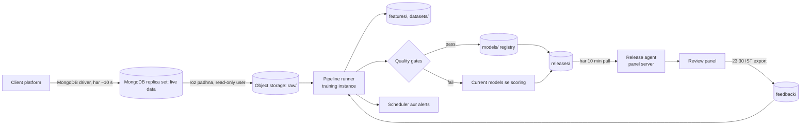
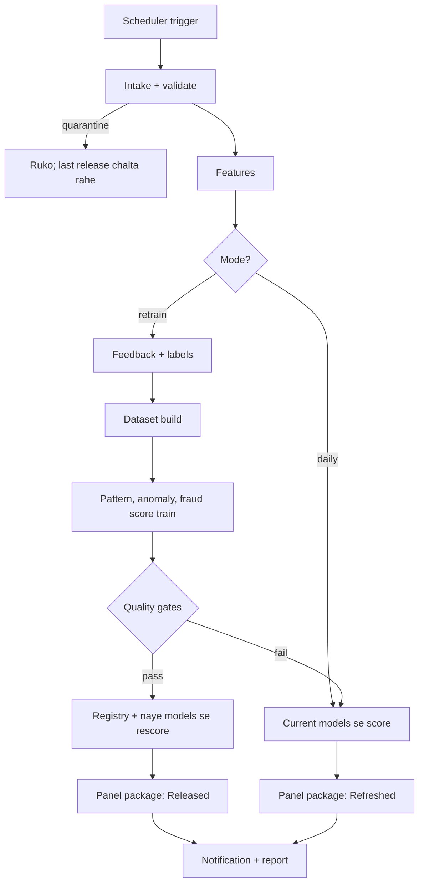

# Continuous Learning aur Retraining Design

# Fraud Detection Platform

## 1. Document Control

| Item              | Detail                                                                                             |
| ----------------- | -------------------------------------------------------------------------------------------------- |
| Document          | Continuous Learning aur Retraining Design                                                          |
| System            | Fraud Detection Platform (withdrawal risk scoring aur Fraud Review panel)                          |
| Version           | 0.3 (Hinglish version, review ke liye draft)                                                       |
| Organisation      | MiraiGate Technologies                                                                             |
| Audience          | Engineering, operations, risk team aur client stakeholders                                         |
| Related documents | System SRS; MongoDB Replica Set SRS; Labeling aur Ground-Truth Policy; Monitoring aur Drift Plan; Service Levels aur Timing |

---

## 2. Executive Summary

Ye design fraud detection system ko ek **band seekhne wala loop** banata hai:

- reviewer panel me jo bhi decision submit kare, wo ek niyam ke saath training label banta hai
- models fix schedule pe retrain hote hain
- panel bina manual kaam ke naye scores dikhata hai

**Aaj:** har update me analyst ke kai ghante lagte hain:

- exports jama karna
- cases label karna
- saat scripts chalana
- files server pe copy karna

Panel me aane wale reviewer decisions abhi training me use nahi hote.

**Target me chaar nateeje:**

1. **Roz naye scores.** Naye withdrawal requests MongoDB replica set (live data) se padhe jaate hain aur current model se 24 ghante ke andar score hote hain, bina retrain ke.
2. **Har hafte seekhna.** Models har hafte retrain hote hain, ya pehle bhi jab 25 ya zyada naye reviewer decisions aa jayein. Reviewer decisions sabse upar ki priority wale labels hain.
3. **Surakshit release.** Naya model tabhi lagta hai jab production model ke saamne tay quality gates pass kare. Warna current model chalta rehta hai aur team ko alert jaata hai.
4. **Poori traceability.** Har label, run aur model version record hota hai, aur koi bhi release ek step me wapas liya ja sakta hai.

---

## 3. Scope, Objectives aur Success Criteria

Automation platform pe nayi withdrawal request se lekar panel me uske naye score tak ka poora rasta cover karta hai, beech ka retrain bhi.

**Scope me:**

- ingest service se naye risk events ka intake
- panel se reviewer decisions, pattern answers aur pattern notes ka export
- label niyam, dataset build, pattern / anomaly / fraud score models ka retrain
- quality gates, model registry, release, rollback aur panel refresh
- scheduling, monitoring, alerting aur audit

**Scope ke bahar:**

- client platform me ya agents ke approve karne ke tareeke me badlav
- withdrawal request ke time real-time scoring (baad ka phase)
- panel ke review workflow me badlav (Phase 3 ke admin view ke alawa)

| Success criterion                     | Target                                                                                    |
| ------------------------------------- | ----------------------------------------------------------------------------------------- |
| Naye requests panel me scored dikhen  | Request ke 24 ghante ke andar (cut-off ke turant baad aayi request ke liye max 26 ghante) |
| Reviewer decisions training me        | Run ke cut-off se pehle submit hue 100% decisions                                         |
| Weekly update me manual steps         | 0 (approval optional; Section 20)                                                         |
| Production se kamzor model ka release | Kabhi nahi; quality gates rokenge                                                         |
| Release rollback ka time              | 5 minute se kam                                                                           |
| Fail ya late runs                     | 15 minute me team ko alert                                                                |

---

## 4. Abhi ki Halat

Aaj har model update ek analyst ek workstation pe haath se chalata hai. Panel ke reviewer decisions training tak nahi pahunchte.

| Step                         | Aaj kaise chalta hai                                                                       | Machine time |
| ---------------------------- | ------------------------------------------------------------------------------------------ | ------------ |
| 1. Data lena                 | Risk-event JSON export (0.7 se 4 GB) workstation pe copy                                   | –            |
| 2. File register karna       | Data preparation script me file haath se jodi jaati hai                                    | –            |
| 3. Dataset banana            | Saare exports dobara padhe jaate hain, features shuru se bante hain                        | ~4 min       |
| 4. Unclear cases label karna | Bina saaf remark wale rejects analyst dekhta hai, faisle meetings me                       | Ghante       |
| 5. Retrain                   | Pattern rules, pattern score, pattern test, anomaly update, fraud score model, ek-ek karke | ~3 min       |
| 6. Score aur panel data      | Har request dobara score, panel ki data files dobara                                       | ~9 min       |
| 7. Release                   | Script se files panel server pe upload, service restart                                    | ~5 min       |

**Ye design kya kami band karta hai:**

- Panel ke reviewer decisions, pattern answers aur notes labels me use nahi hote.
- Naye requests manual update ke baad hi panel me aate hain, isliye queue kai din peeche ho sakti hai.
- Process ek insaan aur ek workstation pe tika hai, koi schedule nahi.
- Models aur datasets usi jagah overwrite hote hain; koi registry, comparison report ya ek-step rollback nahi.
- Failures aur data problems sirf dekhne se pakde jaate hain; koi alert nahi.

---

## 5. Target Architecture

Do inputs ek pipeline me jaate hain: platform se naye risk events aur panel se reviewer feedback. Release panel tak tabhi pahunchta hai jab quality gates pass hon.

Daily run scoring ke baad rukta hai aur current models se naya data publish karta hai. Weekly ya feedback wala run retrain aur gates se guzarta hai; gate fail ho to production waisa hi rehta hai.

| Component            | Kaam                                                           | Status   |
| -------------------- | -------------------------------------------------------------- | -------- |
| MongoDB replica set  | Platform saare withdrawals seedha likhta hai; 2 data servers + arbiter, Singapore | Ban raha hai |
| Ingest service       | Temporary: platform se flagged withdrawals leti hai; kuch time saath chalegi | Bana hua |
| Review panel         | Reviewer decisions, pattern answers, notes; scores dikhata hai | Bana hua |
| Object storage       | Raw data, feedback, features, datasets, models, releases       | Naya     |
| Pipeline runner      | Training instance pe stages order me chalata hai               | Naya     |
| Release agent        | Panel server pe releases pull karke badalta hai                | Naya     |
| Scheduler aur alerts | Runs shuru karta hai; failures aur drift batata hai            | Naya     |

---

## 6. Stage 1: Data Ingestion

Naye risk events roz MongoDB replica set se padhe jaate hain aur ek hi baar, date ke hisaab se rakhe jaate hain. Koi run poori history dobara nahi padhta.

- **Source:** platform har withdrawal request, user ke bets aur statements ke saath, seedha hamare MongoDB replica set me likhta hai (database `fraud`; collections `surveillance`, `bets`, `statements`; har ~10 second). Temporary ingest service (`POST /ingest`) kuch time saath chalegi.
- **Extract:** roz ek job replica set ke secondary se (`fraud_reader`, sirf padhna, `secondaryPreferred`) pichhle safal watermark ke baad bane ya badle records padhti hai. Records ka asli `_id` aur poora activity bundle saath rehta hai. Live data me agent ke faisle (status, remarks, locks) nahi aate; wo sirf temporary source ke records me hain. Replica set me data 60 din rehta hai, isliye job us se pehle padh leti hai.
- **Land:** har extract object storage me compressed file ke roop me `raw/date=YYYY-MM-DD/` ke neeche likha jaata hai. Files kabhi edit nahi hoti; sudhaar same record ke naye version ke roop me aata hai.
- **Deduplicate:** har `_id` ka sabse naya version jeetta hai. Status ka badlav (jaise approved se rejected) history me rehta hai, kyunki label agent ke aakhri nateeje se banta hai.
- **Validate:** job ye check karti hai:
  - schema
  - record count, 7 din ke average ke saamne
  - bina bets ya statements wale records ka hissa
  - duplicate rate

  Limit tooti to batch quarantine hota hai aur team ko alert jaata hai. Scoring pichhle achhe batch pe chalti rehti hai.

- **Watermark:** batch rakh ke validate hone ke baad hi aakhri process hua time likha jaata hai. Fail run bas dobara chalta hai.

Manual JSON export fallback ke roop me chalta rahega: usi `raw/` jagah rakhi file agla run utha lega.

---

## 7. Stage 2: Reviewer Feedback Capture

Panel teen tarah ka feedback poori history ke saath pehle se rakhta hai. Automation har raat inki ek consistent copy export karta hai.

| Feedback       | Panel me kya rakha jaata hai                                             | Kis kaam aata hai                              |
| -------------- | ------------------------------------------------------------------------ | ---------------------------------------------- |
| Decision       | Fraud ya Not fraud, reason, reviewer, time, request id, us time ka score | Training labels (sabse upar ki priority)       |
| Pattern answer | Known pattern is request pe fit hai: Yes, No, ya Other (text ke saath)   | Pattern examples aur naye pattern ki khoj      |
| Pattern note   | P1 se P4 pe free-text note, likhne wala aur time                         | Har rule review me padha jaata hai; label nahi |

- **Export:** 23:30 IST pe panel server pe ek job review database ki consistent copy leti hai (SQLite backup API). Wo `feedback/date=YYYY-MM-DD/` me teen files likhti hai:
  - current decisions
  - poori decision history
  - pattern answers

  Copy read-only hai; export ke dauraan panel chalta rehta hai.

- **Cut-off:** training run apne shuru hone se pehle ka sabse naya export use karta hai. Baad ke decisions agle run me jaate hain. Run report cut-off time batati hai.
- **Integrity:** har export ke saath row count aur checksum hota hai. Agar counts kam hue aur history me unke liye "cleared" entry nahi hai, to training run wo export nahi leta.

---

## 8. Stage 3: Label Governance

Har request ko saboot ke tay order se **ek hi** training label milta hai. Panel me reviewer ka decision hamesha niyamon se upar hai. Poori policy: Labeling aur Ground-Truth Policy.

| Priority | Saboot                                                                         | Label                                  |
| -------- | ------------------------------------------------------------------------------ | -------------------------------------- |
| 1        | Panel me reviewer decision: Fraud                                              | Fraud example (client ne confirm kiya) |
| 1        | Panel me reviewer decision: Not fraud                                          | Genuine, chahe agent ne reject kiya ho |
| 2        | Agent reject + fraud remark, aur data me known pattern                         | Fraud example                          |
| 3        | Agent reject + withdrawal lock, aur data pattern rule pe baithta hai           | Fraud example                          |
| 4        | Agent reject, platform galti ka remark (wrong odds, technical issue)           | Not fraud (fraud class se bahar)       |
| 5        | Agent reject, wajah saaf nahi, purana account (30 din se zyada), lock nahi     | Bahar; sirf data se score              |
| 6        | Agent reject + lock, par data me koi pattern nahi                              | Bahar                                  |
| 7        | Approved, par same user ka reject hai, ya data rejected cases jaisa (jaise P2) | Bahar                                  |
| 8        | Approved, koi shak nahi                                                        | Genuine                                |
| 9        | Bets aur statements nahi                                                       | Bahar (data nahi)                      |

- **Pattern answers:**
  - "Yes, it fits" fraud example ke pattern tag ko pakka karta hai.
  - "No, it does not fit" label wahi rakhta hai, par request us pattern ke examples se hata deta hai, taaki rule ko galat case na sikhaya jaye.
  - "Other" ka text naye pattern ki khoj me jaata hai (Section 13).
- **Takraav:**
  - player pe sabse naya decision jeetta hai, poori history rehti hai
  - do reviewers ne 7 din ke andar ulta faisla diya, to request us run se bahar rehti hai aur run report me lead reviewer ke liye list hoti hai
- **Label snapshot:** har run apni label table rakhta hai, har label ke source ke saath (decision, niyam number, reviewer). Koi bhi model us saboot tak trace ho sakta hai jisse usne seekha.
- **Niyam jame hue nahi:** priority 2 se 7 aaj ki tay practice hain. Har mahine reviewer decisions se milaaye jaate hain. Jo niyam reviewers baar-baar palatte hain, wo normal release process se badla jaata hai.

---

## 9. Stage 4: Dataset Build aur Features

Features har request ke aate hi ek baar bante hain aur feature table me rakhe jaate hain. Retrain 20 GB exports dobara padhne ki jagah kuch megabytes padhta hai.

- **Feature table:**
  - har naye request ke liye daily job 59 behaviour features banati hai
  - features user ke bets aur statements se, request ke time tak (20 din ka window)
  - request id ke saath `features/date=YYYY-MM-DD/` me rakhe jaate hain
  - request ke baad ke statements kabhi use nahi hote

- **Training set:** run feature table ko label snapshot (Section 8) se jodta hai. Data 15 Sep 2026 se shuru hai; purane exports me bets aur statements bahut kam hain.
- **Versioning:** training set `datasets/run=<run id>/` me likha jaata hai, saath me:
  - row count
  - group aur pattern ke hisaab se label counts
  - content hash

  Model registry isi ko point karti hai.

- **Feature code ka badlav:** feature ki definition badle to agle training run se pehle ek backfill job poori history ki feature table dobara banati hai. Run report badlav ko flag karti hai.
- **Checks:** feature ranges aur khaali values pichhle training set se milaayi jaati hain. Bada farak ho to run training se pehle ruk jaata hai.

---

## 10. Stage 5: Model Retraining

Teeno models har **Monday 02:00 IST** pe saath retrain hote hain. Pichhli release ke baad 25 ya zyada naye reviewer decisions aa jayein to pehle bhi (din me max ek extra run).

| Trigger          | Kab                                        | Kya chalta hai                                                            |
| ---------------- | ------------------------------------------ | ------------------------------------------------------------------------- |
| Daily refresh    | Roz 03:00 IST                              | Intake, features, current models se scoring, panel refresh. Training nahi |
| Weekly retrain   | Monday 02:00 IST                           | Poora retrain, quality gates, pass ho to release                          |
| Feedback trigger | Pichhli release ke baad 25+ naye decisions | Poora retrain, weekly jaisa                                               |
| Manual run       | Admin wajah likh ke shuru kare             | Poora retrain ya refresh, jo chuna                                        |

**Training ka order:**

1. **Pattern model (P1 se P4):**
   - rule limits genuine requests se dobara nikalti hain (99 se 99.5 percentile)
   - pattern score har pattern ke fraud examples se dobara banta hai
2. **Anomaly model (Layer 2) aur group check (Layer 3):**
   - sirf genuine requests pe train
   - naya version tabhi lagta hai jab wo pattern chhupa ke test me kam se kam utne fraud examples pakde
   - aur galat alarm limit me rahe: Layer 2 max 3.5%, Layer 3 max 0.6%
3. **Fraud score model:**
   - pattern wala hissa aur behaviour wala hissa milata hai
   - regularisation user-wise cross-validation (5 folds, 10 repeats) se chuna jaata hai
   - 0 se 99 ka scale approved requests ke saamne calibrate hota hai

**Overfitting se bachav:**

- model ka design run-dar-run nahi badalta; sirf data aur labels badhte hain
- test hamesha user ke hisaab se bante hain, koi user training aur test dono me nahi
- har pattern apne examples chhupa ke bhi test hota hai

---

## 11. Stage 6: Validation aur Quality Gates

Candidate model tabhi release hota hai jab wo production model ke saamne, same data pe, har blocking gate pass kare. Warna production waisa hi rehta hai aur team ko report ke saath alert jaata hai.

| Gate               | Check                                                              | Limit                                                                                                                               | Fail pe |
| ------------------ | ------------------------------------------------------------------ | ----------------------------------------------------------------------------------------------------------------------------------- | ------- |
| Data               | Request count, bina data ka hissa, label counts                    | Count 7 din ke trend ke 30% ke andar; bina data 5% se kam; fraud examples pichhle run se kam nahi, jab tak label log me wajah na ho | Block   |
| Accuracy           | AUC, fraud score, user-wise test                                   | Production se 0.005 se zyada kam nahi                                                                                               | Block   |
| Naye patterns      | Har fraud example ka apna pattern chhupa ke AUC                    | Production se 0.01 se zyada kam nahi                                                                                                | Block   |
| Galat alarm        | Approved requests 90%+ pe                                          | 0.1% ya kam                                                                                                                         | Block   |
| Catch rate         | 1% galat alarm pe pakde gaye fraud examples                        | Production se 5 points se zyada kam nahi                                                                                            | Block   |
| Reviewer agreement | Pichhli release ke baad ke Fraud vs Not fraud decisions ki ranking | Report; 0.80 se kam ho to flag                                                                                                      | Warn    |
| Score shift        | 20 points se zyada badle scores                                    | Report; 10% se zyada requests ho to flag                                                                                            | Warn    |
| Queue size         | Review queue me players (60%+)                                     | Report; 30% se zyada badlav ho to flag                                                                                              | Warn    |

Har run ek comparison report banata hai:

- production aur candidate ke metrics saath-saath
- pichhle run ke baad label ke badlav
- wo 20 requests jinke score sabse zyada badle

Report run ke saath rakhi jaati hai aur notification me link hoti hai.

---

## 12. Stage 7: Release, Panel Refresh aur Rollback

Release ek versioned package hai. Panel server use pull karke ek hi baar me badalta hai, isliye panel kabhi aadha-update nahi dikhta, aur koi bhi pichhla release ek step me wapas aa sakta hai.

- **Model registry:** gates pass karne wala har run `models/v<NNN>/` me ek manifest ke saath rakha jaata hai. Manifest me:
  - models
  - training set ka reference
  - label snapshot
  - code version
  - metrics aur gate results
  - cut-off times
  - approver (agar approval chalu ho)

  Registry entries kabhi edit ya delete nahi hoti.

- **Rescoring:** release ke baad 15 Sep 2026 se saare requests naye models se dobara score hote hain. Training records apne out-of-fold score rakhte hain, taaki panel model ke seekhe hue cases ka imaandaar score dikhaye.
- **Panel package:** run panel ki data files (request tables aur activity store) banata hai aur `releases/r<NNN>/` me manifest aur checksums ke saath likhta hai. Daily refresh current models ke saath yahi package banata hai.
- **Deployment (pull, push nahi):**
  - panel server pe ek chhota agent har 10 minute `releases/` dekhta hai
  - naya manifest mile to files staging folder me download karta hai aur checksums verify karta hai
  - phir data folder ek rename me badalta hai aur service restart karta hai
  - reviewer decisions, pattern answers, notes aur accounts kabhi nahi chhue jaate
  - kisi pipeline job ke paas panel server ki login keys nahi hoti

- **Rollback:** admin panel ke admin view (Phase 3) me pichhla release chunta hai, ya server pe ek command chalata hai. Agent 5 minute me us release pe wapas aata hai. Rollback user aur wajah ke saath log hota hai.

---

## 13. Naye Pattern ki Khoj

Naya pattern (P5 se aage) apne aap propose hota hai jab reviewers kam se kam **3 alag users** ko ek hi pattern naam se fraud mark karein. Wo client ki approval ke baad hi lagta hai.

1. **Panel me naam dena:** reviewer request ko fraud mark kare aur koi known pattern fit na ho, to Review box "Other" me pattern ka naam aur chhota description deta hai. Pehle use hue naam suggest hote hain, taaki ek pattern teen tarah se na likha jaye.
2. **Candidate rule:**
   - weekly run confirmed cases ko pattern naam se group karta hai
   - 3+ users wale naam ke liye max 3 aisi shartein dhoondhta hai jo saare cases me hon aur genuine users me kam (top ya bottom 5%)
   - limits genuine data se tay hoti hain

3. **Test:** har case baari-baari hata ke rule dobara banta hai. Report batati hai ki hataye gaye kitne cases phir bhi pakde gaye, aur genuine requests pe galat alarm kitna hai.
4. **Approval:** candidate panel ke admin view me dikhta hai:
   - shartein aur cases
   - test ke nateeje
   - roz ke expected alerts

   Client approve ya reject karta hai. Bina approval kuch nahi lagta.

5. **Use:** approved rule agle run me pattern model me judta hai, Known patterns page pe dikhta hai, aur matches pe "Matches known pattern P5" aata hai.

Cases me koi saaf common shart na ho, to rule propose nahi hota. Report wajah batati hai: cases alag tarah ke ho sakte hain aur unhe alag naam chahiye, ya zyada cases chahiye.

---

## 14. Orchestration aur Scheduling

Ek pipeline runner har run ko stages ki tay sequence me chalata hai. Daily refresh training chhod deta hai. Gate fail ho to current models se scoring hoti hai, isliye panel dono haalat me refresh hota hai.

- **Runner:** ek command, `pipeline run --mode daily|retrain|manual`, training instance pe chalti hai. Scheduler instance chalu karta hai, runner chalta hai, run manifest aur logs likhta hai, notification bhejta hai, aur instance band karta hai.
- **Idempotent stages:** har stage sirf pichhle stages ke outputs padhta hai aur `runs/<run id>/<stage>/` me likhta hai. Fail run fail hue stage se, same inputs ke saath, dobara shuru hota hai. Jo stage safal ho chuka, wo dobara nahi chalta.
- **Retries:** network aur capacity errors 3 baar dobara try hote hain, badhte gap ke saath (1, 5 aur 15 minute). Data aur gate failures dobara try nahi hote; unhe insaan chahiye.
- **Concurrency:** ek time pe ek hi run. Run ke dauraan aaya trigger queue me jaata hai; do queued triggers ek run me mil jaate hain.

| Run state   | Matlab                                                         | Panel pe asar                        |
| ----------- | -------------------------------------------------------------- | ------------------------------------ |
| Queued      | Current run khatam hone ka intezaar                            | Kuch nahi                            |
| Running     | Stages chal rahe                                               | Kuch nahi                            |
| Released    | Gates pass; naye models aur data publish                       | Naye scores aur models               |
| Refreshed   | Daily run, ya gates fail; current models ke saath data publish | Naye requests, wahi models           |
| Quarantined | Input data checks me fail                                      | Kuch nahi; pichhla release rehta hai |
| Failed      | Retries ke baad bhi stage fail                                 | Kuch nahi; pichhla release rehta hai |

---

## 15. Monitoring, Alerting aur Reporting

Run fail ho, data aana band ho, ya scores drift karein, to team ko **15 minute** me khabar milti hai. Stakeholders ko weekly summary milti hai. Poori detail: Monitoring aur Drift Plan.

| Signal             | Naap                                                     | Alert kab                                      |
| ------------------ | -------------------------------------------------------- | ---------------------------------------------- |
| Run health         | Run status aur har stage ka time                         | Koi stage fail, ya run usual ke 2 guna time le |
| Data freshness     | Panel me sabse naye request ki umar                      | Din me 6 ghante se purana                      |
| Data quality       | Batch count, bina data ka hissa, duplicates              | Batch quarantine (Section 6)                   |
| Score drift        | Scores ka distribution, pichhle 4 hafton ke saamne (PSI) | Index 0.2 se upar                              |
| Review backlog     | Queue me waiting players, sabse purana request           | Sabse purana 48 ghante se zyada                |
| Model quality      | Har release ke gate metrics, reviewer agreement          | Gate fail, ya agreement 0.80 se neeche         |
| Panel availability | Sign-in page aur data check har 5 minute                 | Lagataar 2 checks fail                         |

Notifications operations channel pe jaati hain (email ya chat, Section 20), run id, nateeje aur report ke link ke saath.

**Weekly summary** (Monday, retrain ke baad):

- kitne requests score hue
- kitne decisions aaye
- kitne labels jude
- release ka nateeja aur metrics, pichhle hafte ke saamne
- review queue ke sabse bade badlav

---

## 16. Security, Access Control, Audit aur Retention

Har component ko sirf utna access milta hai jitna zaroori hai. Client data company ke cloud account ke andar encrypted rehta hai. Har label, run aur release audit ho sakta hai.

| Component                      | Padh sakta hai                                   | Likh sakta hai                                   |
| ------------------------------ | ------------------------------------------------ | ------------------------------------------------ |
| Intake job                     | Ingest service export endpoint (read-only token) | `raw/`, `features/`                              |
| Feedback export (panel server) | Review database                                  | `feedback/`                                      |
| Training jobs                  | `raw/`, `features/`, `feedback/`, `models/`      | `datasets/`, `models/`, `releases/`, run reports |
| Panel release agent            | `releases/`                                      | Sirf local panel data folder                     |
| Reviewers                      | Panel pages aur data                             | Decisions, pattern answers, notes                |
| Admins                         | Run reports, registry, admin view                | Manual runs, approvals, rollback                 |

**Controls:**

- Object storage at rest encrypted, versioning chalu, public access band. Access instance roles se, rakhi hui keys se nahi.
- Training instance pe koi inbound connection nahi. Scheduler use chalu karta hai aur run ke baad wo band ho jaata hai.
- Replica set pe TLS, authentication aur IP allowlist hai. Intake job `fraud_reader` (sirf padhna) use karti hai; uska password Secrets Manager me hai aur har 90 din badalta hai. Temporary ingest service ka database andar hi rehta hai.
- Panel sign-in, ek account ek browser, aur sign-in limits waise hi rahenge. Admin actions ke liye admin role chahiye.

**Audit:** decision history, pattern-answer history, run manifests, label snapshots, registry entries aur rollbacks system ki poori umar rakhe jaate hain. Har ek me kisne, kya aur kab.

**Retention (proposal):** live data replica set me 60 din (TTL), raw exports 12 mahine, feature tables aur training sets 24 mahine, run reports aur registry hamesha. Aakhri periods Open decision hain (Section 20).

---

## 17. Infrastructure aur Cost Estimate

Automation aaj ke setup pe lagbhag **USD 15 se 25 mahina** jodta hai, kyunki training wala instance sirf run ke time chalu hota hai. Live data ka MongoDB replica set alag hai, lagbhag USD 260 mahina (MongoDB Replica Set SRS, Section 13).

| Component            | Proposed resource                                 | Use                             | Lagbhag mahine ka kharcha |
| -------------------- | ------------------------------------------------- | ------------------------------- | ------------------------- |
| Review panel         | Maujooda EC2 t3.medium, 40 GB gp3                 | Hamesha chalu                   | Pehle se hai              |
| Live data store      | MongoDB replica set: 2 × r7g.large (200 GB) + t4g.small arbiter, Singapore | Hamesha chalu | USD ~260 (alag; MongoDB Replica Set SRS) |
| Ingest service       | Maujooda EC2 + MongoDB (temporary)                | Hamesha chalu, kuch time        | Pehle se hai              |
| Training aur scoring | EC2 m6i.xlarge (4 vCPU, 16 GB), schedule pe chalu | Roz ~30 min, hafte me ~1 ghanta | USD 5 se 8                |
| Object storage       | S3, encrypted, versioned                          | Har mahine ~30 GB badhta hai    | USD 2 se 10, badhta hua   |
| Scheduling aur logs  | EventBridge Scheduler, CloudWatch Logs aur alarms | Roz aur weekly triggers         | USD 5 se kam              |
| Notifications        | Email (SES) ya chat webhook                       | Din me kuch messages            | USD 1 se kam              |

Kharche Mumbai region ki list prices pe andaze hain, tax ke bina (replica set Singapore me hai; uska kharcha uski SRS me). Sign-off se pehle AWS pricing calculator me confirm karne hain. Spot instances training ka kharcha aur kam kar sakte hain; spot run beech me ruke to on-demand pe apne aap retry hoga.

---

## 18. Risks aur Mitigations

Sabse bada risk feedback loop hai, jisme model sirf wahi cases seekhta hai jinhe wo pehle se upar score karta hai. Design isse do tarah rokta hai: random review sample, aur har release ki production ke saamne gates se tulna.

| Risk                                                            | Asar                                                 | Bachav                                                                                                           |
| --------------------------------------------------------------- | ---------------------------------------------------- | ---------------------------------------------------------------------------------------------------------------- |
| Selection bias: reviewers zyadatar high-score cases dekhte hain | Model jo fraud miss karta hai, wo kabhi nahi seekhta | Har hafte 60% se neeche ke 20 random requests "spot check" ke roop me queue me; unke decisions baaki jaise label |
| Reviewers ke faisle ek jaise nahi                               | Labels me noise, scores unstable                     | Reason zaroori, takraav ka niyam (Section 8), takraavon ka monthly review                                        |
| Fraud examples kam (aaj 62)                                     | Overfitting, runs ke beech bade jhatke               | Tay model design, user-wise tests, pattern chhupa ke test, girawat pe gates                                      |
| Platform data format badle                                      | Intake fail ya features galat                        | Schema check aur quarantine; scoring pichhle achhe batch pe                                                      |
| Kamzor model release ho jaye                                    | Queue me galat cases                                 | Blocking gates, comparison report, ek-step rollback                                                              |
| Reviewers ke kaam ke beech panel update                         | Confusion ya kaam kho jana                           | Ek baar me swap; decisions alag rakhe jaate hain, kabhi overwrite nahi                                           |
| Credentials ya data leak                                        | Client data bahar                                    | Role-based access, rakhi hui keys nahi, encryption, training pe inbound access nahi                              |
| Ek insaan pe nirbharta                                          | Wo na ho to deri                                     | Scheduled runs, runbooks, shared channel pe alerts                                                               |

---

## 19. Implementation Roadmap

Phase 1 sabse ahem badlav pehle deta hai: **do hafte me** har reviewer decision agle retrain me use hone lagega. Poora automation **week 6** tak.

```mermaid
gantt
    title Implementation roadmap (4 phases, 7 hafte, har phase ke end me gate)
    dateFormat  X
    axisFormat  Week %s
    section Phase 1
    Feedback export, label governance, ek pipeline command   :p1, 0, 2
    section Phase 2
    Training instance, object storage, scheduler, daily intake, gates, registry, release agent :p2, 2, 4
    section Phase 3
    Admin view (run history, rollback, approvals), drift monitoring, naye pattern ka naam   :p3, 4, 6
    section Phase 4
    Runbooks, backups, restore test, handover   :p4, 6, 7
```

| Phase | Hafte | Kya milega                                                                                                | End gate                                           |
| ----- | ----- | --------------------------------------------------------------------------------------------------------- | -------------------------------------------------- |
| 1     | 1–2   | Nightly feedback export, label governance, ek command se poora retrain (haath se shuru)                   | Retrain ka nateeja aaj ke metrics se mile          |
| 2     | 3–4   | Training instance, object storage, scheduler, daily intake, quality gates, model registry, release agent  | Ek hafta bina manual step ke daily aur weekly runs |
| 3     | 5–6   | Panel admin view (run history, rollback, approvals), drift monitoring, Review box me naye pattern ka naam | Client sign-off                                    |
| 4     | 7     | Runbooks, backups aur restore test, handover                                                              | Restore test pass, handover complete               |

Phase 1 wo kami band karta hai jiska vaada panel ka notification reviewers se pehle se karta hai ("used to retrain the model at the next update"). Phase 2 live hone tak weekly retrain ek pipeline command se haath se shuru hoga. Samay ek engineer aur Section 20 ke open decisions pe time pe sign-off maan ke hain.

---

## 20. Sign-off ke liye Open Decisions

Design neeche ke proposals use karta hai. Phase 2 shuru hone se pehle har ek ka confirmation chahiye.

| Faisla                                   | Is design ka proposal                                                                     | Doosra option                                |
| ---------------------------------------- | ----------------------------------------------------------------------------------------- | -------------------------------------------- |
| Retrain kab                              | Har hafte, aur 25 naye decisions pe pehle                                                 | Sirf weekly, ya har raat                     |
| Training kahan chale                     | Alag instance, sirf run ke time chalu                                                     | Panel server, ya analyst ka workstation      |
| Naye model ka release                    | Saare gates pass hon to apne aap; admin rollback kar sakta hai                            | Har release se pehle panel me admin approval |
| Data intake                              | MongoDB replica set (live data) se roz padhna                                             | Temporary ingest service / manual JSON export |
| Training fraud examples ka minimum score | Tay karna hai: aaj ye cases aur same users ki baad ki requests kam se kam 95% dikhti hain | Sirf model ka apna score dikhana             |
| Spot-check sample                        | Hafte me 20 random low-score requests                                                     | Doosra size, ya nahi                         |
| Data retention                           | Live data 60 din (replica set); raw exports 12 mahine; features 24 mahine; reports hamesha | Client ki policy ke periods                  |
| Notification channel                     | Operations group ko email                                                                 | Chat channel                                 |
| Approvers                                | Client ka ek lead reviewer aur MiraiGate ka ek admin                                      | Naamon ki list                               |

---

## 21. Glossary

| Shabd             | Matlab                                                                                                                           |
| ----------------- | -------------------------------------------------------------------------------------------------------------------------------- |
| Risk event        | Platform ki withdrawal request, user ke bets aur statements ke saath (temporary source me sirf flag ki hui)                      |
| Review panel      | Web application jahan client reviewers flagged players check karke decisions dete hain                                           |
| Decision          | Reviewer ka player pe Fraud ya Not fraud faisla, reason ke saath                                                                 |
| Pattern answer    | Reviewer ka Yes, No ya Other jawab ki known pattern request pe fit hai ya nahi                                                   |
| Known pattern     | Rule wala pakka fraud behaviour: P1 casino jeet, P2 chhota deposit phir badi casino jeet, P3 back aur lay, P4 bina deposit bonus |
| Anomaly model     | Genuine requests pe train model jo batata hai request normal users se kitni alag hai (Layer 2)                                   |
| Group check       | Ek master ke neeche 72 ghante me 3 ya zyada ek jaise ajeeb users dhoondhta hai (Layer 3)                                         |
| Fraud score       | Panel me dikhne wala 0 se 99 ka score, approved requests ke saamne calibrated                                                    |
| Label             | Training me request ki category: fraud example, genuine, not fraud, ya bahar                                                     |
| Out-of-fold score | Training record ka score us model se jisne wo record nahi dekha                                                                  |
| Quality gate      | Release se pehle candidate model ko pass karna padne wala check                                                                  |
| Model registry    | Release hue models aur unke saboot ka versioned, read-only store                                                                 |
| Release           | Models aur panel data ka versioned package jis pe panel switch karta hai                                                         |
| Watermark         | Wo time jahan tak data safalta se ingest ho chuka                                                                                |

---

## 22. Change Log

| Version | Date        | Badlav                                                                                                                      |
| ------- | ----------- | --------------------------------------------------------------------------------------------------------------------------- |
| 0.2     | 10 Oct 2026 | Hinglish version                                                                                                            |
| 0.3     | 14 Oct 2026 | Data intake ab MongoDB replica set (live data) se: target architecture, Stage 1, security controls, retention, cost, Section 20 |
