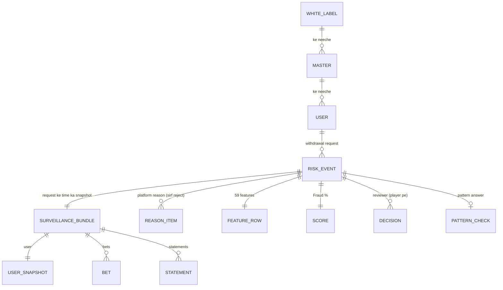

# Data Dictionary
# Fraud Detection Platform

| Item | Detail |
|---|---|
| Document | Data Dictionary |
| Version | 1.0 (review ke liye draft) |
| Date | 10 Oct 2026 |
| Organisation | MiraiGate Technologies |
| Profile ka data | 15 Sep se 8 Oct 2026: 56,425 risk events, 10.7 million bets, 50.7 million statement entries |
| Related documents | Platform Data Contract; Data Quality aur Lineage; System SRS |

**Is document me:**
- har entity ke fields
- har field ka type, matlab, unit, time zone aur example
- data me dekhi gayi values (profile)

Examples banaye hue hain, asli users ke nahi.

**"Confirm karna hai"** ka matlab: ye matlab data dekh ke samjha gaya hai, platform ne likh ke nahi diya. Ye sab Platform Data Contract me sawaal ke roop me hain.

---

## 1. Entities ka Overview

| Entity | Kahan se | Kahan rakha jaata hai |
|---|---|---|
| Risk event | Platform → ingest service (`POST /ingest`) | MongoDB `risk_events`; JSON exports |
| Surveillance bundle (user, bets, statements) | Risk event ke andar | Risk event ke saath; MongoDB `user_data` |
| Reason item | Risk event ke andar | Risk event ke saath |
| Feature row | Data processing (`1_features.py`, `prepare.py`) | `dataset.csv` |
| Score | Fraud score model (`2_score.py`) | Scores file; panel `dashboard.json` |
| Decision, pattern answer, pattern note | Review panel | `review.db` (SQLite) |
| Reviewer account, session, sign-in | Review panel | `users.db` (SQLite) |

---

## 2. Risk Event (Withdrawal Request)

Ek record = ek flag hui withdrawal request.

| Field | Type | Matlab | Example | Profile / Note |
|---|---|---|---|---|
| `_id.$oid` | string (24 hex) | Request ki unique id | `6ac7...9e66` | Unique key. 838 baar same id doosri file me dobara aayi; status kabhi nahi badla |
| `user_id` | integer | Platform ka numeric user id | `5320530` | |
| `user_id_str` | string | User code (login naam) | `a1b2c3d4e5` | 21% records me capital letters ya space hain; hum trim + lowercase karke milate hain |
| `master_id` / `master_id_str` | integer / string | User ka master (agent/branch) | `BRANCH01` | 774 alag masters |
| `white_label_id` / `white_label_id_str` | integer / string | Master ka white label (site) | `site01` | 306 alag white labels |
| `provider_id` | string | Platform ka provider | `CLICKBETOLD` | 2 values: `CLICKBETOLD` (72%), `CLICKBETOLD2` (28%) |
| `reason` | array of objects | Platform ki reason list (Section 3) | `[{"cat":"bet",...}]` | **Sirf rejects pe aati hai** (307/307); approved pe hamesha khaali |
| `action` | string | – | `""` | Hamesha khaali |
| `status` | string | Agent ka faisla | `approved` | `approved` (56,118), `reject` (307) |
| `risk_status` | string | – | `""` | Hamesha khaali |
| `source` | string | Request kahan se aayi | `getid` | `getid` (99.3%), `click_admin1` (215), `click_admin2` (173). Matlab confirm karna hai |
| `transaction_id` | string | Platform ka withdrawal transaction id | `94929493` | |
| `remarks` | string | Agent ka likha remark | `casino checking` | Hamesha bhara hua; free text. Kai baar "hold", "." ya agent ka naam |
| `user_lock` | boolean | Agent ne user lock kiya | `false` | Sirf rejects pe `true` dekha |
| `withdrawal_lock` | boolean | Agent ne withdrawal lock kiya | `false` | Sirf rejects pe `true` dekha (90 rejects) |
| `bet_void` | boolean | Agent ne bets void ki | `false` | Sirf rejects pe `true` dekha (118 rejects) |
| `createdAt.$date` | ISO datetime, **UTC** | Request kab bani | `2026-10-08T07:11:17.392Z` | Data window isi time tak |
| `updatedAt.$date` | ISO datetime, UTC | Record aakhri baar kab badla | | Aam taur pe `action_time` ke barabar |
| `action_time.$date` | ISO datetime, UTC | Agent ne faisla kab kiya | | Median: `createdAt` ke 2.7 minute baad |
| `__v` | integer | Platform ka internal version | `0` | Hamesha 0 |
| `extra.amount` | number | Withdrawal amount | `null` | **Hamesha khaali** |
| `ingested_at.$date` | ISO datetime, UTC | Ingest service me kab aaya | | Median: `action_time` ke 1.8 second baad |
| `batch_id` | string | Ingest service ka batch id | | Ingest service lagata hai |
| `surveillance` | array (0 ya 1 item) | Request ke time ka user, bets aur statements (Section 4) | | 59 records me khaali array |

**Lock ke combinations (sirf rejects pe):**

| user_lock | withdrawal_lock | bet_void | Rejects |
|---|---|---|---|
| false | false | false | 125 |
| false | false | true | 89 |
| false | true | false | 57 |
| true | true | true | 24 |
| false | true | true | 5 |
| true | true | false | 4 |
| true | false | false | 3 |

---

## 3. Reason Item (`reason[]`)

| Field | Type | Matlab | Example |
|---|---|---|---|
| `cat` | string | Category | `bet`, `statement` |
| `reason` | string | Reason ka naam | `Reason 1` |
| `description` | string | Platform ki explanation (aksar Hinglish) | `User doing back and lay very frequently.` |

**Dekhi gayi values (sirf rejects):**

| cat | reason | description (short) | Count |
|---|---|---|---|
| bet | Reason 1 | User doing back and lay very frequently | 182 |
| statement | New User Bet in casino for Statement | Casino me chhoti bets se statement, phir sports back-lay | 59 |
| bet | Reason 2 | User is betting from ground | 44 |
| bet | Runner1 Back Runner2 Back | Ek market me do runners pe back | 19 |
| bet | Same IP Multiple User (aur "Same IP Multiple user") | Same IP se same market me same type ki bets | 5 |
| bet | Late Suspended | Market der se suspend, user ne bet laga di | 2 |

`reason` ka naam ek jaisa nahi likha jaata ("Same IP Multiple User" / "Same IP Multiple user"). Hum case ignore karke milate hain.

---

## 4. Surveillance Bundle (`surveillance[0]`)

| Field | Type | Matlab | Profile |
|---|---|---|---|
| `user` | object | User ka snapshot (Section 5) | 761 records (1.3%) me khaali |
| `bets` | array | User ki bets (Section 6) | Median 97, 90th percentile 471, max 6,139 per request; 8,753 requests (15.5%) me 0 |
| `statements` | array | User ke account ki entries (Section 7) | Median 249, 90th percentile 2,036, max 70,876; 1,011 requests (1.8%) me 0 |
| `surveillance` | array | Andar wali list | **Hamesha khaali** |

**Statements ka window:** request se pehle ke lagbhag 20 din (median 19.3 din, max 20.0). 6,172 requests me kuch statements request ke **baad** ke bhi hain. Unhe features me kabhi nahi liya jaata.

---

## 5. User Snapshot (`surveillance[0].user`)

| Field | Type | Matlab | Example | Note |
|---|---|---|---|---|
| `id` | integer | Platform user id (`user_id` ke barabar) | `5320530` | |
| `userid` | string | User code (`user_id_str` ke barabar) | `a1b2c3d4e5` | |
| `name` | string | Display naam | `BlueRiver1234` | Personal data; panel me nahi dikhaya jaata |
| `balance` | number | Snapshot ke time balance (₹) | `43840.61` | |
| `created_at` | string `YYYY-MM-DD HH:MM:SS`, **UTC** | Account kab bana | `2023-10-02 13:47:16` | Account age isi se |
| `actw` | string | – | `M` | Jab bhi aaya, value `M`. Matlab confirm karna hai |

---

## 6. Bet (`surveillance[0].bets[]`)

| Field | Type (jaise aata hai) | Matlab | Example | Note |
|---|---|---|---|---|
| `bet_id` | integer | Bet ki unique id | `5320531789718119` | Bets ka order isi numbering se |
| `sport_id` | string | Sport | `4` | Section 6.1 |
| `event_id` | string | Match/event | `36075079` | |
| `market_id` | string | Market | `77711404541` | |
| `bet_market_type` | integer | Market ka type | `3` | 1 = Match odds, 2 = Bookmaker, 3 = Fancy |
| `selection_id` | integer | Runner/selection | `77711404541` | |
| `selection` | string | Selection ka naam | `50 Over Runs AUS 2` | |
| `selection_type` | string | Back ya lay | `back` | back 64.6%, lay 35.4% |
| `odds` | string (number) | Jis rate pe bet lagi | `322` | Fancy market me ye run line/rate hai (matlab confirm karna hai) |
| `requested_odds` | string (number) | User ne jo rate maanga | `322` | 22% bets me `odds` se alag |
| `stake` | string (number), ₹ | Lagaya paisa | `10000.00` | |
| `p_l` | string (number), ₹ | **Us rate pe banne wali rakam**, settled result nahi | `10000.00` | Back bet pe sambhavit jeet. Settled result statements me hai |
| `liability` | string (number), ₹ | User ka sabse zyada nuksaan | `-10000.00` | Hamesha minus |
| `bet_status` | integer | Bet ki state | `2` | Codes ka matlab likha nahi gaya (Section 6.2) |
| `reason` | string ya null | Bet void/cancel ki wajah | `null` | 0.12% bets pe (Section 6.3) |
| *(time)* | – | Bet kab lagi | – | **Bets me time nahi aata** |

### 6.1 `sport_id`
| Value | Sport (panel me) | Bets |
|---|---|---|
| 4 | Cricket | 81.5% |
| 2 | Tennis | 15.1% |
| 1 | Football | 3.4% |
| 7 | Horse racing | 401 |
| 4344 | Pata nahi (confirm karna hai) | 2 |

### 6.2 `bet_status` (matlab confirm karna hai)
| Code | Bets | Data se andaza |
|---|---|---|
| 2 | 93.5% | Aam (settled ya active) |
| 8 | 5.4% | – |
| 1 | 0.53% | – |
| 9 | 0.44% | "Wrong result" wali bets me dikha |
| 4 | 0.12% | Void: "Wrong odd", "Late Suspended", "Technical issue" wali bets me dikha |
| 5 | 210 bets | "Late Suspended", "Late no ball" wali bets me dikha |
| 3 | 196 bets | "Cheating", "Wrong odd" wali bets me dikha |

`bet_status` aur bet ka `reason` features me **jaan-boojh ke nahi** liye jaate. Ye agent ke review ke baad badal sakte hain, aur model ko faisla pehle se dikh jaata.

### 6.3 Bet `reason` ki values (dekhi gayi)
Wrong odd, Cheating, Over Not Completed, Reduced over, Wrong result, Late Suspended, Technical issue, Late no ball.

---

## 7. Statement (`surveillance[0].statements[]`)

| Field | Type (jaise aata hai) | Matlab | Example | Note |
|---|---|---|---|---|
| `id` | integer | Entry ki unique id | `2732746220` | |
| `user_id` | integer | Platform user id | `5320530` | |
| `txn_id` | string ya null | Transaction id | `null` | 10.9% entries me null |
| `description` | string | Entry kya hai | `TENNIS > A v B > Match Odds > Result > A` | Type isi se nikalta hai (Section 7.1) |
| `pl` | string (number), ₹ | **Asli paisa aaya (+) ya gaya (−)** | `23828.27` | Settled sports aur casino result yahi hai |
| `balance` | string (number), ₹ | Entry ke baad balance | `43840.61` | |
| `created_at` | string `YYYY-MM-DD HH:MM:SS`, **UTC** | Entry kab bani | `2026-10-08 07:03:02` | Panel me IST me dikhaya jaata hai |

### 7.1 Statement Type kaise tay hota hai
Ye niyam upar se neeche, isi order me lagte hain:

| # | `description` me | Type | Hissa |
|---|---|---|---|
| 1 | "Wallet Deposit" ya "Deposit" se shuru | Deposit | 4.0% |
| 2 | "Wallet Withdraw" ya "Withdraw" se shuru | Withdrawal | 1.5% |
| 3 | "bonus" kahin bhi | Bonus | 0.7% |
| 4 | "Fantasy Cricket" se shuru | Sports | |
| 5 | `X > ...` jahan X = CRICKET, TENNIS, SOCCER, PREMIUM, SPORTSBOOK, FANTASY CRICKET, HORSE RACING | Sports | 11.7% (4 aur 5 milake) |
| 6 | `ROLLBACKED > ...` | Other | |
| 7 | Koi aur `X > ...` (jaise AURA CASINO, WORLI MATKA) | Casino | |
| 8 | Baaki koi bhi text (Live Casino, Dragon Tiger, "debited/credited for ...") | Casino | 82.1% (7 aur 8 milake) |
| 9 | Khaali | Other | 253 entries |

---

## 8. Master aur White Label

Ye alag entity ki tarah nahi aate; har risk event me id aur naam aate hain.

| Field | Matlab | Use |
|---|---|---|
| `master_id_str` | Master (agent/branch) | Account groups (Layer 3), "same master cluster" |
| `white_label_id_str` | Site / brand | Reports aur filter |

Hierarchy: white label → master → user. Aam taur pe user ek hi master ke neeche rehta hai, par:
- 15 Sep se 74 user codes ek se zyada masters ke neeche aur 4 ek se zyada white labels ke neeche dikhe
- poore data me 4 user codes do alag numeric `user_id` ke saath aaye (alag users, same code)

Isliye user ki pehchaan `user_id` (numeric) se honi chahiye, aur master har request ka apna liya jaata hai.

---

## 9. Features (Har Request ke 59)

**Niyam:**
- Sirf request ke time (`createdAt`) tak ke statements liye jaate hain, 20 din ka window.
- Status, remarks, reason, locks, `bet_status` aur bet `reason` kabhi feature nahi bante.
- Paisa ₹ me hai. "Din" fractional hai. Time ke features minute me hain.
- `NO_EVENT` = 43,200 minute (30 din). Ye tab lagta hai jab wo cheez hui hi nahi.

### 9.1 Account aur Paisa
| Feature | Matlab |
|---|---|
| `account_age_days` | Request ke time account kitne din purana |
| `dep_count`, `dep_sum`, `dep_max` | Deposits ki ginti, kul, sabse bada |
| `wd_count`, `wd_sum` | Pichhle withdrawals ki ginti aur kul |
| `bonus_count`, `bonus_sum` | Bonus entries ki ginti aur kul |
| `bonus_to_dep` | bonus_sum / (dep_sum + 1) |
| `net_cashout` | wd_sum − dep_sum |
| `no_deposit` | 1 agar window me deposit nahi |
| `mins_last_dep_to_flag` | Aakhri deposit se request tak minute |
| `dep_to_wd_fastest_min` | Kisi deposit ke baad sabse jaldi withdrawal (minute) |

### 9.2 Activity
| Feature | Matlab |
|---|---|
| `n_stmts` | Statement entries (request tak) |
| `window_days` | Pehli entry se request tak din |
| `active_days` | Kitne alag dino me activity (IST) |
| `stmts_per_active_day` | n_stmts / active_days |
| `night_share` | Raat 12 se 6 baje (IST) wali entries ka hissa |
| `mins_last_activity_to_flag` | Aakhri entry se request tak minute |

### 9.3 Casino
| Feature | Matlab |
|---|---|
| `casino_n` | Casino entries |
| `casino_stake` | Casino me lagaya (minus entries ka jod) |
| `casino_win` | Casino me jeeta (plus entries ka jod) |
| `casino_net` | Casino ka net result |
| `casino_return` | casino_win / casino_stake |
| `casino_max_bet` | Sabse badi casino entry (minus) |
| `casino_share` | Casino entries / sab entries |
| `casino_net_to_dep` | casino_net / dep_sum (deposit 0 ho to khaali) |

### 9.4 Sports (statements se, settled)
| Feature | Matlab |
|---|---|
| `sports_n` | Sports settlement entries |
| `sports_net` | Sports ka net result |
| `sports_win_rate` | Plus wali sports entries ka hissa |
| `sports_max_win` | Sabse badi sports jeet |

### 9.5 Balance aur Jeet
| Feature | Matlab |
|---|---|
| `max_balance`, `last_balance` | Window me sabse zyada aur aakhri balance |
| `biggest_win` | Sabse badi ek jeet (casino ya sports) |
| `total_game_pl` | casino_net + sports_net (house ka exposure) |
| `pl_to_dep` | total_game_pl / dep_sum (deposit 0 ho to khaali) |

### 9.6 Bets (bets list se)
| Feature | Matlab |
|---|---|
| `n_bets` | Bets ki ginti |
| `bet_stake_sum`, `bet_stake_mean`, `bet_stake_max` | Stake ka kul, average, sabse bada |
| `bet_stake_cv` | Stake kitna badalta hai (std / mean) |
| `pct_lay` | Lay bets ka hissa |
| `pct_match_odds`, `pct_bookmaker`, `pct_fancy` | Market type ka hissa |
| `n_markets`, `n_events`, `n_sports` | Alag markets, matches, sports |
| `bets_per_market_max` | Ek market me sabse zyada bets |
| `sel_both_sides_ratio` | Selections jinpe back aur lay dono / sab selections |
| `n_sel_both_sides` | Selections jinpe back aur lay dono (ginti) |
| `multi_runner_back` | Markets jinme 2+ runners pe back |
| `bet_win_rate` | Plus `p_l` wali bets ka hissa |
| `bet_pl_sum`, `bet_roi` | `p_l` ka jod; bet_pl_sum / bet_stake_sum |
| `odds_mo_mean` | Match odds bets ka average rate |
| `pct_odds_changed` | Bets jinka `odds` maange gaye rate se alag |
| `turnover_to_dep` | (casino_stake + bet_stake_sum) / (dep_sum + 1) |

### 9.7 Master
| Feature | Matlab |
|---|---|
| `master_cluster_users` | Same master ke kitne users ka data P2 jaisa hai (7 din se naya account, 1 deposit ≤ ₹1,000, casino 90%+, jeet deposit ki 10 guna+). Anomaly model me nahi liya jaata |

---

## 10. Score Output (Har Request)

| Field | Type | Matlab | Range |
|---|---|---|---|
| `fraud_pct` | number | Fraud % (panel me "Score") | 0–99 |
| `band` | string | Very high / High / Medium / Low / Normal | 90+ / 60–89 / 40–59 / 20–39 / 0–19 |
| `kyun` → panel "Main reasons" | string | Score ki wajahein | Reason Code Catalogue |
| `pattern` | string | Main known pattern | P1–P4 ya khaali |
| `pattern_score` | number | Known pattern se kitna milta hai | 0–99 (panel me) |
| `anomaly` → panel "Unusual score" | number | Normal users se kitna alag | 0–99 |
| `ajeeb_kyun` → panel "Different from normal users" | string | Kya normal se alag hai | Unusual score 97+ pe |
| `group_id` → panel `G<n>` | integer | Account group | −1 = kisi group me nahi |
| `group` → panel "Training label" | string | Training me label | Section 12 |

---

## 11. Review Panel ka Data

### 11.1 `decisions` (har player ka current faisla)
| Field | Type | Matlab |
|---|---|---|
| `player` | text, primary key | Player ki key |
| `user_id` | integer | Platform user id |
| `code` | text | User code |
| `section` | integer | Panel ka data section; abhi hamesha 1 (15 Sep se risk events) |
| `record_id` | text | Jis request pe faisla hua |
| `decision` | text | `fraud` ya `not_fraud` |
| `reason` | text | Reviewer ka reason (zaroori, 3 se 600 characters) |
| `reviewer` | text | Signed-in account ka naam |
| `score` | real | Faisle ke time score |
| `at` | text, IST `YYYY-MM-DD HH:MM` | Kab |

### 11.2 `decision_log`
`decisions` jaise hi fields, saath me `id`.
- Har submit aur badlav yahan judta hai.
- Hatane pe `decision = "cleared"` aur hatane wale ka naam.
- Is table se kuch delete nahi hota.

### 11.3 `pattern_checks` (har request ka current pattern answer)
| Field | Type | Matlab |
|---|---|---|
| `record_id` | text, primary key | Request |
| `pattern` | text | P1–P4 |
| `fits` | integer | 1 = Yes, it fits; 0 = No, it does not fit; 2 = Other |
| `note` | text | "Other" ka text (Other pe zaroori) |
| `reviewer` | text | Kisne |
| `at` | text | Kab |
| `code`, `user_id` | text, integer | User |

### 11.4 `pattern_check_log`
`pattern_checks` jaisi poori history, saath me `id`.

### 11.5 `pattern_notes`
| Field | Type | Matlab |
|---|---|---|
| `id` | integer | Note id |
| `pattern` | text | P1–P4 |
| `note` | text | Note (max 2,000 characters) |
| `author` | text | Likhne wala |
| `at` | text | Kab likha |
| `removed_at` | text ya null | Kab hataya (row rehti hai) |

### 11.6 Accounts (`users.db`)
| Table | Fields | Note |
|---|---|---|
| `users` | `name` (case ignore), `password` (PBKDF2-SHA256 hash), `created`, `changed`, `last_login` | Password kabhi plain text me nahi |
| `sessions` | `token` (SHA-256 hash), `name`, `created`, `seen`, `ip`, `agent`, `ended` | `ended`: `replaced` (doosre browser me sign in), sign out, ya time khatam |
| `logins` | `id`, `at`, `name`, `ip`, `ok` | Har sign-in koshish |

---

## 12. Enumerations

### 12.1 Training Label (panel me "Training label")
| Internal value | Panel me | Matlab |
|---|---|---|
| `fraud` | Fraud example in training | Fraud example |
| `genuine` | Genuine (approved) | Genuine example |
| `not_fraud` | Rejected, platform error | Fraud class se bahar |
| `unknown` | Rejected, reason not confirmed | Training se bahar |
| `shak: user ka reject bhi hua` | Watch: user also has a rejected request | Training se bahar |
| `shak: bina deposit bonus` | Watch: bonus with no deposit | Training se bahar |
| `shak: same master cluster` | Watch: same-master cluster | Training se bahar |
| `shak: P2 jaisa data, approved` | Watch: approved, data like P2 | Training se bahar |
| `data nahi` | No betting data | Score nahi |

### 12.2 Decision aur Pattern Answer
| Field | Values |
|---|---|
| Decision | `fraud`, `not_fraud` (history me hatane pe `cleared`) |
| Pattern answer (API) | `fits`, `not_fit`, `other` (database me 1 / 0 / 2) |

---

## 13. Time Zone aur Units

| Data | Time zone | Format |
|---|---|---|
| `createdAt`, `updatedAt`, `action_time`, `ingested_at` | UTC | ISO 8601, `Z` ke saath |
| Statement `created_at`, user `created_at` | UTC (zone ka mark nahi aata) | `YYYY-MM-DD HH:MM:SS` |
| Panel, reports, CSV (`decided_at_ist`) | IST (UTC + 5:30) | `YYYY-MM-DD HH:MM` |
| Panel databases: decisions, history, pattern answers, notes, account `created`/`changed`/`last_login` | IST | `YYYY-MM-DD HH:MM` (minute tak) |
| Panel databases: `sessions.created`/`seen`, `logins.at` | UTC | Unix epoch seconds |

- **Paisa:** Indian Rupee (₹). Bets aur statements me number string ke roop me aata hai, hum use number me badalte hain.
- **Odds:** decimal (match odds / bookmaker). Fancy me run line/rate.
