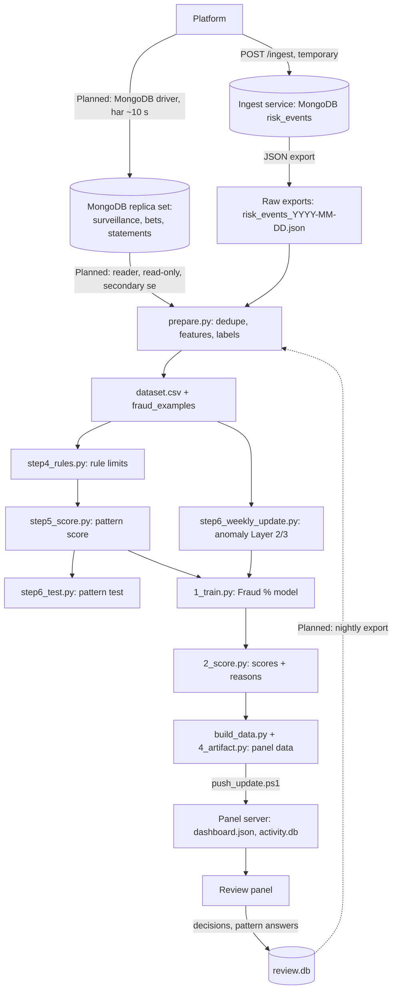

# Data Quality aur Lineage
# Fraud Detection Platform

| Item | Detail |
|---|---|
| Document | Data Quality aur Lineage |
| Version | 1.1 (review ke liye draft) |
| Date | 14 Oct 2026 |
| Organisation | MiraiGate Technologies |
| Profile ka data | 9 exports, 15 Sep se 8 Oct 2026 (56,425 unique requests) |
| Related documents | Data Dictionary; Platform Data Contract; MongoDB Replica Set SRS; Continuous Learning aur Retraining Design |

**Status ka matlab:** **Bana hua** = abhi chal raha hai; **Planned** = automation ke saath banega.

---

## 1. Purpose

Ek kharab batch chupchaap scores badal deta hai. Ye document do cheezein tay karta hai:
1. **Data quality:** har stage pe kya check hota hai, limit kya hai, aur fail hone pe kya hota hai.
2. **Lineage:** panel ka har number kis export, kis code aur kis model se aaya, ye kaise trace hoga.

---

## 2. Lineage: Data Kahan se Kahan Jaata Hai

### 2.1 Stages
| # | Stage | Input | Code | Output | Status |
|---|---|---|---|---|---|
| 1 | Intake (temporary source) | Platform stream | Ingest service | MongoDB `risk_events`, `user_data` | Bana hua |
| 1a | Live intake | Platform, MongoDB driver (har ~10 second) | MongoDB replica set, `fraud` DB | `surveillance`, `bets`, `statements` (60 din, TTL) | Planned (replica set ban raha hai) |
| 2 | Export (temporary source) | MongoDB | Manual export | `fraud_ingest/data/risk_events_<date>.json` | Bana hua (manual) |
| 2a | Live read | Replica set secondary (`fraud_reader`) | Reader job, watermark ke saath | Local store / `raw/date=YYYY-MM-DD/` | Planned |
| 3 | Dataset | Saare exports (`SOURCES` list) | `pattern_detection/data_prep/prepare.py` | `dataset.csv`, `fraud_examples.csv/json`, `summary.txt` | Bana hua |
| 4 | Pattern rules | `dataset.csv` | `rules/step4_rules.py` | `rules.json`, `rule_results.csv` | Bana hua |
| 5 | Pattern score | Rules + dataset | `scoring/step5_score.py` | `score_model.joblib`, `scores.csv` | Bana hua |
| 6 | Pattern test | Upar wale | `testing/step6_test.py` | `loo_result.csv`, `summary.txt` | Bana hua |
| 7 | Anomaly update | Dataset | `new_pattern_detection/system/step6_weekly_update.py` | `models/layer2.joblib`, `layer3.joblib`, `versions/` | Bana hua |
| 8 | Fraud % train | Dataset + pattern + anomaly | `fraud_score/1_train.py` | `model/fraud_pct.joblib`, `train_oof.csv`, `cv_report.txt` | Bana hua |
| 9 | Scoring | Exports + models | `fraud_score/2_score.py` | `scores_risk_events.csv`, `score_summary.txt` | Bana hua |
| 10 | Panel data | Scores + exports | `panel/build_data.py` (+ `4_artifact.py`) | `data/dashboard.json`, `data/activity.db` | Bana hua |
| 11 | Release | Panel data | `deploy/push_update.ps1` | Panel server pe `/opt/fraud-panel/data` | Bana hua (manual) |
| 12 | Feedback | Panel | Nightly export | `feedback/date=<date>/` | Planned |

### 2.2 Lineage ke Keys
| Key | Kahan se kahan tak | Kaam |
|---|---|---|
| `_id` (record_id) | Platform → dataset → scores → panel → decisions | Har request ko har stage pe jodta hai |
| `batch_id` | Ingest service (sirf temporary source; live data me nahi) | Kaunse ingest batch me aaya |
| Export file ka naam | Raw → `prepare.py` ki `SOURCES` list | Kaunsi file se aaya |
| Model version | Anomaly `current_version.json`; Fraud % file ka time | Kaunse model ne score diya |
| "Model updated / Data up to" | `dashboard.json` → panel sidebar | Panel kis run ka hai |
| Run id aur release id | Run manifest | Planned |

### 2.3 Run Manifest (Planned)
Har run ek manifest likhega:
- inputs: export files ke naam, size, checksum; feedback export ka cut-off
- code ka version
- har stage ke outputs ke checksum aur row counts
- label counts (label aur pattern ke hisaab se)
- model versions aur metrics
- gate results
- release id

Manifest kabhi edit ya delete nahi hoga. Panel ka koi bhi number manifest se us export aur code tak trace ho sakega.

---

## 3. Quality ke Dimensions aur Abhi ki Halat

| Dimension | Check | Abhi (15 Sep – 8 Oct) | Limit | Fail hua to |
|---|---|---|---|---|
| Uniqueness | Same `_id` kai baar | 838 baar dobara aaya; status kabhi nahi badla | Report | Latest version liya jaata hai |
| Completeness | Bina `surveillance` bundle | 59 records | Batch ke 5% se kam | Score nahi; "No betting data" |
| Completeness | Bina user object | 761 (1.3%) | 2% | Account age khaali; report |
| Completeness | Bina statements | 1,011 (1.8%) | 5% | "No betting data" |
| Completeness | Bina bets | 8,753 (15.5%) | Report | Normal ho sakta hai (sirf casino wale users) |
| Completeness | `extra.amount` | 100% khaali | – | Contract gap G-06 |
| Completeness | Statement `txn_id` | 10.9% null | Report | Use nahi hota |
| Validity | Number fields string me | Saare | Parse fail < 0.1% | Parse na ho to khaali |
| Validity | Anjaane enum values | `sport_id` 4344 (2 bets); statement type "other" (253) | Report | Platform se poochha jayega |
| Timeliness | Request ke baad ke statements | 6,172 records me kuch | Report | Features me nahi liye jaate |
| Timeliness | `createdAt` ≤ `action_time` | 0 galat | 0 | Record flag |
| Timeliness | Data window | Median 19.3 din, max 20 | ≥ 19 din median | Report |
| Consistency | `user_id_str` me capital ya space | 21% records | – | Trim + lowercase |
| Consistency | Same user code, alag numeric `user_id` | 4 codes | Report | Key `user_id` honi chahiye (Section 5, DQ-05) |
| Consistency | User ka master badla | 74 user codes | Report | Request ka apna master liya jaata hai |
| Accuracy (label) | Reject bina saaf wajah | 100 / 307 (33%) | Kam karna hai | Unknown; Labeling Policy |

---

## 4. Har Batch ke Checks

| # | Check | Limit | Fail hone pe | Status |
|---|---|---|---|---|
| 1 | Schema: zaroori fields aur types | 99.9% valid | Galat records quarantine | Planned |
| 2 | Count, 7 din ke average se | ±30% ke andar | Batch quarantine + alert | Planned |
| 3 | Bina bets aur statements | 5% se kam | Batch quarantine + alert | Planned |
| 4 | Duplicate `_id` | Report | Latest version | Bana hua (dedupe) |
| 5 | Time ka order | `createdAt` ≤ `action_time` | Record flag | Planned |
| 6 | Features ki range aur khaali values | Pichhle training set se bada farak na ho | Training run rukta hai | Planned |
| 7 | Label counts | Fraud examples pichhle run se kam na hon, ya label log me wajah ho | Run rukta hai | Planned |
| 8 | Feedback export ke counts | Decisions ki ginti kam na ho, jab tak history me "cleared" na ho | Export reject | Planned |
| 9 | Panel me jo line ka English text nahi | 0 | Report | Bana hua (report) |

### 4.1 Quarantine ke Niyam
- Quarantine wala batch scoring me nahi jaata. Panel pichhla achha data dikhata rehta hai.
- Watermark aage nahi badhta. Theek hone pe wahi batch dobara chalta hai.
- Quarantine ki khabar 15 minute me team ko jaati hai. Platform ko 1 business day me batana hai.
- Quarantine ka faisla aur wajah run report me likhi jaati hai.

---

## 5. Known Data Quality Issues

| ID | Issue | Asar | Abhi ka workaround | Owner |
|---|---|---|---|---|
| DQ-01 | Bets me time nahi | Bet ka sequence, late bets, ground line nahi dikhte | Bets `bet_id` ke order me | Platform (G-02) |
| DQ-02 | Record faisle ke baad aata hai | Real-time score nahi ho sakta | Batch | Platform (G-01) |
| DQ-03 | `extra.amount` khaali | Withdrawal ki rakam nahi pata | Statements se profit | Platform (G-06) |
| DQ-04 | `bet_status` codes ka matlab nahi | Void/settled alag nahi | Features me use nahi | Platform (G-04) |
| DQ-05 | System user ko `user_id_str` (code) se pehchaanta hai | 4 codes do alag users ke | Abhi asar chhota | MiraiGate: numeric `user_id` pe jaana |
| DQ-06 | Statement/user time bina zone ke | Galat time zone ka khatra | UTC maana jaata hai | Platform (G-11) |
| DQ-07 | Har request me poore 20 din ke statements | Ek user ke statements kai baar aate hain; exports 0.7–4 GB | Har export poora padha jaata hai | MiraiGate: feature table (Planned) |
| DQ-08 | Remarks free text | 33% rejects bina saaf wajah | Unknown label | Client operations (G-05) |

---

## 6. Reconciliation (Counts Milna)

Har run ke baad ye counts milne chahiye:

| Stage | 8 Oct ka count |
|---|---|
| Exports me unique `_id` (15 Sep se) | 56,425 |
| `dataset.csv` rows | 56,425 |
| Betting data wale | 55,414 |
| Bina data | 1,011 |
| Scored (Fraud % bana) | 55,414 |
| Panel `activity.db` requests | 55,414 |

Koi count na mile to release nahi hoga aur run report me farak likha jayega.

---

## 7. Roles

| Kaam | Owner |
|---|---|
| Schema aur feed ki quality | Platform IT |
| Batch checks, quarantine, reconciliation | MiraiGate data team |
| Remarks ki quality | Client operations |
| Is document ka review (har mahine) | MiraiGate data lead |

## Change Log
| Version | Date | Badlav |
|---|---|---|
| 1.0 | 10 Oct 2026 | Pehla draft |
| 1.1 | 14 Oct 2026 | Live data ka raasta (MongoDB replica set) lineage diagram aur stages 1a, 2a me |
