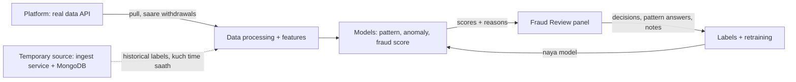

# Software Requirements Specification (SRS)

# Fraud Detection Platform: Withdrawal Risk Scoring and Review System

| Item              | Detail                                                                                                                |
| ----------------- | --------------------------------------------------------------------------------------------------------------------- |
| Document          | Software Requirements Specification                                                                                   |
| Version           | 1.1                                                                                                                   |
| Date              | 10 Oct 2026                                                                                                           |
| Organisation      | MiraiGate Technologies                                                                                                |
| Related documents | Fraud Review Panel SRS; Continuous Learning Automation Design; Zaroori Documents list (`fraud_detection_prep_doc.md`) |

**Requirement status ka matlab:**

- **Bana hua** = system me abhi chal raha hai
- **Planned** = design ho gaya hai, banana baaki hai
- **Open** = faisla baaki hai (Section 12)

**Version 1.1 me kya badla:** abhi ka data (ingest service / MongoDB / JSON export) ab **temporary data source** maana gaya hai. Asli kaam **real data source** (platform ki nayi API) pe hoga, jisme approve/reject aur agent ke faisle wale fields nahi aayenge. Poori list end me Change Log me hai.

---

## 1. Introduction

### 1.1 Purpose

Ye document poore Fraud Detection Platform ki requirements likhta hai. Isme ye sab aata hai:

- platform ki real data API se data lena
- bets aur statements se features banana
- fraud patterns pakadna
- har withdrawal request ko 0 se 99 ka Fraud % dena
- client ke reviewers ka panel me faisla karna
- un faislon se model ko dobara train karna

### 1.2 Scope

**System kya karega:**

- Platform ki real data API se har withdrawal request ko uske user ke bets aur statements ke saath lena (hum API se pull karenge).
- Har request ko Fraud % dena, aur saath me wajah (reasons) batana.
- Jin players ka score 60% ya zyada hai, unhe review queue me dikhana.
- Reviewers ko statements, bets aur pichhli requests dekh ke **Fraud / Not fraud** faisla dene dena.
- Faislon, pattern answers aur notes ko save karna aur model training me use karna.
- Models ko time-time pe retrain karke naye scores panel me dikhana.

**System kya nahi karega:**

- Withdrawal ko khud approve ya reject nahi karega. Score sirf salah hai, faisla platform aur reviewer ka hai.
- Platform ke wallet, bets ya accounts me koi badlav nahi karega.
- Abhi withdrawal ke time pe real-time block nahi karega (future phase).

### 1.3 Definitions

| Words                 | Meaning                                                                                                                                        |
| --------------------- | ---------------------------------------------------------------------------------------------------------------------------------------------- |
| Request               | Platform ki ek withdrawal request, user ke bets aur statements ke saath                                                                        |
| Real data source      | Platform ki nayi API (production). Saare withdrawals aayenge; approve/reject, remarks, reason list, locks aur action_time**nahi** aayenge      |
| Temporary data source | Abhi ka ingest service (MongoDB) aur uske JSON exports. Sirf platform ke flag kiye withdrawals, agent ke faisle ke saath. Asli source nahi hai |
| Historical data       | Temporary source ka 15 Sep 2026 se ab tak ka data, jisme agent ke faisle hain. Shuruaati training labels isi se bane                           |
| Agent                 | Client ka staff jo platform pe withdrawal approve/reject karta hai. Uske faisle sirf temporary source me dikhte hain                           |
| Reviewer              | Client ka user jo Fraud Review panel me player ko Fraud / Not fraud mark karta hai                                                             |
| Master / White label  | Platform ki hierarchy: user ek master ke neeche hota hai, master ek white label ke neeche                                                      |
| Normal data           | Wo requests jinse model "normal" behaviour seekhta hai (Section 5.2)                                                                           |
| Fraud % / score       | 0 se 99 ka number; normal requests ke mukable request kitni fraud jaisi hai                                                                    |
| Known pattern         | Pakke fraud cases se bana pattern jiska rule hai: P1, P2, P3, P4                                                                               |
| Anomaly model         | Normal data pe train hua model jo batata hai request normal users se kitni alag hai (Layer 2)                                                  |
| Account group         | Ek master ke neeche 3 ya zyada users jo 72 ghante me ek jaisa ajeeb behaviour dikhayein (Layer 3)                                              |
| Label                 | Training me request ki category: fraud example, genuine, not fraud, ya training se bahar                                                       |
| Data window           | Request se pehle ke 20 din ke statements (bets me time nahi aata)                                                                              |

### 1.4 References

- Fraud Review Panel: Software Requirements Specification
- Fraud Detection Platform: Continuous Learning Automation Design
- Panel README (`dashboard_github/fraud_detection/panel/README.md`)
- Fraud score README (`fraud_score/README.md`), data preparation README (`pattern_detection/data_prep/README.md`)

---

## 2. Overall Description

### 2.1 Product Perspective

System chaar hisson me bata hai:

1. **Data intake:**
   - **Real data source:** platform ki nayi API se hum har withdrawal request pull karenge (Planned; API ki detail aani baaki hai).
   - **Temporary data source:** abhi platform har flag hui withdrawal ko ingest service (`POST /ingest`) pe bhejta hai, jo MongoDB me save hoti hai; wahan se JSON export.
   - Ye source asli nahi hai. Real API aane ke baad kuch time saath chalega (milaan ke liye), phir band hoga. Iska purana data training labels ke liye rahega.
2. **Data processing aur models:** features banana, teen models chalana, score aur reasons nikalna.
3. **Fraud Review panel:** reviewers ke liye web application (FastAPI + SQLite), EC2 pe, login ke saath.
4. **Retraining:** labels banana, models train karna, check karna, aur naya model panel tak pahunchana.

### 2.2 Product Functions (short me)

- Data intake (real API se pull) aur validation
- Feature engineering (59 features per request)
- Pattern detection (P1–P4) aur pattern score
- Anomaly score aur account groups
- Fraud % (0–99), bands aur reasons
- Review queue, request detail, statements, bets
- Reviewer decisions, pattern answers, pattern notes
- Decisions ka CSV export
- Labeling aur retraining
- Monitoring aur audit

### 2.3 User Classes

| User                         | Kaam                                                                                    | Access                                                                |
| ---------------------------- | --------------------------------------------------------------------------------------- | --------------------------------------------------------------------- |
| Reviewer (client)            | Queue dekhna, case check karna, Fraud / Not fraud dena, pattern answer aur notes likhna | Panel, apne login se                                                  |
| Lead reviewer (client)       | Reviewers ke beech takraav suljhana, naye pattern approve karna                         | Panel (admin view Planned)                                            |
| Admin (MiraiGate)            | Accounts banana/hatana, retraining chalana, release aur rollback                        | Server aur admin tools                                                |
| Data/ML engineer (MiraiGate) | Models, labels, pipeline ka rakh-rakhaav                                                | Training environment                                                  |
| Agent (client platform)      | Withdrawal approve/reject (platform pe)                                                 | System use nahi karta; uske faisle sirf temporary source me aate hain |

### 2.4 Operating Environment

- **Panel server:** AWS EC2 t3.medium, Ubuntu 22.04/24.04, 40 GB gp3, nginx + systemd, panel `127.0.0.1:8080` pe.
- **HTTPS:** domain ke aage wala proxy/CDN deta hai (`review-panel.api.savage1.one`).
- **Real data API:** platform ki taraf; endpoint, authentication aur format abhi aane baaki hain (Open).
- **Temporary ingest service:** alag EC2, Go service + MongoDB (Docker), sirf API port bahar khula.
- **Training:** abhi analysis workstation (Python 3.12, pandas, scikit-learn); Planned: alag training instance.
- **Browser:** Chrome, Edge, Firefox, Safari ke current versions; desktop aur mobile.

### 2.5 Constraints

- **Real data me approve/reject, remarks, platform reason list, locks aur action_time nahi aayenge.** Model aur panel ko inke bina kaam karna hai.
- Real data me naye labels sirf panel ke reviewer decisions se aayenge.
- Abhi tak ka model sirf platform ke **flag kiye** withdrawals pe bana hai. Real data me **saare** withdrawals aayenge, jinka mix alag ho sakta hai (Section 7.4).
- Bets me time nahi aata, isliye bets ka order sirf platform ke numbering se hai.
- IP aur device data nahi aata, isliye "same IP" ya multi-device fraud data se nahi pakda ja sakta.
- `extra.amount` hamesha khaali aata hai; withdrawal amount statements se nikalta hai.
- Bet status codes (1, 2, 3, 4, 5, 8, 9) ka matlab platform ne nahi bataya.
- Statements ka time UTC me hai; request ka time IST me dikhaya jaata hai.
- Fraud examples kam hain (62), isliye model design simple aur regularised rakhna zaroori hai.

### 2.6 Assumptions aur Dependencies

- Real API me approve/reject aur agent ke faisle wale fields chhod ke baaki sab abhi jaisa aayega: user (account kab bana, balance), master, white label, request, bets aur statements. Ye abhi ka maan hai; API ki detail aane pe confirm hoga (Open).
- Real API se data hum pull karenge.
- Score har withdrawal request pe banega.
- Temporary source real API ke saath kuch time chalega, phir band hoga.
- Client ke reviewers panel me faisle aur reason likhenge. Real data me ye hi naye labels ka source hai.
- AWS account, domain aur proxy client/MiraiGate ke control me hain.

---

## 3. External Interface Requirements

### 3.1 User Interface

- Panel ka saara text professional English me hai (client-facing).
- Layout: left sidebar (Review queue, Decisions, Withdrawal requests, Account groups, Known patterns), upar search ("Find a user ID"), neeche signed-in user aur Sign out.
- Mobile pe sidebar menu button se khulta hai; tables horizontally scroll hote hain.
- Score badge ka rang band ke hisaab se: Very high, High, Medium, Low, Normal.

### 3.2 Software Interfaces

| Interface                                                     | Direction       | Kaam                                              | Status                |
| ------------------------------------------------------------- | --------------- | ------------------------------------------------- | --------------------- |
| **Platform real data API** (hum pull karenge)                 | Andar           | Saare withdrawal requests, user, bets, statements | Planned (detail Open) |
| Platform → Ingest service`POST /ingest`, `POST /ingest/users` | Andar           | Flag kiye risk events (temporary source)          | Bana hua (temporary)  |
| Ingest service JSON export                                    | Andar           | Temporary source ka data aur historical labels    | Bana hua (temporary)  |
| Panel API (`/api/...`)                                        | Browser ↔ panel | Data, decisions, notes, login                     | Bana hua              |
| Decisions CSV (`/api/decisions.csv`)                          | Bahar           | Platform ko faisle bhejna                         | Bana hua              |
| Object storage (S3)                                           | Andar/bahar     | Raw data, features, models, releases              | Planned               |

### 3.3 Panel API (bana hua)

| Method              | Path                      | Kaam                                                          |
| ------------------- | ------------------------- | ------------------------------------------------------------- |
| POST                | `/api/login`              | Sign in (name, password); session cookie set                  |
| POST                | `/api/logout`             | Sign out                                                      |
| GET                 | `/api/me`, `/api/session` | Signed-in user; session check (activity nahi ginta)           |
| GET                 | `/api/dashboard`          | Requests, bands, groups, model figures                        |
| GET                 | `/api/activity`           | Ek request ke statements ya bets (filters, paging)            |
| GET / PUT / DELETE  | `/api/decisions`          | Decisions dekhna, submit karna, hatana (history me rehta hai) |
| GET                 | `/api/decisions.csv`      | Decisions ka CSV                                              |
| GET / POST / DELETE | `/api/pattern-notes`      | Known patterns pe notes                                       |
| GET / PUT           | `/api/pattern-checks`     | Request pe pattern answer (fits / not_fit / other)            |

---

## 4. Functional Requirements: Data

### 4.1 Data Sources (SRC)

|                 | Real data source                                                       | Temporary data source                                              |
| --------------- | ---------------------------------------------------------------------- | ------------------------------------------------------------------ |
| Kya hai         | Platform ki nayi API                                                   | Ingest service (MongoDB) + JSON exports                            |
| Kaise aata hai  | Hum pull karenge                                                       | Platform push karta hai (`POST /ingest`); hum export nikaalte hain |
| Kaunse requests | Saare withdrawals                                                      | Sirf platform ke flag kiye withdrawals                             |
| Agent ke faisle | **Nahi** (status, remarks, reason, locks, action_time nahi)            | Haan                                                               |
| Kaam            | Production scoring, panel, aage ki training (reviewer labels ke saath) | Historical labels, shuruaati training, real API se milaan          |
| Kab tak         | Hamesha                                                                | Real API ke saath kuch time, phir band (kitna time: Open)          |

| ID     | Requirement                                                                                                                       | Status   |
| ------ | --------------------------------------------------------------------------------------------------------------------------------- | -------- |
| SRC-01 | Production scoring aur panel ka data real data source se aayega. Temporary source ko real data source nahi maana jayega.          | Planned  |
| SRC-02 | Temporary source ka 15 Sep 2026 se ab tak ka data historical data ke roop me rakha jayega (training labels aur tests ke liye).    | Bana hua |
| SRC-03 | Jab tak dono source saath chalein, jo requests dono me hain unke data aur score milaaye jayenge; farak report hoga (Section 7.4). | Planned  |
| SRC-04 | Temporary source band karne ka faisla SRC-03 ki report ke baad hoga.                                                              | Open     |

### 4.2 Data Intake (ING)

| ID     | Requirement                                                                                                                                                                               | Status                               |
| ------ | ----------------------------------------------------------------------------------------------------------------------------------------------------------------------------------------- | ------------------------------------ |
| ING-01 | System har request ko uski unique id se ek hi baar rakhega; same request dobara aaye to latest version maana jayega.                                                                      | Bana hua (temporary); Planned (real) |
| ING-02 | Real API se har request ke saath user, master, white label, request ka time, bets aur statements rakhe jayenge.                                                                           | Planned                              |
| ING-03 | Temporary source ke records ke saath status, remarks, reason list, locks (`user_lock`, `withdrawal_lock`, `bet_void`) aur action_time bhi rakhe jayenge (sirf historical labels ke liye). | Bana hua                             |
| ING-04 | System real API se naye requests tay schedule pe pull karega, watermark ke saath (jahan tak data aa chuka). Pull kitni der me: Open.                                                      | Planned                              |
| ING-05 | Har batch ka schema, count (7 din ke average se), bina data wale records ka hissa aur duplicates check honge; galat batch quarantine hoga aur alert jayega.                               | Planned                              |
| ING-06 | Real data me agar status/remarks jaise fields kabhi aa bhi jayein, to wo score ya features me use nahi honge.                                                                             | Planned                              |
| ING-07 | 15 Sep 2026 se pehle ke temporary records training me nahi liye jayenge (unme bets/statements bahut kam hain).                                                                            | Bana hua                             |
| ING-08 | Manual JSON export temporary source ke chalne tak fallback ke roop me chalega.                                                                                                            | Bana hua                             |

### 4.3 Data Processing aur Features (FEA)

| ID     | Requirement                                                                                                                                                                                | Status   |
| ------ | ------------------------------------------------------------------------------------------------------------------------------------------------------------------------------------------ | -------- |
| FEA-01 | Har request ke liye sirf request ke time tak ke statements use honge; baad ke statements kabhi feature me nahi jayenge.                                                                    | Bana hua |
| FEA-02 | Data window request se pehle ke 20 din ka hoga.                                                                                                                                            | Bana hua |
| FEA-03 | Har request ke 59 features banenge: account age, deposit/withdraw/bonus, casino aur sports, bets ka tareeka, back+lay selections, 2+ runners pe back, jeet ka deposit se anupaat, waghera. | Bana hua |
| FEA-04 | Status, remarks, reason aur locks kabhi feature nahi banenge. Isliye wahi features real data (jisme ye fields nahi) pe bhi bante hain.                                                     | Bana hua |
| FEA-05 | Jis request me bets aur statements dono nahi hain, use score nahi milega ("No betting data").                                                                                              | Bana hua |
| FEA-06 | Features har request ke aate hi ek baar banenge aur feature table me rakhe jayenge, taaki retraining poora history dobara na padhe.                                                        | Planned  |

---

## 5. Functional Requirements: Labels aur Models

### 5.1 Labeling (LBL)

Har request ko training ke liye ek hi label milega, is priority se. **Agent wale niyam (2 se 8) sirf historical (temporary source) data pe lagte hain.** Real data me agent ke faisle nahi aate, isliye wahan label sirf reviewer decision (priority 1) se banta hai.

| Priority | Saboot                                                                                               | Label                                     | Kis data pe       |
| -------- | ---------------------------------------------------------------------------------------------------- | ----------------------------------------- | ----------------- |
| 1        | Panel me reviewer ka decision: Fraud                                                                 | Fraud example                             | Real + historical |
| 1        | Panel me reviewer ka decision: Not fraud                                                             | Genuine (agent ne reject kiya ho tab bhi) | Real + historical |
| 2        | Agent reject + fraud remark (casino checking, cheater, bet void, suspicious) + data me known pattern | Fraud example                             | Sirf historical   |
| 3        | Agent reject + withdrawal lock + data pattern rule pe baithta hai                                    | Fraud example                             | Sirf historical   |
| 4        | Agent reject, platform ki galti (wrong odd, tech issue)                                              | Not fraud (fraud class se bahar)          | Sirf historical   |
| 5        | Agent reject, wajah saaf nahi, account 30 din se purana, lock nahi                                   | Training se bahar                         | Sirf historical   |
| 6        | Agent reject + lock, par data me koi pattern nahi                                                    | Training se bahar                         | Sirf historical   |
| 7        | Approved, par user ka reject bhi hua, ya data rejected cases jaisa (jaise P2)                        | Training se bahar                         | Sirf historical   |
| 8        | Approved, koi shak nahi                                                                              | Genuine                                   | Sirf historical   |
| 9        | Bets aur statements nahi                                                                             | Training se bahar                         | Real + historical |

| ID     | Requirement                                                                                                                                                                               | Status   |
| ------ | ----------------------------------------------------------------------------------------------------------------------------------------------------------------------------------------- | -------- |
| LBL-01 | Upar ki table ke niyam 2 se 8 historical data preparation me lagte hain.                                                                                                                  | Bana hua |
| LBL-02 | Review se tay hue cases ek alag list (manual review) me rakhe jaate hain, saboot ke saath.                                                                                                | Bana hua |
| LBL-03 | Panel ke decisions priority 1 ke roop me training me jayenge.                                                                                                                             | Planned  |
| LBL-04 | Do reviewers 7 din ke andar ulta faisla dein to wo request us run me bahar rahegi aur lead reviewer ko dikhegi.                                                                           | Planned  |
| LBL-05 | Har training run apni label table (har label ka source) save karega.                                                                                                                      | Planned  |
| LBL-06 | Pattern answer "No, it does not fit" wali request us pattern ke examples se hategi; "Other" ka text naye pattern ki khoj me jayega.                                                       | Planned  |
| LBL-07 | Labeling ke niyam har mahine reviewers ke faislon se milaake dekhe jayenge.                                                                                                               | Planned  |
| LBL-08 | Training labels = panel ke reviewer decisions + historical data ke labels. Historical labels ek tay snapshot ke roop me rakhe jayenge (temporary source band hone ke baad nahi badlenge). | Planned  |
| LBL-09 | Real data ke bina review wale requests Fraud % model me genuine label ki tarah use hon ya nahi: Open (Section 12).                                                                        | Open     |

### 5.2 Normal Data (NRM)

Anomaly model, pattern rule ki limits aur score ka scale "normal" requests se bante hain. Historical data me ye approved requests the; real data me approve nahi aata, isliye normal ki definition ye hai:

**Normal = real data ke saare requests, siwaye:**

- jin users ko reviewer ne **Fraud** mark kiya, aur training ke fraud examples
- jinka score **60% ya zyada** hai aur **review abhi baaki** hai

Review ke baad **Not fraud** wale 60%+ requests wapas normal me aate hain. 0–59% wale saare requests normal me rehte hain.

**Kyun:**

- Fraud bahut kam hai (historical data me agent rejects 0.54%).
- Limits 99–99.5 percentile aur scale top 1% pe bante hain. Normal data me thoda chhupa fraud ho, to bhi ye mushkil se hilte hain.
- Sirf 60%+ ke Not fraud ko normal maanna galat hoga, kyunki wo ajeeb dikhne wale genuine log hain. Sirf 10–50% lena bhi galat hoga, kyunki sabse normal log 0–10% me hain.

| ID     | Requirement                                                                                                                                                               | Status  |
| ------ | ------------------------------------------------------------------------------------------------------------------------------------------------------------------------- | ------- |
| NRM-01 | Real data pe normal set upar ki definition se banega.                                                                                                                     | Planned |
| NRM-02 | Har hafte 60% se neeche ke 20 random requests reviewers ko "spot check" ke roop me dikhaye jayenge (RVQ-04), taaki naapa ja sake ki normal set me kitna fraud chhupa hai. | Planned |
| NRM-03 | Spot check me fraud ka hissa 1% se zyada nikle to normal ki definition dobara dekhi jayegi.                                                                               | Planned |
| NRM-04 | Jab tak real data kaafi na ho (kitna: Open), historical approved requests normal set me rahenge.                                                                          | Open    |

### 5.3 Pattern Model (PAT)

| ID     | Requirement                                                                                                                                    | Status                                                          |
| ------ | ---------------------------------------------------------------------------------------------------------------------------------------------- | --------------------------------------------------------------- |
| PAT-01 | System chaar known patterns ke rules lagayega (Appendix A).                                                                                    | Bana hua                                                        |
| PAT-02 | Rule ki limits normal data ke 99 se 99.5 percentile ke paas tay hongi, taaki normal me 1% se kam flag hon.                                     | Bana hua (historical: approved pe); Planned (real: Section 5.2) |
| PAT-03 | Pattern score (0–100) = 50 × rule laga + 25 × limit se kitna aage + 25 × fraud examples se kitna milta hai.                                    | Bana hua                                                        |
| PAT-04 | Ek request ka ek hi main pattern hoga, is order me: P2 > P1 > P3 > P4.                                                                         | Bana hua                                                        |
| PAT-05 | Har pattern ka "chhupa ke test" hoga: example hata ke rule dobara banao aur dekho hata hua example pakda gaya ya nahi.                         | Bana hua                                                        |
| PAT-06 | Naya pattern (P5 se aage) tab propose hoga jab 3 alag users ek hi naye pattern naam se fraud mark hon; client ki approval ke bina nahi lagega. | Planned                                                         |

### 5.4 Anomaly Model aur Account Groups (ANO)

| ID     | Requirement                                                                                                                                            | Status                                             |
| ------ | ------------------------------------------------------------------------------------------------------------------------------------------------------ | -------------------------------------------------- |
| ANO-01 | Anomaly model (Layer 2) sirf normal data (Section 5.2) pe train hoga aur har request ko 0–99 "Unusual score" dega.                                     | Bana hua (historical: approved pe); Planned (real) |
| ANO-02 | Unusual score 97 ya zyada ho to system batayega ki kya cheez normal se alag hai ("Different from normal users").                                       | Bana hua                                           |
| ANO-03 | Layer 3: ek master ke neeche 3 ya zyada ajeeb users 72 ghante ke andar milein to account group banega.                                                 | Bana hua                                           |
| ANO-04 | Naya anomaly version tabhi lagega jab wo chhupa ke test me purane se kam na pakde, aur galat alarm Layer 2 me 3.5% aur Layer 3 me 0.6% se zyada na ho. | Bana hua                                           |
| ANO-05 | Har version save hoga aur purana version wapas lagaya ja sakega.                                                                                       | Bana hua                                           |

### 5.5 Fraud Score (SCR)

| ID     | Requirement                                                                                                                                                                                                                        | Status                                                   |
| ------ | ---------------------------------------------------------------------------------------------------------------------------------------------------------------------------------------------------------------------------------- | -------------------------------------------------------- |
| SCR-01 | Fraud % do hisson se banega: A = known pattern score, B = behaviour (anomaly aur paise ke signals). Dono me jo bada, wahi lagega.                                                                                                  | Bana hua                                                 |
| SCR-02 | Score normal requests ke hisaab se calibrate hoga: 20 / 40 / 60 / 90 = normal me sirf 10% / 3% / 1% / 0.1% itne upar. Historical data me normal = approved; real data me Section 5.2.                                              | Bana hua (historical); Planned (real)                    |
| SCR-03 | Score 0 se 99 tak hoga; 100 kabhi nahi.                                                                                                                                                                                            | Bana hua                                                 |
| SCR-04 | Behaviour ke har factor ki disha pehle se tay hogi; haar ya kam activity se score nahi badhega.                                                                                                                                    | Bana hua                                                 |
| SCR-05 | 30 din se purane account: 90+ band me sirf 95–98, baaki 89 se neeche.                                                                                                                                                              | Bana hua                                                 |
| SCR-06 | Bina deposit, bonus se chhoti jeet (aur P1–P3 nahi): score jeet ke hisaab se seemit (Appendix B).                                                                                                                                  | Bana hua                                                 |
| SCR-07 | Training ke fraud examples aur unke users ki baad wali requests ko kam se kam 95% dikhana.                                                                                                                                         | Bana hua, Open (Section 12)                              |
| SCR-08 | Training wali requests ka score out-of-fold hoga (us model se jisne wo request nahi dekhi).                                                                                                                                        | Bana hua                                                 |
| SCR-09 | Har score ke saath "Main reasons" aayenge (Appendix C). Historical fraud examples pe sabse upar agent ka faisla aur remark aayega; reviewer ke Fraud decision se bane example pe reviewer ka faisla. "Confirmed fraud" kabhi nahi. | Bana hua (agent wali line); Planned (reviewer wali line) |
| SCR-10 | 20% se kam score pe behaviour wali reasons na dikhana, ya sirf "Looks normal" dikhana.                                                                                                                                             | Open                                                     |
| SCR-11 | Score ke liye koi bhi agent ke faisle wala field zaroori nahi hoga; real data pe score bina inke bane.                                                                                                                             | Bana hua (features me ye fields nahi)                    |

### 5.6 Retraining aur Release (MLO)

| ID     | Requirement                                                                                                                                          | Status            |
| ------ | ---------------------------------------------------------------------------------------------------------------------------------------------------- | ----------------- |
| MLO-01 | Retraining ka order: data preparation → pattern rules → pattern score → pattern test → anomaly weekly update → Fraud % model → scoring → panel data. | Bana hua (manual) |
| MLO-02 | Roz data refresh: real API ke naye requests ko current models se score karke panel update karna.                                                     | Planned           |
| MLO-03 | Har hafte retrain, aur 25 naye reviewer decisions aate hi pehle bhi.                                                                                 | Planned           |
| MLO-04 | Naya model tabhi lagega jab saare quality gates pass hon (Section 7.3); warna current model chalta rahega aur alert jayega.                          | Planned           |
| MLO-05 | Har release ek versioned package hoga (models, data, metrics, label snapshot); panel server use khud pull karke ek hi baar me badlega.               | Planned           |
| MLO-06 | Admin ek step me pichhla release wapas laga sakega (5 minute me).                                                                                    | Planned           |
| MLO-07 | Model ka design run-dar-run nahi badlega; sirf data aur labels badhenge (overfitting se bachne ke liye).                                             | Bana hua          |

---

## 6. Functional Requirements: Fraud Review Panel

### 6.1 Sign-in aur Accounts (AUTH)

| ID      | Requirement                                                                                                                                      | Status   |
| ------- | ------------------------------------------------------------------------------------------------------------------------------------------------ | -------- |
| AUTH-01 | Har page aur API ke liye sign-in zaroori; panel ka apna sign-in page hoga (browser popup nahi).                                                  | Bana hua |
| AUTH-02 | Password kam se kam 8 characters, user name jaisa nahi; salted PBKDF2-SHA256 hash me rakha jayega.                                               | Bana hua |
| AUTH-03 | Ek account ek time pe ek hi browser pe; doosre browser me sign in hote hi pehla browser 30 second ke andar sign out ho jayega aur wajah dikhegi. | Bana hua |
| AUTH-04 | 12 ghante koi activity na ho to session khatam; 7 din baad har haal me khatam.                                                                   | Bana hua |
| AUTH-05 | Ek user name pe 5 galat koshish ya ek address se 20 galat koshish ke baad 15 minute ka pause.                                                    | Bana hua |
| AUTH-06 | Accounts server pe command se banenge, password badlega, hatenge, list honge (`fraud-panel-users`).                                              | Bana hua |
| AUTH-07 | Doosri site se aayi data badalne wali requests reject hongi.                                                                                     | Bana hua |
| AUTH-08 | Admin role (manual run, approval, rollback) panel me.                                                                                            | Planned  |

### 6.2 Review Queue (RVQ)

| ID     | Requirement                                                                                                                                                | Status                                      |
| ------ | ---------------------------------------------------------------------------------------------------------------------------------------------------------- | ------------------------------------------- |
| RVQ-01 | Queue me wo players dikhenge jinki kisi request ka score 60% ya zyada hai.                                                                                 | Bana hua                                    |
| RVQ-02 | Tabs: Waiting, Fraud, Not fraud, All; filters: search, minimum score, sirf naye accounts; agent decision filter sirf historical data pe.                   | Bana hua (real data ke liye badlav Planned) |
| RVQ-03 | Upar counts: waiting, marked fraud, marked not fraud, 90%+ players.                                                                                        | Bana hua                                    |
| RVQ-04 | Har hafte 20 random kam-score (60% se neeche) requests "spot check" ke roop me queue me aayengi (NRM-02).                                                  | Planned                                     |
| RVQ-05 | Saare withdrawals aane se queue badhegi (score top 1% pe 60 hai, isliye roz ke volume ka lagbhag 1%). Queue limit volume pata chalne ke baad dekhi jayegi. | Open                                        |

### 6.3 Request Detail (REQ)

| ID     | Requirement                                                                                                                                                                          | Status                                      |
| ------ | ------------------------------------------------------------------------------------------------------------------------------------------------------------------------------------ | ------------------------------------------- |
| REQ-01 | Request page pe: user, master, white label, score aur band, request time, account age, deposits, withdrawn, profit, casino share, bonus. Agent decision sirf historical requests pe. | Bana hua (real data ke liye badlav Planned) |
| REQ-02 | "Why this score": reasons, known pattern aur uska link, purane account ki note, "Different from normal users". Agent remark aur platform reason sirf historical requests pe.         | Bana hua (real data ke liye badlav Planned) |
| REQ-03 | Statements tab: wahi entries jinpe score bana; type filter, search, order, totals; data na ho to "NA".                                                                               | Bana hua                                    |
| REQ-04 | Bets tab: sport, market, selection, back/lay, odds (asked odds alag ho to), stake, P/L, liability, status; back/lay aur market filter; note ki bets me time nahi hai.                | Bana hua                                    |
| REQ-05 | Other requests tab: usi user ki baaki requests.                                                                                                                                      | Bana hua                                    |
| REQ-06 | Signals: pattern score, unusual score, account group, training label, user ki requests ki ginti.                                                                                     | Bana hua                                    |
| REQ-07 | Jo field data me nahi hai (jaise real data me agent decision), panel use khaali "–" ki jagah dikhayega hi nahi.                                                                      | Planned                                     |

### 6.4 Review aur Feedback (REV)

| ID     | Requirement                                                                                                                                                                                            | Status   |
| ------ | ------------------------------------------------------------------------------------------------------------------------------------------------------------------------------------------------------ | -------- |
| REV-01 | Reviewer Fraud ya Not fraud chunega aur reason likhega (quick reason chips ke saath);**Submit** aur **Submit and open next**.                                                                          | Bana hua |
| REV-02 | Request pe known pattern ho to Review box me sawaal: "Does it fit this request?" —**Yes, it fits / No, it does not fit / Other**. Yes/No bina text ke; Other pe text box zaroori. Sawaal optional hai. | Bana hua |
| REV-03 | Decision aur pattern answer ek hi Submit se save honge; reviewer ka naam login se aayega.                                                                                                              | Bana hua |
| REV-04 | Submit ke baad notification: kya save hua aur ki ye agle model update me training me jayega.                                                                                                           | Bana hua |
| REV-05 | Decision badla ja sakta hai (Change) ya hataya ja sakta hai; har badlav history me rahega.                                                                                                             | Bana hua |
| REV-06 | Har player pe latest decision hi lagu hoga.                                                                                                                                                            | Bana hua |

### 6.5 Decisions aur Export (DEC)

| ID     | Requirement                                                                                              | Status   |
| ------ | -------------------------------------------------------------------------------------------------------- | -------- |
| DEC-01 | Decisions page: har decision ka time, user, decision, reason, reviewer, score; filter Fraud / Not fraud. | Bana hua |
| DEC-02 | CSV export: user_id, user_code, decision, reason, reviewer, decided_at_ist, request_id, score.           | Bana hua |

### 6.6 Withdrawal Requests, Groups aur Known Patterns

| ID     | Requirement                                                                                                                                                                                                                              | Status                                      |
| ------ | ---------------------------------------------------------------------------------------------------------------------------------------------------------------------------------------------------------------------------------------- | ------------------------------------------- |
| WRQ-01 | Withdrawal requests page: saari scored requests, band cards se filter, search (user, master,`G24` group, `P2` pattern), review status, minimum score, toggles. Remark search aur agent decision filter sirf historical data pe.          | Bana hua (real data ke liye badlav Planned) |
| GRP-01 | Account groups page: har group ka master, median score, users, requests, median deposit/withdrawn/profit, casino share, account age, time period. "Rejects" column sirf historical data pe; real data me reviewer ke Fraud decisions.    | Bana hua (badlav Planned)                   |
| KNP-01 | Known patterns page row format me: sirf wo patterns jo model ne pakde hain (koi request 60%+ pe), columns: fraud examples in training, caught by the model, marked fraud/not fraud, notes. "Rejected by agents" sirf historical data pe. | Bana hua (badlav Planned)                   |
| KNP-02 | Row pe click se details: rule kya check karta hai, "View the N caught requests", notes likhna/padhna; apna note hi hata sakte hain.                                                                                                      | Bana hua                                    |

---

## 7. Model Quality Requirements

### 7.1 Testing ka tareeka

- Test user-wise hoga: koi user training aur testing dono me nahi (5 hisse, 10 baar).
- Har pattern ka example uska pattern chhupa ke bhi test hoga ("naya pattern" test).
- Score normal requests ke out-of-fold scores se calibrate hoga (historical: approved; real: Section 5.2).

### 7.2 Abhi ke numbers (8 Oct 2026, temporary source ka data)

Ye numbers sirf platform ke **flag kiye** withdrawals pe hain. Saare withdrawals (real data) pe numbers Section 7.4 ke baad hi pata chalenge.

| Metric                             | Value                                                                          |
| ---------------------------------- | ------------------------------------------------------------------------------ |
| Data                               | 56,425 requests (15 Sep – 8 Oct), 62 fraud examples (57 users), 54,587 genuine |
| AUC (fraud vs genuine)             | 0.984                                                                          |
| AUC, apna pattern chhupa ke        | 0.963                                                                          |
| Genuine me 1% alarm pe fraud pakde | 66%                                                                            |
| Genuine me 3% alarm pe fraud pakde | 83%                                                                            |
| Model akele 90%+ pe fraud examples | 20 / 62                                                                        |
| Genuine requests 90%+ pe           | 0.03%                                                                          |
| Pattern rules chhupa ke test       | 51 / 62                                                                        |

### 7.3 Release ke Quality Gates (Planned)

| Gate                                                 | Limit                                                          |
| ---------------------------------------------------- | -------------------------------------------------------------- |
| AUC (labelled data: historical + reviewer decisions) | Production se 0.005 se zyada kam nahi                          |
| AUC, pattern chhupa ke                               | Production se 0.01 se zyada kam nahi                           |
| Normal requests 90%+ pe                              | 0.1% ya kam                                                    |
| 1% alarm pe fraud pakde                              | Production se 5 points se zyada kam nahi                       |
| Data                                                 | Count 7 din ke trend se 30% ke andar; bina data wale 5% se kam |
| Reviewer agreement, score shift, queue size          | Report hoga; limit paar ho to warning                          |

### 7.4 Real Data pe Go-live se Pehle (VAL)

| ID     | Requirement                                                                                                           | Status  |
| ------ | --------------------------------------------------------------------------------------------------------------------- | ------- |
| VAL-01 | Jo requests dono sources me hain, unke features aur score same aane chahiye; farak ho to wajah dhoondh ke theek hogi. | Planned |
| VAL-02 | Real data pe score ka distribution, bands aur queue size ki report: kitne requests 60%+ aur 90%+ pe aate hain.        | Planned |
| VAL-03 | Normal set (Section 5.2) aur calibration real data pe banane ke baad 20 / 40 / 60 / 90 dobara check honge.            | Planned |
| VAL-04 | Real data pe panel bina agent wale fields ke sahi chale (REQ-07).                                                     | Planned |
| VAL-05 | Go-live ka faisla in reports ke baad, client risk lead ke sign-off se.                                                | Planned |

---

## 8. Non-Functional Requirements

### 8.1 Performance

| ID      | Requirement                                                                                                                                                                                        |
| ------- | -------------------------------------------------------------------------------------------------------------------------------------------------------------------------------------------------- |
| NFR-P01 | Panel ka pehla load (dashboard data ~8 MB, gzip ke saath) normal internet pe 5 second se kam. Saare withdrawals aane pe data badhega; tab panel ka data page-wise load karna pad sakta hai (Open). |
| NFR-P02 | Statements/bets tab ka ek page (100 rows) 1 second se kam me.                                                                                                                                      |
| NFR-P03 | Decision submit 1 second se kam me save.                                                                                                                                                           |
| NFR-P04 | Naya request panel me 26 ghante ke andar scored dikhe (roz ke pull aur refresh ke baad). Pull kitni der me hoga, ye tay hone pe ye target badlega (Open).                                          |
| NFR-P05 | Roz kitne withdrawals aayenge, ye abhi pata nahi (Open). Capacity real API ka volume pata chalne ke baad tay hogi. Temporary source pe abhi ~2,000–4,800 flagged requests roz aate hain.           |

### 8.2 Availability aur Reliability

| ID      | Requirement                                                                                        |
| ------- | -------------------------------------------------------------------------------------------------- |
| NFR-A01 | Panel business hours me 99% available.                                                             |
| NFR-A02 | Panel service band ho to systemd use 3 second me dobara chalu kare.                                |
| NFR-A03 | Scoring band ho to withdrawals ka kaam nahi rukna chahiye (fail-open); score sirf salah hai.       |
| NFR-A04 | Review aur accounts database ka roz backup; restore ka test har mahine (Planned).                  |
| NFR-A05 | Naye data ya code ka update panel ke decisions, notes aur accounts ko kabhi nahi chhuega.          |
| NFR-A06 | Real API se pull fail ho to retry; data na aaye to panel pichhla data dikhata rahe aur alert jaye. |

### 8.3 Security

| ID      | Requirement                                                                             |
| ------- | --------------------------------------------------------------------------------------- |
| NFR-S01 | Saara traffic HTTPS pe; HTTP se HTTPS redirect.                                         |
| NFR-S02 | Panel sirf`127.0.0.1` pe sunta hai; bahar sirf 443 aur 80 khule; SSH sirf apne IP se.   |
| NFR-S03 | Security headers: X-Frame-Options DENY, nosniff, no-referrer, noindex, HSTS.            |
| NFR-S04 | Session cookie HttpOnly, SameSite=Lax, HTTPS pe Secure; database me sirf token ka hash. |
| NFR-S05 | Sign-in pe nginx ki rate limit (10 per minute, burst 5) aur app ki lockout.             |
| NFR-S06 | Client data wale browser responses cache na hon (`private, no-cache`).                  |
| NFR-S07 | Keys aur passwords kabhi code ya chat me nahi; public repository me client data nahi.   |
| NFR-S08 | Real API ke credentials sirf server ke secret store me; API call HTTPS pe.              |

### 8.4 Privacy aur Compliance

| ID      | Requirement                                                                                                     |
| ------- | --------------------------------------------------------------------------------------------------------------- |
| NFR-C01 | India ke users ka personal data Digital Personal Data Protection Act, 2023 ke hisaab se.                        |
| NFR-C02 | Data retention: raw data 12 mahine, features/datasets 24 mahine, reports aur registry hamesha (proposal, Open). |
| NFR-C03 | PCI-DSS lagu nahi (card data nahi); GDPR sirf EU users hon to.                                                  |
| NFR-C04 | Gaming aur AML ki zimmedariyan legal counsel se confirm hongi.                                                  |

### 8.5 Auditability

| ID      | Requirement                                                                              |
| ------- | ---------------------------------------------------------------------------------------- |
| NFR-U01 | Har decision, pattern answer aur note ka poora history (kisne, kab, kya).                |
| NFR-U02 | Sign-in log (successful aur failed).                                                     |
| NFR-U03 | Har model release ke saath training data, labels, metrics aur gates ka record (Planned). |
| NFR-U04 | Rollback ka log, user aur wajah ke saath (Planned).                                      |
| NFR-U05 | Har request pe likha ho ki wo kis source se aayi (real ya temporary).                    |

### 8.6 Usability aur Explainability

| ID      | Requirement                                                                                   |
| ------- | --------------------------------------------------------------------------------------------- |
| NFR-X01 | Har score ke saath saaf English me wajah; client ko samajh aaye bina technical shabdon ke.    |
| NFR-X02 | Panel me koi Hinglish ya internal shabd nahi dikhega.                                         |
| NFR-X03 | Har update ke baad browser khud nayi files le (versioned links);`Ctrl+F5` ki zarurat na pade. |
| NFR-X04 | Mobile pe saare pages bina text kate chalein.                                                 |

### 8.7 Maintainability

| ID      | Requirement                                                          |
| ------- | -------------------------------------------------------------------- |
| NFR-M01 | Har module ka README; har retrain ka update README me.               |
| NFR-M02 | Server setup ek script se, update ek command se (`push_update.ps1`). |
| NFR-M03 | Model, data aur code ke versions alag-alag trace ho sakein.          |

---

## 9. Data Requirements

### 9.1 Main Entities

| Entity                                  | Zaroori fields                                                                                                                                                                                                                                 |
| --------------------------------------- | ---------------------------------------------------------------------------------------------------------------------------------------------------------------------------------------------------------------------------------------------- |
| Withdrawal request                      | Request id,`user_id`, `user_id_str`, `master_id_str`, `white_label_id_str`, `provider_id`, request ka time (`createdAt`), user, bets aur statements. Real API ke asli field naam API aane pe likhe jayenge                                     |
| Agent ka faisla (sirf temporary source) | `status`, `remarks`, `reason[]`, `user_lock`, `withdrawal_lock`, `bet_void`, `action_time`. **Real data me nahi aate**                                                                                                                         |
| User                                    | `id`, `userid`, `name`, `balance`, `created_at`                                                                                                                                                                                                |
| Bet                                     | `bet_id`, `sport_id`, `event_id`, `market_id`, `bet_market_type` (1 match odds, 2 bookmaker, 3 fancy), `selection_id`, `selection`, `selection_type` (back/lay), `odds`, `requested_odds`, `stake`, `p_l`, `liability`, `bet_status`, `reason` |
| Statement                               | `id`, `created_at` (UTC), `description`, `pl`, `balance`, `txn_id`                                                                                                                                                                             |
| Decision (panel)                        | player, user_id, code, request_id, decision, reason, reviewer, score, time                                                                                                                                                                     |
| Pattern answer (panel)                  | request_id, pattern, answer (fits / not_fit / other), note, reviewer, time                                                                                                                                                                     |

### 9.2 Field ke zaroori matlab

- Bet ka `p_l`: back bet pe user ka sambhavit profit; lay bet pe platform liability jitna number bhejta hai. Settled result nahi hai.
- `liability`: user ka sabse zyada nuksaan, hamesha minus.
- `requested_odds`: user ne kya odds maange the; `odds` = jis pe bet lagi.
- Statement `pl`: asli paisa aaya ya gaya; settled sports aur casino result yahin hai.

### 9.3 Data Gaps (platform se maangne hain)

| Gap                                                                                        | Asar                                                            |
| ------------------------------------------------------------------------------------------ | --------------------------------------------------------------- |
| Real API ki detail (endpoint, auth, fields, paging, kitni der me naya data) abhi nahi aayi | Intake aur timing tay nahi ho sakte                             |
| Real data me approve/reject aur agent ke faisle nahi aayenge (design se)                   | Naye labels sirf reviewers se; agent wale reasons nahi dikhenge |
| Bets me time nahi                                                                          | Bet ka sequence aur late betting nahi dikhta                    |
| IP / device nahi                                                                           | Same IP, multi-account aur device sharing nahi pakad sakte      |
| `extra.amount` khaali                                                                      | Withdrawal amount statements se nikalna padta hai               |
| Bet status codes ka matlab nahi                                                            | Void / settled / cancelled bets alag nahi kar sakte             |
| Andar wali`surveillance` list khaali                                                       | Platform ke apne flags nahi milte                               |

Bets, IP, amount aur status codes wale gaps temporary source me dekhe gaye hain. Real API me ye hain ya nahi, API aane pe confirm hoga.

---

## 10. Acceptance Criteria

1. Real API se naye requests apne aap pull hon, bina code badle process hon, aur panel me scored dikhen.
2. Real data me agent ke faisle wale fields na hon, tab bhi score, reasons aur panel sahi chalein.
3. Dono sources me aane wali requests ka score same aaye (VAL-01).
4. Panel ke saare pages sign-in ke baad hi khulein; galat password pe saaf error aaye.
5. Ek account doosre browser me sign in kare to pehla browser sign out ho aur wajah dikhe.
6. Reviewer Fraud / Not fraud + reason + pattern answer submit kare, notification aaye, aur Decisions page aur CSV me dikhe.
7. Request page pe statements aur bets wahi dikhen jinpe score bana; data na ho to "NA".
8. Known patterns page sirf pakde gaye patterns dikhaye; row click pe details aur notes chalen.
9. Retrain ke baad quality numbers pichhle release se kharab na hon; kharab hon to naya model na lage.
10. Server update ke baad decisions, notes aur accounts wahi rahen.
11. Panel me "Confirmed fraud" kahin na ho.
12. Mobile aur desktop dono pe pages bina text kate dikhen.

---

## 11. Known Limitations

- Fraud examples sirf 62 hain; P4 ka sirf 1 example hai, isliye P4 ka score kamzor hai.
- **Abhi ka model sirf flag kiye withdrawals pe bana aur test hua hai.** Saare withdrawals pe kaisa chalega, ye real data pe test (Section 7.4) ke baad hi pata chalega.
- **Real data me naye labels sirf reviewers se aayenge.** Agent rejects jaisa bada source nahi hoga, isliye model dheere seekhega aur zyadatar wahi cases seekhega jo queue me aate hain. Spot check (RVQ-04) isi ke liye hai.
- Normal set me kuch chhupa fraud ho sakta hai; spot check se naapa jayega (NRM-02, NRM-03).
- Historical data ke kai agent remarks ("hold", "small amount", naam) se fraud ya genuine tay nahi hota; aise rejects training se bahar rehte hain.
- Panel ke decisions abhi training me automatically nahi jaate (LBL-03 Planned).
- Anomaly model v5 ka group alarm 0.80% hai (limit 0.6%); naya v7 kam pakadta tha, isliye nahi laga.
- Model sirf statements aur bets se seekhta hai; IP, KYC, device ya bank details pe based fraud nahi seekh sakta.

---

## 12. Open Issues (faisla baaki)

| #   | Sawaal                                                                                           | Abhi ki proposal                  |
| --- | ------------------------------------------------------------------------------------------------ | --------------------------------- |
| 1   | Training fraud examples ko 95% minimum score dena chalu rakhein?                                 | Faisla baaki                      |
| 2   | 20% se kam score pe reasons dikhayein ya "Looks normal"?                                         | Faisla baaki                      |
| 3   | Retraining kab: weekly + 25 decisions?                                                           | Weekly + 25 decisions             |
| 4   | Training kahan: alag instance, panel server, ya workstation?                                     | Alag instance                     |
| 5   | Naya model apne aap lage ya admin approval se?                                                   | Gates pass ho to apne aap         |
| 6   | Real API ki detail: endpoint, authentication, fields, paging, rate limit                         | Platform dega                     |
| 7   | Real API se pull kitni der me (har kuch minute, har ghante, ya roz)?                             | Faisla baaki                      |
| 8   | Roz kitne withdrawals aayenge?                                                                   | Pata nahi; real API aane pe       |
| 9   | Saare withdrawals aane pe review queue ki limit (60%) wahi rahe?                                 | Volume pata hone ke baad          |
| 10  | Temporary source kitne time saath chalega?                                                       | VAL-01 ki report ke baad          |
| 11  | Real data ke bina review wale requests Fraud % model me genuine label ki tarah use hon? (LBL-09) | Faisla baaki                      |
| 12  | Historical approved requests normal set me kab tak rahein? (NRM-04)                              | Faisla baaki                      |
| 13  | Anomaly: v5 rakhein (zyada pakadta hai) ya v7 (kam galat alarm)?                                 | v5                                |
| 14  | Data retention ke periods                                                                        | Raw 12 mahine, features 24 mahine |
| 15  | Notifications kahan: email ya chat?                                                              | Email                             |

---

## Appendix A: Known Pattern Rules

| Pattern | Naam                                     | Rule (request se pehle ke 20 din ke data pe)                                                                                            |
| ------- | ---------------------------------------- | --------------------------------------------------------------------------------------------------------------------------------------- |
| P1      | Casino me asaadharan khel / jeet         | Casino ka hissa ≥ 85% AUR (casino jeet deposit ka ≥ 4 guna, YA koi deposit nahi aur casino jeet ≥ ₹10,000)                              |
| P2      | Chhota deposit, phir 10 guna casino jeet | Sirf 1 deposit, ≤ ₹1,000 AUR jeet deposit ka ≥ 10 guna AUR casino ≥ 90% AUR account ≤ 30 din                                            |
| P3      | Back-lay / kai runners pe back           | ≥ 150 selections pe back + lay, YA ≥ 80 markets me 2+ runners pe back, YA (account 2 din se naya AUR ≥ 3 markets me 2+ runners pe back) |
| P4      | Bina deposit bonus                       | Koi deposit nahi AUR bonus ≥ ₹300                                                                                                       |

## Appendix B: Score Bands aur Score Niyam

| Band      | Score | Matlab                                    |
| --------- | ----- | ----------------------------------------- |
| Very high | 90–99 | Normal requests me se sirf 0.1% itne upar |
| High      | 60–89 | Top 1%; review queue yahan se shuru       |
| Medium    | 40–59 | Top 3%                                    |
| Low       | 20–39 | Top 10%                                   |
| Normal    | 0–19  | Baaki                                     |

**Purana account (30 din se zyada):** 90+ band me sirf 95–98; baaki score 89 se neeche dabaya jaata hai.

**Bina deposit, bonus se chhoti jeet** (P1–P3 nahi lage):

| Profit     | Max score      |
| ---------- | -------------- |
| ₹2,000 tak | 39             |
| ₹5,000     | 59             |
| ₹10,000    | 79             |
| ₹25,000    | 89             |
| ₹50,000+   | Koi seema nahi |

## Appendix C: Main Reasons (panel me)

| Reason                                                                          | Kahan se                                                  |
| ------------------------------------------------------------------------------- | --------------------------------------------------------- |
| Rejected by agent, remark: … / Earlier request rejected by agent, remark: …     | Historical fraud example ka label (sirf historical data)  |
| Approved by agent, remark: …; used as a fraud example after data review         | Review se maana gaya fraud example (sirf historical data) |
| Reviewer ke Fraud decision se bana example (text tay karna hai)                 | Real data ka fraud example (Planned)                      |
| Small win from a bonus with no deposit, so the score is kept lower              | Bonus limit ka niyam                                      |
| Matches known pattern P1–P4                                                     | Pattern rule laga                                         |
| Very different from normal users; Among the top 1–3% most unusual               | Anomaly model                                             |
| Large winnings; Winnings far above deposits; Casino winnings far above deposits | Paise ke signals                                          |
| Backed 2+ runners in a market; Back and lay on the same selection               | Betting tareeka                                           |
| Mostly casino play; New account (under 7 days)                                  | Behaviour                                                 |
| Profit with no deposit; Bonus with no deposit                                   | Bina deposit signals                                      |
| In a group of unusual users under the same master                               | Account group (Layer 3)                                   |
| Looks normal                                                                    | Koi signal nahi                                           |

---

## Change Log

| Version | Date        | Badlav                                                                                                                                                                                                                                                                                                                                                                                                                                                                                                                                                        |
| ------- | ----------- | ------------------------------------------------------------------------------------------------------------------------------------------------------------------------------------------------------------------------------------------------------------------------------------------------------------------------------------------------------------------------------------------------------------------------------------------------------------------------------------------------------------------------------------------------------------- |
| 1.0     | 10 Oct 2026 | Pehla version                                                                                                                                                                                                                                                                                                                                                                                                                                                                                                                                                 |
| 1.1     | 10 Oct 2026 | Abhi ka ingest service / MongoDB / JSON export ab "temporary data source"; asli source platform ki nayi API (pull, saare withdrawals, bina approve/reject aur agent ke faisle wale fields). Naya Section 4.1 (data sources), 5.2 (normal data), 7.4 (real data pe go-live se pehle). Labels: reviewer decisions + historical labels; agent wale niyam sirf historical data pe. Calibration, rule limits aur anomaly model "normal" data pe. Panel ke agent wale hisse sirf historical data pe. Volume, pull ka time aur queue limit Open. Open issues update. |
