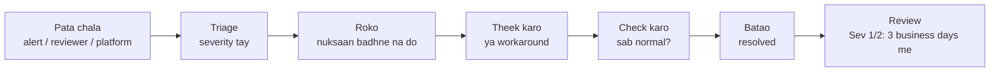

# Incident Response Playbook
# Fraud Detection Platform

| Item | Detail |
|---|---|
| Document | Incident Response Playbook |
| Version | 1.0 (review ke liye draft) |
| Date | 10 Oct 2026 |
| Organisation | MiraiGate Technologies |
| Related documents | Service Levels aur Timing; Deployment, Backup aur DR Runbook; Monitoring aur Drift Plan; Access Control aur Security Design |

---

## 1. Purpose aur Buniyadi Niyam

Scoring, data intake ya panel band ho jaye, ya security ka khatra ho, to team ko pata ho ki kya karna hai.

**Niyam:**
1. **Fail-open:** score sirf salah hai. Uske bina bhi withdrawals chalte rehte hain. Platform ka kaam kabhi system ke liye nahi rukta.
2. **Decisions sabse keemti hain.** Koi bhi step `review.db` aur `users.db` ko chhune se pehle backup leta hai.
3. **Pehle roko, phir theek karo, phir samjho.**
4. **Batate raho:** client ko time pe aur seedhi baat.
5. **Sab likho:** har incident log me jayega (Section 9).
6. Passwords, keys ya server addresses incident chat ya email me nahi likhe jaate.

---

## 2. Severity

| Severity | Udaharan | Response | Fix ya workaround | Client ko khabar |
|---|---|---|---|---|
| Sev 1 | Panel poora band; data leak ya account hack ka shak; `review.db` kharab | 30 minute | 4 ghante | 1 ghante me |
| Sev 2 | Daily batch fail; data 24 ghante se purana; galat model release; ingest feed band | 2 ghante | 1 business day | 4 ghante me |
| Sev 3 | Ek page ya filter galat; reason ka text galat; chhoti UI kami | 1 business day | Agli release | Weekly summary me |

Pakka na ho to upar wali severity maanein; baad me ghata sakte hain.

---

## 3. Roles

| Role | Kaun | Kaam |
|---|---|---|
| Incident lead | MiraiGate on-call | Severity tay, steps chalana, faisle |
| Communications | MiraiGate data lead | Client ko updates |
| Platform contact | Platform IT on-call | Feed, schema, platform side |
| Client contact | Client risk lead / lead reviewer | Reviewers ko batana; business faisle |
| Security lead (Sev 1 security) | MiraiGate admin | Containment, keys badalna, CERT-In (lagu ho to) |

Naam aur contact Section 8 me sign-off pe bhare jayenge.

---

## 4. Incident ka Rasta



**Pata kaise chalta hai:**
- alerts (Planned)
- roz ka health check (Runbook P-05)
- reviewers ki shikayat
- platform ki khabar
- weekly report

---

## 5. Playbooks

### IR-01: Panel Nahi Khul Raha (error, 502, timeout)
**Severity:** Sev 1

1. Domain browser me kholo. Error proxy ka hai ya nginx ka?
2. Server pe:
```bash
systemctl status fraud-panel --no-pager
```
```bash
journalctl -u fraud-panel -n 100 --no-pager
```
```bash
curl -fsS -o /dev/null -w "%{http_code}\n" http://127.0.0.1:8080/login
```
```bash
sudo nginx -t && systemctl status nginx --no-pager
```
```bash
df -h /opt /tmp
```
3. Service band ho to restart:
```bash
sudo systemctl restart fraud-panel
```
4. Haal hi me update hua tha to rollback (Runbook P-07).
5. Disk bhari ho to purane logs aur `/tmp` saaf karo; `data/` folder ko mat chhuo.
6. Server hi na mile to Runbook R-03.

### IR-02: Reviewers Sign In Nahi Kar Pa Rahe / Baar-baar Sign-out
**Severity:** Sev 2 (sab ke liye), Sev 3 (ek user)

1. "Sign-in paused" dikhe to 15 minute ka lockout hai. Ruko, ya galat koshishon ka source dekho:
```bash
sudo -u panel sqlite3 /opt/fraud-panel/data/users.db "SELECT datetime(at,'unixepoch','+5 hours','+30 minutes'), name, ip, ok FROM logins ORDER BY at DESC LIMIT 30;"
```
2. Baar-baar sign-out: kya wahi account doosre browser me khula hai? (Ek account ek browser.) Session table me `ended = 'replaced'` dekho.
3. Password bhool gaye: Runbook P-02 (`passwd`). Naya password secure channel se.
4. Ek hi account pe kai IPs se bahut koshishein → IR-08.

### IR-03: Panel Purana Data Dikha Raha Hai
**Severity:** Sev 2 (24 ghante se purana)

1. Sidebar me "Data up to" ki date.
2. Pipeline ka aakhri run hua? Report me error? (Abhi manual: workstation pe P-04 ke steps.)
3. Data bana par server tak nahi gaya: `push_update.ps1` dobara (P-03).
4. Ingest me hi naya data nahi: IR-04.

### IR-04: Ingest Feed Band (naye records nahi aa rahe)
**Severity:** Sev 2

1. Ingest server pe:
```bash
docker compose ps
```
```bash
curl http://localhost:8090/health
```
```bash
docker compose logs --tail 200 api
```
2. Mongo down ho to: `docker compose restart mongo`, phir api.
3. Service theek hai par records nahi aa rahe: platform IT ko batao (feed ya API key ka masla). Security group me platform ka IP badla to nahi?
4. Theek hone ke baad platform se kehna ki gap wale time ke records dobara bheje. Same `_id` dobara aane se duplicate nahi bante.

### IR-05: Kharab Data Batch (schema badla, counts ajeeb, bahut records bina data)
**Severity:** Sev 2

1. Batch ko scoring aur training me **mat lo** (quarantine). Panel pichhla data dikhata rahe.
2. Kya badla, ye likho: fields, types, counts, kuch sample `_id`.
3. Platform ko Data Contract ke hisaab se 1 business day me batao.
4. Theek batch aane pe normal run.

### IR-06: Galat Model Release (scores ajeeb, queue achanak bahut badi ya khaali)
**Severity:** Sev 2

1. Pichhle release se compare: queue size, 90%+ ka hissa, top badle scores.
2. Galat ho to **rollback**: panel data (P-07); anomaly model (P-08).
3. Client risk lead ko batao. Galat time me kiye gaye decisions ki list `decision_log` se nikaal ke lead reviewer ko do, taaki wo dobara dekhein.
4. Wajah dhoondhne ke baad hi agla release.

### IR-07: `review.db` Kharab ya Decisions Gayab
**Severity:** Sev 1

1. **Turant** service roko, aur jo file hai uski copy lo:
```bash
sudo systemctl stop fraud-panel
sudo cp -a /opt/fraud-panel/data/review.db /opt/fraud-panel/data/review.db.incident_$(date +%Y%m%d_%H%M)
```
2. Check:
```bash
sudo sqlite3 /opt/fraud-panel/data/review.db "PRAGMA integrity_check;"
```
3. Kharab ho to S3 backup se restore (Runbook R-01).
4. Backup ke baad ke decisions: reviewers ko batao ki us time ke players dobara dekhein.

### IR-08: Security Incident (account hack, key leak, anjaana access)
**Severity:** Sev 1

**Roko:**
- Account hack ka shak → us account ka password badlo (`fraud-panel-users passwd`). Isse session bhi khatam hota hai. Zarurat ho to account hatao.
- SSH key leak → security group se 22 band karo; nayi key; `authorized_keys` se purani hatao.
- Ingest API key leak → nayi key `.env` me, `docker compose up -d`, platform ko nayi key secure channel se.
- Anjaana access → server ka snapshot lo (saboot ke liye), phir naya server (Runbook R-03).

**Saboot rakho:**
- `logins` table
- `/var/log/auth.log`
- nginx logs
- `decision_log`

Inhe delete ya edit mat karo.

**Batao:**
- client ko 1 ghante me
- CERT-In ko 6 ghante me, agar lagu ho (Regulatory Compliance Matrix)

**Check karo:** kya data dekha ya bahar gaya? Haan ho to IR-09.

### IR-09: Data Leak (client data bahar gaya)
**Severity:** Sev 1

1. Leak ka rasta band karo (link, file, access).
2. Kya data, kitne users, kab se: likho.
3. Client ko 24 ghante ke andar likhit me (Data Privacy aur Retention Policy). Client DPDP ke hisaab se Board aur users ko batayega.
4. CERT-In, agar lagu ho, 6 ghante me.
5. Review aur sudhaar.

### IR-10: Server Poora Kho Gaya
**Severity:** Sev 1. Runbook R-03 (panel) ya R-04 (MongoDB).

---

## 6. Communication Templates

**Shuruaati khabar:**
> **Subject:** [Sev X] Fraud Review panel: <short problem>
> Humein <time IST> pe pata chala ki <kya ho raha hai>. Asar: <reviewers / data / scoring>. Withdrawals pe koi asar nahi; score sirf salah hai. Hum kaam kar rahe hain. Agla update <time> tak.

**Update:**
> **Subject:** [Sev X] Update: <short problem>
> Ab tak: <kya pata chala, kya kiya>. Abhi: <kya chal raha hai>. Agla update <time> tak.

**Theek ho gaya:**
> **Subject:** [Resolved] <short problem>
> <time IST> se sab normal hai. Wajah: <ek line>. Reviewers ke liye: <koi action, jaise X se Y ke beech ke decisions dobara dekhein>. Poora review <date> tak bhejenge.

---

## 7. Incident Review (Sev 1 aur Sev 2, 3 business days me)

| Section | Kya likhna hai |
|---|---|
| Summary | Kya hua, kab se kab tak, asar |
| Timeline | Pata chala, triage, roka, theek, resolved (IST) |
| Wajah | Asli wajah, bina kisi ko dosh diye |
| Kya achha chala, kya nahi | |
| Actions | Har action ka owner aur date |

---

## 8. Contacts (sign-off pe bharna)

| Role | Naam | Primary contact | Backup |
|---|---|---|---|
| MiraiGate on-call | | | |
| MiraiGate data lead | | | |
| MiraiGate admin | | | |
| Platform IT on-call | | | |
| Client risk lead | | | |
| Client lead reviewer | | | |

---

## 9. Incident Log

| # | Date | Severity | Short problem | Time to resolve | Review link |
|---|---|---|---|---|---|
| | | | | | |

## Change Log
| Version | Date | Badlav |
|---|---|---|
| 1.0 | 10 Oct 2026 | Pehla draft |
