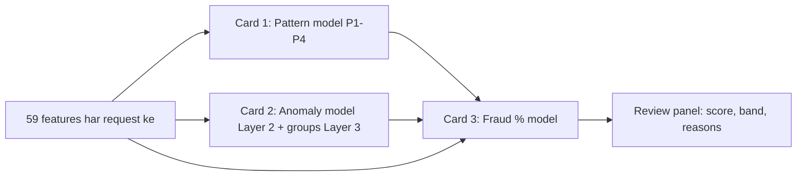

# Model Cards
# Fraud Detection Platform

| Item | Detail |
|---|---|
| Document | Model Cards (teen models) |
| Version | 1.0 (review ke liye draft) |
| Date | 10 Oct 2026 |
| Organisation | MiraiGate Technologies |
| Training data | 15 Sep 2026 00:01 se 8 Oct 2026 12:41 IST |
| Related documents | Labeling aur Ground-Truth Policy; Score aur Threshold Policy; Reason Code Catalogue; Monitoring aur Drift Plan |

Har model ka ek card hai:
- wo kya karta hai
- kis data pe train hua
- kitna achha chalta hai
- kahan uspe bharosa nahi karna chahiye

---

## Common: Training Data

| Item | Value |
|---|---|
| Requests | 56,425 (betting data wale 55,414) |
| Users | 18,004 |
| Fraud examples | 62 requests, 57 users (P1 22, P2 16, P3 23, P4 1) |
| Genuine | 54,587 requests |
| Training se bahar | Unknown 183, not fraud 38, watch 544, bina data 1,011 |
| Labels kaise bane | Labeling aur Ground-Truth Policy |
| Features | 59, sirf request ke time tak ke 20 din ke statements aur bets se |
| Feature me kabhi nahi | Status, remarks, reason, locks, `bet_status`, bet `reason` |

**Test ka tareeka (teeno models):**
- **User-wise split:** koi user ek saath training aur test dono me nahi.
- **Pattern chhupa ke test:** har fraud example ko aise test kiya jaata hai jaise uska pattern kabhi dekha hi na ho. Isse pata chalta hai ki naya pattern pakda ja sakta hai ya nahi.

---

## Card 1: Pattern Model (P1–P4)

| Item | Detail |
|---|---|
| Kaam | Request chaar known fraud patterns me se kisi jaisi hai ya nahi; pattern score 0–100 |
| Type | Rules + similarity score |
| Version | 8 Oct 2026 retrain (`rules.json`, `score_model.joblib`) |
| Owner | MiraiGate data team |
| Output | Har pattern ka score; sabse bada "main pattern" (order P2 > P1 > P3 > P4) |

### 1.1 Kaise Kaam Karta Hai
**Pattern score = 50 × (rule laga) + 25 × (limit se kitna aage) + 25 × (us pattern ke fraud examples se kitna milta hai).** Milan nearest-neighbour se naapa jaata hai, sabse paas ke 6 examples tak.

**Rules:**

| Pattern | Rule |
|---|---|
| P1 | Casino share ≥ 85% AUR (casino jeet ≥ 4 × deposit, YA deposit nahi aur casino jeet ≥ ₹10,000) |
| P2 | 1 deposit ≤ ₹1,000 AUR jeet ≥ 10 × deposit AUR casino ≥ 90% AUR account ≤ 30 din |
| P3 | ≥ 150 selections pe back + lay, YA ≥ 80 markets me 2+ runners pe back, YA (account < 2 din AUR ≥ 3 markets me 2+ runners pe back) |
| P4 | Deposit nahi AUR bonus ≥ ₹300 |

**Data se bani limits** (har retrain pe genuine requests se):

| Limit | Value | Genuine me isse neeche |
|---|---|---|
| Casino jeet / deposit | 4.0 | 99.4% |
| Jeet / deposit | 10.0 | 99.2% |
| Back + lay selections | 150 | 99.5% |
| 2+ runners pe back wale markets | 80 | 99.3% |

### 1.2 Nateeje
| Pattern | Fraud examples pe rule laga | Genuine pe rule laga | Chhupa ke test |
|---|---|---|---|
| P1 | 17 / 22 | 287 (0.53%) | 16 / 22 |
| P2 | 14 / 16 | 0 (0%) | 13 / 16 |
| P3 | 4 / 23 | 631 (1.16%) | 22 / 23 (Section 1.3 dekhein) |
| P4 | 1 / 1 | 0 (0%) | 0 / 1 |
| **Koi bhi** | **39 / 62** | **918 (1.68%)** | **51 / 62** |

**Time test** (genuine pe koi bhi rule):
- 15–19 Sep: 1.28%
- 20–24 Sep: 1.76%

### 1.3 Kamiyan
- **P4 ka sirf 1 example hai.** Chhupa ke test me rule ban hi nahi sakta. P4 ka score kamzor hai.
- **P3 ka asli rule sirf 4/23 pakadta hai.** Chhupa ke test ka 22/23 isliye achha dikhta hai kyunki test me naye-account wale hisse ki limit bahut dheeli ho jaati hai. P3 ke zyadatar examples Fraud % model ke "2+ runners pe back" aur naye account signals se aate hain.
- **P1** purane accounts me miss hota hai jahan casino jeet deposit ki 4 guna se kam thi (4 users).
- Genuine me bhi bade casino winners aur back-lay traders hain. P3 rule 1.16% genuine pe lagta hai.

---

## Card 2: Anomaly Model (Layer 2) aur Account Groups (Layer 3)

| Item | Detail |
|---|---|
| Kaam | Layer 2: request normal (genuine) users se kitni alag hai, "Unusual score" 0–100. Layer 3: ek master ke neeche ek jaise ajeeb users ke groups |
| Type | Layer 2: Isolation Forest (500 trees). Layer 3: same master + 72 ghante + paas wale ajeeb records ka jod |
| Training data | Sirf genuine requests; fraud kabhi nahi dikhaya jaata |
| Features | 58 (59 me se `master_cluster_users` nahi, kyunki wo P2 ki jaankari hai) |
| Version (lagu) | v5, 1 Oct 2026 15:52 se |
| Owner | MiraiGate data team |

### 2.1 Kaise Kaam Karta Hai
**Layer 2:**
- Model genuine requests se seekhta hai ki normal kaisa hota hai.
- Unusual score = approved requests me se kitne % is request se kam alag hain.
- 97+ pe panel "Different from normal users" me sabse alag 3 cheezein dikhata hai.

**Layer 3 (setting U = 95, D = 2.0):**
- Sirf wo requests jinka Unusual score 95 ya zyada hai.
- Same master, 72 ghante ke andar, aur 10 numbers (deposit, jeet/deposit, casino share, account age, bonus, bets, back-lay, 2+ runners waghera) pe doori 2.0 ya kam.
- Aise jude records me **3 ya zyada alag users** hon to group.

### 2.2 Nateeje (8 Oct ka weekly test)
| Measure | v5 (lagu) | v7 (naya candidate) | Limit |
|---|---|---|---|
| Pattern chhupa ke test (P1–P4) | 51 / 62 | 46 / 62 | Kam nahi hona chahiye |
| Jo sirf Layer 2/3 pakad sakte | 34 / 45 | 29 / 45 | Kam nahi hona chahiye |
| Genuine me galat alarm, Layer 2 (97+) | 3.3% | 3.0% | 3.5% tak |
| Genuine me galat alarm, Layer 3 | 0.80% | 0.40% | 0.6% tak |
| Roz ka bojh ("naya ho sakta hai") | ~76 | ~70 | – |

**Faisla:** v7 nahi lagaya, kyunki usne kam fraud pakde. v5 hi chal raha hai.

**Groups:** 15 Sep – 8 Oct me 75 groups, 1,559 requests, 1,165 users. Inme reject rate 5.0% hai; sab requests me 0.54%.

### 2.3 Versions
| Version | Date | Nateeja |
|---|---|---|
| v0 | Pehla (Step 2/3) | Lagu tha |
| v1 | 24 Sep | Lagu |
| v2 | 28 Sep | Lagu |
| v3 | 29 Sep | Nahi laga (chhupa ke test me 17 < 18) |
| v4 | 30 Sep | Lagu |
| **v5** | **1 Oct** | **Lagu (abhi tak)** |
| v6 | 5 Oct | Nahi laga (39 < 40) |
| v7 | 8 Oct | Nahi laga (46 < 51) |

Har version rakha jaata hai; ek command se pichhla lag sakta hai.

### 2.4 Kamiyan
- **Unusual ka matlab fraud nahi.** Bade deposit ya badi haar bhi "alag" hoti hai.
- Jo fraud bilkul normal jaisa dikhe, jaise bada casino winner, wo chhoot sakta hai.
- **Layer 3 ka galat alarm (0.80%) abhi limit (0.6%) se upar hai.** v5 rakhein ya v7 lein, ye faisla Open hai.
- IP, bet ka time aur withdrawal amount data me nahi hain. Inse jude groups nahi bante.

---

## Card 3: Fraud % Model

| Item | Detail |
|---|---|
| Kaam | Har request ko 0–99 Fraud % aur "Main reasons" dena |
| Type | Do chhote logistic models: A (known pattern) aur B (behaviour). Raw score = dono me jo bada. B ke har wazan ki disha pehle se tay |
| Training | Class-balanced, L2 regularisation (C = 1.0); user-wise 5 folds × 10 repeats se chuna |
| Calibration | Approved requests ke out-of-fold score se: 20 / 40 / 60 / 90 = top 10% / 3% / 1% / 0.1% |
| Version | 8 Oct 2026 (`fraud_pct.joblib`) |
| Owner | MiraiGate data team |

### 3.1 Inputs aur Wazan (B, standardised)
| Signal | Wazan | Signal | Wazan |
|---|---|---|---|
| Unusual score | +2.06 | Casino share | +0.21 |
| 2+ runners pe back | +1.26 | Bina deposit profit | +0.14 |
| Badi jeet | +0.73 | Bina deposit bonus | +0.11 |
| Top 1–3% unusual | +0.64 | Account group | +0.09 |
| Jeet / deposit | +0.62 | Casino jeet / deposit | +0.04 |
| Naya account (< 7 din) | +0.29 | Jeet / stake, haar, back + lay | 0 |

A me sirf pattern score hai. Purane account (30+ din) pe A aur B dono me shift lagta hai (Score aur Threshold Policy, Section 4).

### 3.2 Nateeje (user-wise test, out-of-fold)
| Tareeka | AUC | 1% alarm pe pakde | 3% alarm pe pakde | AP |
|---|---|---|---|---|
| **Fraud % (lagu)** | **0.984** | **66%** | **83%** | **0.257** |
| Fraud %, apna pattern chhupa ke | 0.963 | 37% | 62% | 0.160 |
| Sirf anomaly score | 0.965 | 24% | 71% | 0.026 |
| Sirf pattern score | 0.992 | 63% | 100% | 0.184 |
| Sirf pattern score, chhupa ke | 0.917 | 27% | 35% | 0.046 |

"1% alarm pe pakde" ka matlab: genuine me se sirf 1% ko flag karein to fraud examples ka kitna hissa pakda jayega.

**Band ke hisaab se (model akele, 95% minimum ke bina):**

| Band | Requests | Agent reject | Fraud examples |
|---|---|---|---|
| 90–99 | 124 | 37.1% | 20 |
| 60–89 | 575 | 7.8% | 22 |
| 40–59 | 1,152 | 2.2% | 10 |
| 20–39 | 3,926 | 0.9% | 7 |
| 0–19 | 49,637 | 0.25% | 3 |

- Genuine requests 90%+ pe: 0.03%.
- Fraud examples model akele 90%+ pe: 20 / 62.

**Pattern ke hisaab se (fraud examples, model akele):**

| Pattern | 60%+ pe | 90%+ pe | Median score |
|---|---|---|---|
| P1 | 17 / 22 | 4 / 22 | 74 |
| P2 | 16 / 16 | 16 / 16 | 99 |
| P3 | 8 / 23 | 0 / 23 | 54 |
| P4 | 1 / 1 | 0 / 1 | 66 |

**Account age ke hisaab se:**

| Age | Requests | 90%+ | Unme agent reject | Fraud examples |
|---|---|---|---|---|
| 0–7 din | 1,895 | 78 | 42% | 32 |
| 7–30 din | 2,910 | 40 | 33% | 10 |
| 30+ din | 50,609 | 6 | 0% | 20 |

### 3.3 Kahan Bharosa Na Karein
- **Score probability nahi hai.** 90% ka matlab "approved me se top 0.1%", "90% chance fraud" nahi.
- **P3 (back-lay)** pe kamzor: 23 me se sirf 8 hi 60%+ pe hain.
- **Purane accounts** ka score jaan-boojh ke kam rakha jaata hai. Purane account wala fraud (P1 me 16/22) neeche reh sakta hai.
- **Training fraud examples ka 95%** model ka score nahi, label ka niyam hai.
- **Bina betting data** wali requests ka score nahi banta.
- **July data pe bahar ka test:** client ki July wali rules list (921 users) aur model ke score ka milan kam tha (AUC 0.56). Rules list aur model alag cheezein dekhte hain; is list ko label nahi maana gaya.

---

## Validation aur Release

| Check | Kab | Limit |
|---|---|---|
| User-wise test (AUC, 1% aur 3% alarm pe catch) | Har retrain | Production se 0.005 AUC aur 5 points se zyada kam nahi |
| Pattern chhupa ke test | Har retrain | AUC production se 0.01 se zyada kam nahi |
| Genuine 90%+ pe | Har retrain | 0.1% ya kam |
| Anomaly ka chhupa ke test aur galat alarm | Har hafte | Section 2.2 ki limits |
| Time test (purana data train, naya test) | Har mahine | Report |

Model ka design run-dar-run nahi badalta; sirf data aur labels badhte hain. Design badalna ho to naya model card version banega.

## Change Log
| Version | Date | Badlav |
|---|---|---|
| 1.0 | 10 Oct 2026 | Pehla draft: pattern model (8 Oct), anomaly v5, Fraud % (8 Oct) |
