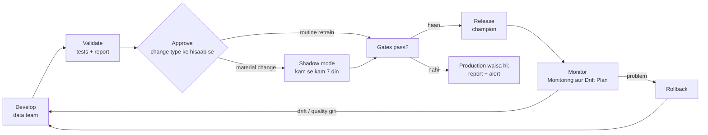

# Model Governance aur Validation
# Fraud Detection Platform

| Item | Detail |
|---|---|
| Document | Model Governance aur Validation |
| Version | 1.0 (review ke liye draft) |
| Date | 10 Oct 2026 |
| Organisation | MiraiGate Technologies |
| Related documents | Model Cards; Score aur Threshold Policy; Labeling aur Ground-Truth Policy; Continuous Learning aur Retraining Design; Monitoring aur Drift Plan; RACI |

**Status ka matlab:** **Bana hua** = abhi hota hai; **Planned** = banana hai.

---

## 1. Purpose

Industry ke model risk niyam kehte hain:
- model release se pehle validate ho
- ek naam se owner use approve kare
- use hote waqt uspe nazar rakhi jaye
- zarurat pade to pichhla version wapas lag sake

Ye document tay karta hai ki ye sab is system me kaise hoga: kaun kya karega, kaunse tests chalenge, kaunsa badlav kitni approval maangta hai, aur kya likha jayega.

**Scope:**
- pattern model (P1–P4 rules aur pattern score)
- anomaly model (Layer 2) aur group check (Layer 3)
- Fraud % model
- score ke niyam (calibration, purana account, bonus limit, training minimum)
- labeling niyam

---

## 2. Model Inventory

| Model | Kaam | Risk tier | Owner | Lagu version | Aakhri validation |
|---|---|---|---|---|---|
| Fraud % model | Har request ka 0–99 score; review queue isi se | **High** | MiraiGate data lead | 8 Oct 2026 | 8 Oct 2026 (cv_report) |
| Pattern model | P1–P4 rules aur pattern score | Medium | MiraiGate data lead | 8 Oct 2026 | 8 Oct 2026 (pattern test) |
| Anomaly model (Layer 2/3) | Unusual score, account groups | Medium | MiraiGate data lead | v5 (1 Oct 2026) | 8 Oct 2026 (weekly test) |
| Score niyam | Calibration, purana account, bonus limit, 95% minimum | High | Client risk lead | 8 Oct 2026 | Score Policy |
| Labeling niyam | Training labels | High | Client risk lead | 8 Oct 2026 | Labeling Policy |

**Risk tier:**
- **High:** seedha tay karta hai ki reviewer kya dekhega, ya model kya seekhega.
- **Medium:** High model ka input hai.

---

## 3. Model Lifecycle

---

## 4. Roles

| Role | Kaun | Kaam |
|---|---|---|
| Model owner | MiraiGate data lead | Model ka aakhri zimmedar; release approve (routine aur minor) |
| Developer | MiraiGate data team | Model banana, tests chalana, validation report ka draft |
| Validator | MiraiGate ka koi engineer jo us badlav ka developer nahi | Material change ki report check karna, tests dobara chalana |
| Business approver | Client risk lead | Material change aur score/label niyamon ka approval |
| Release admin | MiraiGate admin | Release aur rollback lagana |
| Lead reviewer | Client | Naye pattern ka approval; reviewers ka feedback |

Chhoti team me validator alag na mile, to client risk lead ke saath ek review meeting me report padhi jayegi aur ye bhi report me likha jayega.

---

## 5. Badlav ki Category aur Approval

| Category | Udaharan | Validation | Approval | Rollout |
|---|---|---|---|---|
| **Routine retrain** | Same design, naya data aur labels (weekly / 25 decisions) | Automatic gates (Section 7) | Gates pass = release (Open: admin approval chahiye ya nahi) | Seedha |
| **Minor** | Reason ka text; feature code ka bug fix jisse metrics na badlein; gate ki report me naya number | Short report; gates | Model owner; client risk lead ko khabar | Seedha |
| **Material** | Naya feature; naya model type; naya pattern rule (P5+); calibration points; queue limit; purana-account niyam; bonus limit; 95% minimum; labeling niyam | Poori validation report (Section 9) | Model owner + validator + **client risk lead** | Shadow mode, kam se kam 7 din |
| **Emergency** | Galat release ka rollback; score ka bada bug | Baad me | Model owner (client risk lead ko usi din khabar) | Turant; 3 business days me review |

**Niyam:** model ka design run-dar-run nahi badalta. Design ka koi bhi badlav **Material** hai.

---

## 6. Validation Tests

| # | Test | Kya dekhta hai | Kab | Status |
|---|---|---|---|---|
| V-01 | Data checks | Count, bina data, label counts, feature ranges | Har run | Partial (manual); Planned (automatic) |
| V-02 | User-wise cross-validation | AUC, 1% aur 3% galat alarm pe catch, AP; 5 folds × 10 repeats, koi user dono taraf nahi | Har retrain | Bana hua |
| V-03 | Pattern chhupa ke test | Har fraud example ka apna pattern chhupa ke AUC aur catch | Har retrain | Bana hua |
| V-04 | Rule ka leave-one-out test | Example hata ke rule dobara; hata hua pakda gaya? | Har retrain (pattern model) | Bana hua |
| V-05 | Anomaly ka chhupa ke test aur galat alarm | Layer 2 ≤ 3.5%, Layer 3 ≤ 0.6%, purane version se kam na pakde | Har hafte | Bana hua |
| V-06 | Out-of-time test | Purane hafton pe train, sabse naye hafte pe test | Har mahine, aur har material change | Partial (rules ka time test bana hua); Planned (Fraud %) |
| V-07 | Calibration check | Genuine me 20 / 40 / 60 / 90 ke upar ~10% / 3% / 1% / 0.1% | Har release | Bana hua (scale isi se banta hai) |
| V-08 | Segment checks | Account age, pattern, white label ke hisaab se catch aur galat alarm | Har release | Partial (age aur pattern bana hua) |
| V-09 | Champion vs challenger | Same data pe production aur candidate | Har release | Partial (anomaly me bana hua; Fraud % Planned) |
| V-10 | Simple baselines | Sirf pattern score, sirf anomaly se tulna | Har release | Bana hua (cv_report) |
| V-11 | Stability | Score shift (20+ points), PSI, queue size | Har release | Planned |
| V-12 | Explainability | Har reason ka English text Reason Code Catalogue me; panel me Hinglish nahi | Har build | Partial (missing text report hota hai) |
| V-13 | Business impact | Queue size, reviewer bojh, KPI-02/05/06 | Material change | Planned |

---

## 7. Quality Gates (Release se pehle)

| Gate | Limit | Fail pe |
|---|---|---|
| Data | Count 7 din ke trend ke 30% ke andar; bina data 5% se kam; fraud examples pichhle run se kam nahi (ya label log me wajah) | Block |
| AUC (V-02) | Production se 0.005 se zyada kam nahi | Block |
| AUC, pattern chhupa ke (V-03) | Production se 0.01 se zyada kam nahi | Block |
| Genuine 90%+ pe | 0.1% ya kam | Block |
| 1% galat alarm pe catch | Production se 5 points se zyada kam nahi | Block |
| Anomaly (V-05) | Section 6 ki limits | Block (anomaly version) |
| Reviewer agreement | 0.80 se kam ho to flag | Warn |
| Score shift | 10% se zyada requests 20+ points badlein to flag | Warn |
| Queue size | 30% se zyada badlav pe flag | Warn |

Warn wale gate release nahi rokte, par report me model owner ko dikhte hain. Material change me Warn pe bhi client risk lead ki raay li jaati hai.

---

## 8. Rollout

### 8.1 Shadow Mode (material change ke liye, Planned)
- Naya model har run me production ke saath chalta hai. Uska score save hota hai, **panel me nahi dikhta**.
- Kam se kam 7 din, ya jab tak 25 naye reviewer decisions na aa jayein.
- Compare karte hain:
  - dono models ka queue
  - reviewer decisions pe ranking
  - agent rejects pe catch
  - score shift
- Report model owner, validator aur client risk lead ko jaati hai.

### 8.2 Champion vs Challenger
- **Champion** = production model; **challenger** = candidate.
- Har release me challenger ko champion ke saamne same data pe test kiya jaata hai (Section 7).
- Challenger jeete aur gates pass hon, tabhi wo champion banta hai. Purana champion registry me rehta hai (rollback ke liye).
- Traffic split (kuch requests naye model se) nahi kiya jaata. Volume aur fraud examples kam hain, aur reviewers ko do alag scale dikhenge.

### 8.3 Rollback
**Kab:**
- release ke baad koi Block wala metric live data pe toote
- queue achanak 50% se zyada badle
- reviewers bade paimane pe galat cases bataayein

**Kaise:**
- Panel data aur models: Runbook P-07; automation ke baad release agent se ek step (5 minute)
- Anomaly: Runbook P-08 (`--wapas <version>`)

**Likhna:** rollback log (kisne, kab, kis release pe, kyun) aur incident (Sev 2).

---

## 9. Validation Report Template

Har material change aur har mahine ki review ke liye:

| Section | Kya likhna hai |
|---|---|
| 1. Summary | Kya badla, kyun, recommendation (release / nahi / shadow aur) |
| 2. Badlav | Code, features, niyam, data period, label counts |
| 3. Data | Training data ka time, requests, fraud examples pattern ke hisaab se, label ke badlav |
| 4. Results | V-02 se V-10 ke numbers, production ke saamne |
| 5. Segments | Account age, pattern, white label |
| 6. Business impact | Queue size, reviewer bojh, KPIs |
| 7. Kamiyan aur risk | Kahan model kamzor hai; naye risks |
| 8. Shadow results | Material change me |
| 9. Approvals | Model owner, validator, client risk lead: naam aur date |

Report run ke saath rakhi jaati hai aur Model Cards ka change log update hota hai.

---

## 10. Periodic Review

| Review | Kab | Kaun | Kya |
|---|---|---|---|
| Weekly | Har Monday | MiraiGate data team | Retrain ka nateeja, gates, anomaly test |
| Monthly model review | Mahine ka pehla hafta | MiraiGate data lead + client risk lead | Monitoring trends, labeling niyamon ka milan, out-of-time test, open decisions |
| Quarterly validation | Har 3 mahine | Validator + model owner | Poori validation report (Section 9), segments, targets |
| Annual governance review | Har saal | MiraiGate + client | Ye document, roles, risk tiers |

---

## 11. Ab tak ke Model Badlav

| Date | Model | Badlav | Nateeja |
|---|---|---|---|
| 23 Sep 2026 | Pattern model | Pehla version: P1–P4 rules aur pattern score | Lagu |
| 24 Sep 2026 | Anomaly | v1 | Lagu |
| 28 Sep 2026 | Anomaly | v2 | Lagu |
| 28–30 Sep 2026 | Fraud % | Pehla version: pattern + behaviour, calibration | Lagu |
| 29 Sep 2026 | Anomaly | v3 | **Nahi laga**: chhupa ke test me kam pakde (17 < 18) |
| 29 Sep 2026 | Labels | Review list: same master ke 6 naye accounts (P2) | Lagu |
| 30 Sep 2026 | Anomaly | v4 | Lagu |
| 1 Oct 2026 | Anomaly | v5 | **Lagu (abhi tak)** |
| 1 Oct 2026 | Labels | Review list: 3 rejects | Lagu |
| 5 Oct 2026 | Anomaly | v6 | **Nahi laga**: kam pakde (39 < 40) |
| 8 Oct 2026 | Saare | Retrain (data 8 Oct tak); review list me 5 cases; "P2 jaisa data, approved" watch group; bonus jeet ki limit; panel pe "Confirmed fraud" ki jagah agent ka faisla | Lagu |
| 8 Oct 2026 | Anomaly | v7 | **Nahi laga**: kam pakde (46 < 51) |

---

## 12. Abhi ki Kamiyan aur Actions

| # | Kami | Action | Priority |
|---|---|---|---|
| 1 | Material changes (jaise 8 Oct ki bonus limit) client ke saath chat me tay hue, report nahi bani | Section 9 ka template agle material change se | P1 |
| 2 | Fraud % ka out-of-time test nahi | V-06 har mahine | P1 |
| 3 | Shadow mode nahi bana | Automation Phase 2–3 | P2 |
| 4 | Score shift aur PSI ki report nahi | V-11, Monitoring Plan ke saath | P1 |
| 5 | Validator alag nahi | Naam tay karna | P1 |
| 6 | Layer 3 ka galat alarm (v5: 0.80%) limit se upar, par v7 kam pakadta hai | Client ke saath faisla (Open) | P1 |
| 7 | Routine retrain apne aap release ho ya admin approval se | Faisla (Open) | P1 |

## Change Log
| Version | Date | Badlav |
|---|---|---|
| 1.0 | 10 Oct 2026 | Pehla draft |
