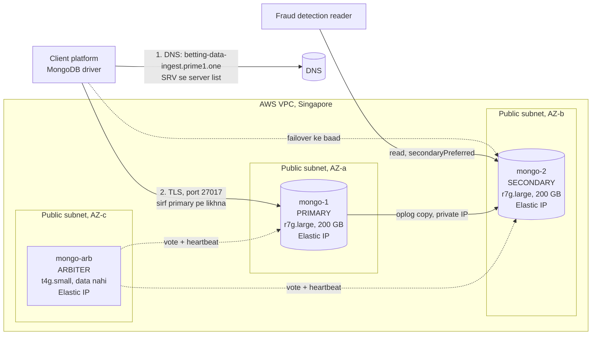

# SRS: MongoDB Replica Set (live data intake)

| Item         | Detail                                                                           |
| ------------ | -------------------------------------------------------------------------------- |
| Document     | Software Requirements Specification, MongoDB replica set                         |
| Version      | 1.5                                                                              |
| Date         | 14 Oct 2026                                                                      |
| Organisation | MiraiGate Technologies                                                           |
| Related      | Fraud Detection System SRS; Platform Data Contract; System Architecture Document |

---

## 1. Purpose

Client platform live betting data seedha ek MongoDB database me daalega. Fraud detection system wahan se padh ke fraud score dega.

Ye database ek **replica set** hoga, AWS ke **Singapore region** me:

- **2 data servers** honge, aur data hamesha dono pe rahega.
- **1 arbiter** hoga, jo sirf vote deta hai.
- Primary girne pe doosra server **apne aap 10–12 second me** primary ban jaata hai.
- Client ko sirf ek naam milega: **`betting-data-ingest.prime1.one`**.

Data temporary hai. Score dene ke liye kuch din rakha jaata hai, phir apne aap hat jaata hai (RS-07).

## 2. Scope

- **Included:**
  - MongoDB replica set aur uske servers
  - network, ports aur DNS
  - users aur security
  - monitoring aur failover
  - create karne ke steps
- **Not included:**
  - client ka data bhejne wala code (uski zarooratein Section 5 me hain)
  - scoring aur panel (unke apne documents me)

## 3. Architecture

### 3.1 Diagram



### 3.2 Members

| Member      | DNS naam                                   | AZ   | Instance                         | Disk                                        | Kaam                        | Votes | Priority |
| ----------- | ------------------------------------------ | ---- | -------------------------------- | ------------------------------------------- | --------------------------- | ----- | -------- |
| `mongo-1`   | `mongo-1.betting-data-ingest.prime1.one`   | AZ-a | `r7g.large` (2 vCPU, 16 GB, ARM) | 20 GB (OS) + 200 GB gp3 (data, alag volume) | Data. Shuru me primary      | 1     | 1        |
| `mongo-2`   | `mongo-2.betting-data-ingest.prime1.one`   | AZ-b | `r7g.large` (2 vCPU, 16 GB, ARM) | 20 GB (OS) + 200 GB gp3 (data, alag volume) | Data. Shuru me secondary    | 1     | 1        |
| `mongo-arb` | `mongo-arb.betting-data-ingest.prime1.one` | AZ-c | `t4g.small` (2 vCPU, 2 GB, ARM)  | Sirf 20 GB (OS)                             | Sirf vote. Data nahi rakhta | 1     | 0        |

- Software: MongoDB 8.0 Community, Ubuntu 24.04 ARM64 (teeno pe).
- Teeno alag AZ me hain, taaki ek AZ band hone pe baaki do chalte rahein.
- Dono data servers ki priority barabar hai. Jo primary hai wahi bana rehta hai; bina wajah switch nahi hota.

### 3.3 Teeno kaise kaam karenge

1. **Connect:**
   - Client `betting-data-ingest.prime1.one` ka SRV record padhta hai, aur use `mongo-1` aur `mongo-2` ki list milti hai.
   - Phir woh dono se poochta hai ki primary kaun hai.
   - Arbiter ko driver khud dhoondh leta hai.
2. **Write:** client sirf primary pe likhta hai.
3. **Copy (replication):**
   - Primary har badlav apni **oplog** (badlavon ki list) me likhta hai.
   - Secondary lagatar oplog padh ke wahi badlav apne data pe lagata hai.
   - Ye copy private IP se hoti hai, aur isme kuch millisecond lagte hain.
4. **Heartbeat:** teeno servers har 2 second ek doosre ko check karte hain.
5. **Vote:**
   - Primary banne ke liye 3 me se 2 vote chahiye.
   - Koi bhi ek server gire, to baaki do milke primary chun lete hain.
   - Arbiter sirf yahi teesra vote deta hai.
6. **Reads:**
   - Fraud detection reader `secondaryPreferred` se padhega, yaani jo bhi secondary hai usse.
   - Secondary band ho to reader apne aap primary se padhega.

### 3.4 Kuch girne pe kya hoga

| Kya hua                       | Kya hota hai                                                                                                                                                                 | Hum kya karenge                                                                                       |
| ----------------------------- | ---------------------------------------------------------------------------------------------------------------------------------------------------------------------------- | ----------------------------------------------------------------------------------------------------- |
| Primary gira, ya uska AZ down | Bacha hua data server + arbiter = 2 vote. Woh **10–12 second me apne aap primary** ban jaata hai, aur driver khud naye primary se jud jaata hai                              | Kuch nahi. Alert aayega; gira hua server theek karna hai                                              |
| Gira hua server wapas aaya    | Woh khud secondary ban ke judta hai aur copy baraabar kar leta hai. Jo writes girne ke waqt copy nahi hue the (kuch millisecond ke), woh `rollback` folder me save hote hain | Kuch nahi                                                                                             |
| Secondary gira                | Primary + arbiter = 2 vote, to likhna chalta rehta hai. Bas copy ruk jaati hai                                                                                               | Alert aayega. 24 ghante se zyada band rahe to OPS-06                                                  |
| Arbiter gira                  | Dono data servers = 2 vote, to kuch farq nahi padta                                                                                                                          | Alert aayega. Arbiter jaldi theek karna hai, kyunki tab tak ek aur server girne pe failover nahi hoga |
| Disk kharab                   | Doosre server pe poori copy hai                                                                                                                                              | Naya volume lagayenge, initial sync karenge                                                           |
| Dono data servers gire        | Database band                                                                                                                                                                | Snapshot se wapas laayenge (OPS-01)                                                                   |

## 4. Network, Ports aur DNS

### 4.1 Network

| Cheez      | Kaise                                                                                             |
| ---------- | ------------------------------------------------------------------------------------------------- |
| Region     | Singapore (`ap-southeast-1`)                                                                      |
| VPC        | Ek VPC, 3 AZ                                                                                      |
| Subnets    | 3 **public** subnets: AZ-a (`mongo-1`), AZ-b (`mongo-2`), AZ-c (`mongo-arb`). Private subnet nahi |
| Public IP  | Har server pe ek **Elastic IP** (fixed). Restart pe bhi nahi badalta                              |
| Private IP | Har server ka fixed private IP. Servers aapas me isi se baat karte hain                           |
| Internet   | Internet gateway (VPC ke saath aata hai). NAT gateway aur load balancer nahi                      |

### 4.2 Security group `sg-mongo`

Teeno servers pe ek hi security group lagega, `sg-mongo`.

**Inbound rules:**

| Port      | Source                                   | Kis liye                                                              |
| --------- | ---------------------------------------- | --------------------------------------------------------------------- |
| TCP 27017 | `sg-mongo` (khud)                        | Teeno servers aapas me: copy, heartbeat, vote                         |
| TCP 27017 | Client ka IP `/32` (har IP ka alag rule) | Client data likhega (driver arbiter ko bhi check karta hai)           |
| TCP 27017 | Reader ka IP `/32`                       | Fraud detection data padhega                                          |
| TCP 22    | Admin ka IP `/32`                        | SSH login. Setup ke dauraan thodi der `0.0.0.0/0`, phir sirf admin IP |

- **Port 27017 ke do rules kyun:** port ek hi hai, par aane wale alag hain. Ek rule teeno servers ke liye hai, doosra bahar wale client aur reader ke liye.
- **Outbound:** default (sab allowed). OS updates, MongoDB packages aur CloudWatch ke liye.
- **`0.0.0.0/0` 27017 pe kabhi nahi**, sivaay Section 4.4 wale case ke.

### 4.3 DNS

**Ek naam, teen server:**

- Har server ka apna DNS naam hai (Section 3.2).
- Client ko sirf **`betting-data-ingest.prime1.one`** diya jaata hai. Is naam pe SRV record hai, jo driver ko `mongo-1` aur `mongo-2` ki list deta hai.
- Ye naam khud data aage nahi bhejta. Sirf list deta hai, phir driver seedha primary se judta hai.
- Ek A record se kaam nahi chalta: primary failover pe badalta hai, to ek server pe point kiya naam galat server pe le jaayega.

**Bahar ka DNS** (jahan `prime1.one` ka DNS hai; Cloudflare ho to **"DNS only"**, proxy off):

| Record                                         | Type | Value                                                                             | TTL |
| ---------------------------------------------- | ---- | --------------------------------------------------------------------------------- | --- |
| `mongo-1.betting-data-ingest.prime1.one`       | A    | `mongo-1` ka Elastic IP                                                           | 60  |
| `mongo-2.betting-data-ingest.prime1.one`       | A    | `mongo-2` ka Elastic IP                                                           | 60  |
| `mongo-arb.betting-data-ingest.prime1.one`     | A    | `mongo-arb` ka Elastic IP                                                         | 60  |
| `_mongodb._tcp.betting-data-ingest.prime1.one` | SRV  | priority 0, weight 0, port 27017, target `mongo-1.betting-data-ingest.prime1.one` | 60  |
| `_mongodb._tcp.betting-data-ingest.prime1.one` | SRV  | priority 0, weight 0, port 27017, target `mongo-2.betting-data-ingest.prime1.one` | 60  |
| `betting-data-ingest.prime1.one`               | TXT  | `replicaSet=rs0&authSource=admin`                                                 | 60  |

**Andar ka DNS** (Route 53 **private** hosted zone `betting-data-ingest.prime1.one`, Singapore VPC se judi hui):

- Upar wale **saare 6 records** isme bhi banenge.
- Farak sirf itna hai ki teeno A records me **private IP** hoga.

**Isse kya hota hai:**

- Client (bahar) ko naam se Elastic IP milta hai.
- Servers (andar) ko wahi naam private IP deta hai. Isliye aapas ki copy private network se hoti hai, aur `sg-mongo` wala rule kaam karta hai.

**Niyam:**

- Private zone sirf `betting-data-ingest.prime1.one` ka banega, `prime1.one` ka nahi. Warna VPC ke andar baaki `prime1.one` naam kaam karna band kar denge.
- Replica set config aur certificates me **IP nahi, yahi naam** jaayenge.

**Connection strings** (password yahan nahi likhte):

| Kaun   | String                                                                                                               |
| ------ | -------------------------------------------------------------------------------------------------------------------- |
| Client | `mongodb+srv://client_writer@betting-data-ingest.prime1.one/fraud?tlsCAFile=ca.pem&retryWrites=true`                 |
| Reader | `mongodb+srv://fraud_reader@betting-data-ingest.prime1.one/fraud?tlsCAFile=ca.pem&readPreference=secondaryPreferred` |

- `mongodb+srv` me TLS apne aap on rehta hai.
- Replica set ka naam aur `authSource` TXT record se aate hain.
- `ca.pem` hamare CA ka public certificate hai, jo client ko denge.

### 4.4 Agar client IP nahi deta

Client ka IP na mile to 27017 ka client wala rule `0.0.0.0/0` hoga. Tab **client certificate (mutual TLS)** zaroori hai, yaani server sirf usi ko andar aane dega jiske paas hamara diya certificate hai. Bina certificate wala connection TLS pe hi kat jaata hai, MongoDB tak pahunchta hi nahi.

Badlav:

1. `mongod.conf` se `allowConnectionsWithoutCertificates: true` wali line hata do (teeno pe), aur `mongod` restart karo.
2. Step 9 wale CA se `client_writer` aur `fraud_reader` ke certificate banao (`extendedKeyUsage=clientAuth`).
3. Client ki string me `&tlsCertificateKeyFile=client_writer.pem` judega.
4. Server pe admin login ke liye `mongosh ... --tlsCertificateKeyFile /etc/mongodb/tls/<naam>.pem` lagega.

Pehle client se "egress IP" (unke servers jis IP se internet pe jaate hain) maangna hai. Woh na mile tabhi ye tareeka.

## 5. Functional Requirements

| ID    | Requirement                                                                                                                                                                                |
| ----- | ------------------------------------------------------------------------------------------------------------------------------------------------------------------------------------------ |
| RS-01 | Replica set `rs0`: `mongo-1` + `mongo-2` (data) + `mongo-arb` (arbiter)                                                                                                                    |
| RS-02 | Primary girne pe naya primary apne aap 10–12 second me bane; client ka driver khud naye primary se jude                                                                                    |
| RS-03 | Database `fraud`, collections: `surveillance`, `bets`, `statements`                                                                                                                        |
| RS-04 | Client ka data har ~10 second aayega                                                                                                                                                       |
| RS-05 | Secondary pe copy ~10 ms me (normal load pe)                                                                                                                                               |
| RS-06 | Default write concern `w:1`. Arbiter wale set me yahi sahi hai: `w:majority` pe ek data server girte hi writes ruk jaate                                                                   |
| RS-07 | Data **60 din** rakhenge, phir TTL index se apne aap hatega. Score ke baad data ka seedha kaam nahi, par model score ke liye user ki purani bets dekhta hai, isliye itne din chahiye       |
| RS-08 | Users aur roles Section 6.1 ke hisaab se                                                                                                                                                   |
| RS-09 | Indexes: har collection pe `_id`, `user_id` aur time field (TTL)                                                                                                                           |
| RS-10 | Client ko ye karna hoga: `retryWrites=true`; har record ka fixed `_id` (dobara bhejne pe duplicate na bane); write fail ho to data apne paas rakh ke dobara bheje (failover me ~15 second) |

## 6. Security

| ID     | Requirement                                                                                                                |
| ------ | -------------------------------------------------------------------------------------------------------------------------- |
| SEC-01 | Port 27017 sirf client, reader aur aapas ke servers ke liye khula. Client IP na mile to Section 4.4                        |
| SEC-02 | Authentication hamesha on (SCRAM-SHA-256); members ke beech `keyFile`                                                      |
| SEC-03 | TLS hamesha on (`requireTLS`), hamare apne CA ke certificates                                                              |
| SEC-04 | Server login SSH se, sirf key pair se (password login band). Port 22 sirf admin ke IP ke liye. Key file sirf admin ke paas |
| SEC-05 | EBS volumes encrypted                                                                                                      |
| SEC-06 | Termination protection on; data volume "delete on termination" off; IMDSv2 required                                        |
| SEC-07 | Passwords, keyFile aur CA key AWS Secrets Manager me (console se save). Code, file ya chat me kabhi nahi                   |

### 6.1 Users

| User            | Role                      | Kya kar sakta hai                                        |
| --------------- | ------------------------- | -------------------------------------------------------- |
| `admin`         | `root`                    | Sirf setup aur emergency                                 |
| `client_writer` | Custom role `fraudWriter` | `fraud` DB me insert, update, find. Delete aur drop nahi |
| `fraud_reader`  | `read` on `fraud`         | Sirf padhna                                              |
| `monitor`       | `clusterMonitor`          | Status aur metrics padhna                                |

## 7. Server settings

| Cheez                  | Value                                                         | Kyun                                                                                 |
| ---------------------- | ------------------------------------------------------------- | ------------------------------------------------------------------------------------ |
| Data volume            | Alag 200 GB gp3 (3,000 IOPS, 125 MB/s), XFS, `/data` pe mount | MongoDB ke liye XFS recommended hai; OS se alag rakhne pe resize aur snapshot aasaan |
| Transparent Huge Pages | Enable (`always`, defrag `defer+madvise`)                     | MongoDB 8.0 ke liye yahi recommended hai                                             |
| `ulimit`               | 64000 (MongoDB package ki service me pehle se set)            | Connections aur files                                                                |
| `vm.swappiness`        | 1                                                             | Memory disk pe na jaye                                                               |
| Time                   | `chrony` + Amazon Time Sync                                   | Replication ke liye sahi time zaroori                                                |
| WiredTiger cache       | Default (~7.5 GB data servers pe)                             | Taaza data aur indexes memory me                                                     |
| Oplog                  | Kam se kam 48 ghante                                          | Secondary 2 din band rahe tab bhi bina poori copy ke baraabar ho jaaye               |

## 8. Non-Functional Requirements

| ID     | Requirement                | Target                                                                                                                   |
| ------ | -------------------------- | ------------------------------------------------------------------------------------------------------------------------ |
| NFR-01 | Koi bhi ek server girne pe | Likhna chalta rahe                                                                                                       |
| NFR-02 | Failover time              | 10–12 second, apne aap                                                                                                   |
| NFR-03 | Data loss                  | Sirf woh writes jo girne ke waqt copy nahi hue the (kuch millisecond ke), aur woh bhi `rollback` file me save rehte hain |
| NFR-04 | Replication lag            | Normal load pe 10 ms se kam; 1 second se zyada pe alert                                                                  |
| NFR-05 | Write latency              | p95 50 ms se kam (server pe)                                                                                             |
| NFR-06 | Disk                       | 200 GB har data server; 70% pe alert                                                                                     |

## 9. Operations

| ID     | Requirement                                                                                                                                                                                         |
| ------ | --------------------------------------------------------------------------------------------------------------------------------------------------------------------------------------------------- |
| OPS-01 | Roz EBS snapshot dono data volumes ka (Data Lifecycle Manager), 3 din rakhna. Ye sirf galti se data delete hone ya dono servers girne ke case ke liye hai                                           |
| OPS-02 | CloudWatch agent (CPU, memory, disk) + har minute member state, lag aur connections                                                                                                                 |
| OPS-03 | Alerts (SNS → email): primary nahi hai; koi member down; lag > 1 s; disk > 70%; CPU > 80% 15 min tak                                                                                                |
| OPS-04 | Mahine me ek baar failover test: primary pe `rs.stepDown()`, aur 15 second me naya primary bane                                                                                                     |
| OPS-05 | OS patching ek-ek karke: arbiter → secondary → primary pe `rs.stepDown()` → purana primary. Writes sirf election ke 10–12 second rukte hain aur retry ho jaate hain                                 |
| OPS-06 | Koi data server 24 ghante se zyada band rahe, to uske votes 0 aur priority 0 kar do (MongoDB ki arbiter-set guidance), taaki primary pe memory ka dabav na badhe. Wapas aane pe votes 1, priority 1 |

## 10. Teesra data server (jab zaroorat ho)

**Kab:**

- client ko har write pe pakki do-copy guarantee (`w:majority`) chahiye;
- ya volume itna badhe ki ek aur copy chahiye.

**Kaise (downtime nahi):** arbiter ki jagah data server aata hai.

1. `mongo-3` banao: AZ-c, `mongo-1` jaisa spec, Elastic IP.
   - Naam `mongo-3.betting-data-ingest.prime1.one` dono DNS me banao.
   - SRV me ek line aur jodo.
   - Uska certificate banao.
2. Pehle bina vote ke jodo, aur copy poori hone do (`rs.status()` me SECONDARY):
   `rs.add({ host: "mongo-3.betting-data-ingest.prime1.one:27017", priority: 0, votes: 0 })`
3. Arbiter hatao: `rs.remove("mongo-arb.betting-data-ingest.prime1.one:27017")`
4. `mongo-3` ko vote do:
   ```js
   cfg = rs.conf();
   m = cfg.members.find((x) => x.host.startsWith("mongo-3"));
   m.votes = 1;
   m.priority = 1;
   rs.reconfig(cfg);
   ```
5. Default write concern majority karo:
   `db.adminCommand({ setDefaultRWConcern: 1, defaultWriteConcern: { w: "majority" } })`
6. Arbiter instance band karke hata do.

## 11. Create karne ke steps

Placeholders: `<naam>` = `mongo-1`, `mongo-2` ya `mongo-arb`; `<private IP>` = us server ka private IP. Passwords hamesha prompt pe type karo, kahin likho mat.

### Step 1: VPC (AWS console → Singapore region → VPC → Create VPC → "VPC and more")

| Setting                       | Value       |
| ----------------------------- | ----------- |
| Name                          | `mongo`     |
| Number of AZs                 | 3           |
| Public subnets                | 3           |
| Private subnets               | 0           |
| NAT gateways                  | None        |
| VPC endpoints                 | None        |
| DNS hostnames, DNS resolution | Dono enable |

### Step 2: Key pair aur IAM role

1. **EC2 → Key pairs → Create key pair:**
   - naam `mongo-key`, type ED25519, format `.pem`
   - File download hogi. Use safe rakho aur kisi ko mat do; ye dobara download nahi hoti.
2. **IAM → Roles → Create role → AWS service → EC2:**
   - naam `mongo-ec2-role`
   - policy `CloudWatchAgentServerPolicy` (monitoring ke liye)

### Step 3: Security group (EC2 → Security Groups → Create)

1. Naam `sg-mongo`, VPC `mongo`. Pehle bina rule ke save karo.
2. Phir **Edit inbound rules** me Section 4.2 ke rules jodo:
   - TCP 27017, source `sg-mongo` (list se chuno)
   - TCP 27017, source client ka IP `/32`
   - TCP 27017, source reader ka IP `/32`
   - TCP 22, source abhi `0.0.0.0/0`. Setup ke baad sirf aapka IP `/32`

### Step 4: Teeno servers launch karo (EC2 → Launch instance)

| Setting                           | `mongo-1`                                            | `mongo-2`          | `mongo-arb`        |
| --------------------------------- | ---------------------------------------------------- | ------------------ | ------------------ |
| AMI                               | Ubuntu Server 24.04 LTS, **64-bit (Arm)**            | same               | same               |
| Instance type                     | `r7g.large`                                          | `r7g.large`        | `t4g.small`        |
| Key pair                          | `mongo-key`                                          | `mongo-key`        | `mongo-key`        |
| VPC / Subnet                      | `mongo`, public subnet AZ-a                          | public subnet AZ-b | public subnet AZ-c |
| Auto-assign public IP             | Disable (Elastic IP lagayenge)                       | same               | same               |
| Security group                    | `sg-mongo`                                           | `sg-mongo`         | `sg-mongo`         |
| Root disk                         | 20 GB gp3, encrypted                                 | same               | same               |
| Extra disk                        | 200 GB gp3, encrypted, delete on termination **off** | same               | Nahi               |
| Advanced → IAM instance profile   | `mongo-ec2-role`                                     | same               | same               |
| Advanced → Termination protection | Enable                                               | Enable             | Enable             |
| Advanced → Metadata version       | V2 only                                              | same               | same               |
| Name tag                          | `mongo-1`                                            | `mongo-2`          | `mongo-arb`        |

### Step 5: Elastic IPs (EC2 → Elastic IPs)

1. **Allocate Elastic IP address**, 3 baar.
2. Har ek pe **Actions → Associate**, aur ek-ek server se jodo.
3. Har server ka Elastic IP aur private IP note karo (EC2 → Instances me dikhta hai). Agle step me DNS ke liye chahiye. Kisi file ya chat me save mat karo.

### Step 6: DNS

1. **Bahar ka (jahan `prime1.one` ka DNS hai):** Section 4.3 ke 6 records banao (3 A, 2 SRV, 1 TXT). A records Elastic IP pe, proxy off.
2. **Andar ka (Route 53 → Hosted zones → Create hosted zone):**
   - Domain name `betting-data-ingest.prime1.one`
   - Type **Private hosted zone**
   - Region Singapore, VPC `mongo`
   - Usme wahi 6 records banao, par teeno A records **private IP** pe.
3. **Check:**
   - Apne PC se:

     ```bash
     nslookup -type=SRV _mongodb._tcp.betting-data-ingest.prime1.one
     ```

     Isme dono servers ke naam aane chahiye.

   - Kisi server pe (Step 7 ke baad):

     ```bash
     getent hosts mongo-2.betting-data-ingest.prime1.one
     ```

     Isme private IP aana chahiye.

### Step 7: OS setup (teeno pe, SSH se)

Login (apne PC se, jahan `mongo-key.pem` hai):

```bash
ssh -i mongo-key.pem ubuntu@mongo-1.betting-data-ingest.prime1.one
```

Teeno pe:

```bash
sudo apt-get update && sudo apt-get -y upgrade
sudo apt-get install -y gnupg curl chrony

# Amazon Time Sync
echo "server 169.254.169.123 prefer iburst minpoll 4 maxpoll 4" | sudo tee /etc/chrony/conf.d/aws.conf
sudo systemctl restart chrony

# swappiness
echo "vm.swappiness=1" | sudo tee /etc/sysctl.d/90-mongodb.conf
sudo sysctl --system

# Transparent Huge Pages (MongoDB 8.0)
sudo tee /etc/systemd/system/enable-thp.service >/dev/null <<'EOF'
[Unit]
Description=Enable Transparent Hugepages for MongoDB
Before=mongod.service
[Service]
Type=oneshot
ExecStart=/bin/sh -c 'echo always > /sys/kernel/mm/transparent_hugepage/enabled && echo defer+madvise > /sys/kernel/mm/transparent_hugepage/defrag && echo 0 > /sys/kernel/mm/transparent_hugepage/khugepaged/max_ptes_none'
[Install]
WantedBy=multi-user.target
EOF
sudo systemctl daemon-reload && sudo systemctl enable --now enable-thp
```

Sirf `mongo-1` aur `mongo-2` pe, data disk lagao:

```bash
lsblk                       # 200G wala disk dhoondo, jaise nvme1n1
DISK=/dev/nvme1n1           # lsblk me jo naam dikhe wahi
sudo mkfs.xfs $DISK
sudo mkdir -p /data
echo "UUID=$(sudo blkid -s UUID -o value $DISK) /data xfs defaults,noatime,nofail 0 2" | sudo tee -a /etc/fstab
sudo mount -a && df -h /data
```

### Step 8: MongoDB install (teeno pe)

```bash
curl -fsSL https://www.mongodb.org/static/pgp/server-8.0.asc | sudo gpg -o /usr/share/keyrings/mongodb-server-8.0.gpg --dearmor
echo "deb [ arch=amd64,arm64 signed-by=/usr/share/keyrings/mongodb-server-8.0.gpg ] https://repo.mongodb.org/apt/ubuntu noble/mongodb-org/8.0 multiverse" | sudo tee /etc/apt/sources.list.d/mongodb-org-8.0.list
sudo apt-get update
sudo apt-get install -y mongodb-org
```

Sirf `mongo-1` aur `mongo-2` pe:

```bash
sudo mkdir -p /data/db && sudo chown -R mongodb:mongodb /data
```

### Step 9: Certificates aur keyFile

**9a. Banana (sirf `mongo-1` pe, ek baar):**

```bash
sudo -i
mkdir -p /root/mongo-ca && cd /root/mongo-ca && chmod 700 .
ZONE=betting-data-ingest.prime1.one

openssl genrsa -out ca.key 4096
openssl req -x509 -new -key ca.key -sha256 -days 3650 -subj "/CN=fraud-mongo-ca" -out ca.pem

for H in mongo-1 mongo-2 mongo-arb; do
  openssl genrsa -out $H.key 2048
  openssl req -new -key $H.key -subj "/CN=$H.$ZONE" -out $H.csr
  printf "subjectAltName=DNS:$H.$ZONE,DNS:localhost\nextendedKeyUsage=serverAuth,clientAuth\n" > $H.ext
  openssl x509 -req -in $H.csr -CA ca.pem -CAkey ca.key -CAcreateserial -days 825 -sha256 -extfile $H.ext -out $H.crt
  cat $H.key $H.crt > $H.pem
done

openssl rand -base64 756 > keyfile
```

**9b. `mongo-1` pe lagana:**

```bash
mkdir -p /etc/mongodb/tls
cp ca.pem mongo-1.pem /etc/mongodb/tls/
cp keyfile /etc/mongodb/keyfile
chown -R mongodb:mongodb /etc/mongodb
chmod 600 /etc/mongodb/keyfile /etc/mongodb/tls/*.pem
```

**9c. `mongo-2` aur `mongo-arb` pe lagana (copy-paste se, do SSH windows khol ke):**

Har file ke liye:

1. `mongo-1` pe file dikhao, jaise `cat /root/mongo-ca/mongo-2.pem`, aur poora text copy karo.
2. Doosre server pe ye chalao, text paste karo, phir Enter aur `Ctrl+D` dabao:
   ```bash
   sudo mkdir -p /etc/mongodb/tls
   sudo tee /etc/mongodb/tls/<naam>.pem >/dev/null     # yahan paste, phir Ctrl+D
   ```

Teen files bhejni hain:

| `mongo-1` pe file           | Doosre server pe kahan        |
| --------------------------- | ----------------------------- |
| `/root/mongo-ca/ca.pem`     | `/etc/mongodb/tls/ca.pem`     |
| `/root/mongo-ca/<naam>.pem` | `/etc/mongodb/tls/<naam>.pem` |
| `/root/mongo-ca/keyfile`    | `/etc/mongodb/keyfile`        |

Phir us server pe:

```bash
sudo chown -R mongodb:mongodb /etc/mongodb
sudo chmod 600 /etc/mongodb/keyfile /etc/mongodb/tls/*.pem
```

**9d. Safai (`mongo-1` pe):**

1. `ca.key` aur `keyfile` ka text AWS Secrets Manager me save karo (console → Secrets Manager → Store a new secret → Other type of secret), naam `mongo/ca-key` aur `mongo/keyfile`.
2. Phir:
   ```bash
   shred -u /root/mongo-ca/ca.key
   ```

### Step 10: `mongod.conf` (teeno pe)

`/etc/mongod.conf` ko poora is se badlo (`sudo nano /etc/mongod.conf`):

```yaml
storage:
  dbPath: /data/db # mongo-arb pe: /var/lib/mongodb
  oplogMinRetentionHours: 48 # mongo-arb pe ye line hata do
systemLog:
  destination: file
  path: /var/log/mongodb/mongod.log
  logAppend: true
  logRotate: reopen
net:
  port: 27017
  bindIp: localhost,<private IP>
  tls:
    mode: requireTLS
    certificateKeyFile: /etc/mongodb/tls/<naam>.pem
    CAFile: /etc/mongodb/tls/ca.pem
    allowConnectionsWithoutCertificates: true # users password se login karte hain (Section 4.4 me ye line hategi)
security:
  authorization: enabled
  keyFile: /etc/mongodb/keyfile
replication:
  replSetName: rs0
```

`bindIp` me private IP hi aata hai, Elastic IP nahi. Bahar se aaya traffic AWS khud private IP pe bhejta hai.

Phir:

```bash
sudo systemctl enable --now mongod
sudo systemctl status mongod --no-pager      # "active (running)" dikhna chahiye
```

### Step 11: Replica set shuru karo (sirf `mongo-1` pe)

```bash
mongosh "mongodb://localhost:27017/?tls=true&tlsCAFile=/etc/mongodb/tls/ca.pem"
```

```js
rs.initiate({
  _id: "rs0",
  members: [{ _id: 0, host: "mongo-1.betting-data-ingest.prime1.one:27017" }],
});
// 5-10 second ruko, prompt me "primary" aa jaaye
db.getSiblingDB("admin").createUser({
  user: "admin",
  pwd: passwordPrompt(),
  roles: ["root"],
});
exit;
```

`admin` se dobara login karo:

```bash
mongosh "mongodb://localhost:27017/admin?tls=true&tlsCAFile=/etc/mongodb/tls/ca.pem" -u admin
```

```js
// arbiter wale set ke liye default write concern (arbiter jodne se pehle zaroori)
db.adminCommand({ setDefaultRWConcern: 1, defaultWriteConcern: { w: 1 } });

rs.add("mongo-2.betting-data-ingest.prime1.one:27017");
rs.addArb("mongo-arb.betting-data-ingest.prime1.one:27017");

// 1-2 minute baad: PRIMARY, SECONDARY, ARBITER dikhna chahiye
rs.status().members.map((m) => [m.name, m.stateStr]);
```

### Step 12: Users, collections aur indexes (`mongo-1` pe, `admin` se)

```js
admin = db.getSiblingDB("admin");
admin.createRole({
  role: "fraudWriter",
  roles: [],
  privileges: [
    {
      resource: { db: "fraud", collection: "" },
      actions: ["find", "insert", "update"],
    },
  ],
});
admin.createUser({
  user: "client_writer",
  pwd: passwordPrompt(),
  roles: [{ role: "fraudWriter", db: "admin" }],
});
admin.createUser({
  user: "fraud_reader",
  pwd: passwordPrompt(),
  roles: [{ role: "read", db: "fraud" }],
});
admin.createUser({
  user: "monitor",
  pwd: passwordPrompt(),
  roles: ["clusterMonitor"],
});

f = db.getSiblingDB("fraud");
["surveillance", "bets", "statements"].forEach((c) => {
  f.createCollection(c);
  f[c].createIndex({ user_id: 1 });
});
// TTL index client ka time field pata chalne pe (field Date type hona chahiye), jaise:
// f.bets.createIndex({ created_at: 1 }, { expireAfterSeconds: 60 * 24 * 3600 })
```

Passwords Secrets Manager me `mongo/<user>` naam se save karo.

### Step 13: Snapshot (EC2 → Lifecycle Manager → Create lifecycle policy)

- Policy type: EBS snapshot.
- Target: `mongo-1` aur `mongo-2` ke 200 GB volumes. Pehle volumes pe ek tag lagao, jaise `backup=mongo`, aur policy me wahi tag chuno.
- Schedule: roz ek baar, retention 3.

### Step 14: Monitoring

- CloudWatch agent teeno pe lagao (memory aur disk ke liye).
- Alarms: har instance ka `StatusCheckFailed`, disk > 70%, CPU > 80%. Sab SNS topic → email.
- MongoDB ka state aur lag: `monitor` user se har minute ek chhoti script CloudWatch me bhejegi (OPS-02, OPS-03).

### Step 15: Test aur band karna

**Client wale IP se:**

```bash
mongosh "mongodb+srv://client_writer@betting-data-ingest.prime1.one/fraud?tlsCAFile=ca.pem"
```

**Failover test:**

1. `mongo-1` pe `admin` se `rs.stepDown()` chalao.
2. 15 second me `mongo-2` PRIMARY ban jaana chahiye.
3. Client connection bina kuch badle likhta rehna chahiye.

**Security test:** kisi aur IP se (jo security group me nahi hai) 27017 pe connection **fail** hona chahiye.

**Aakhri kaam:** `sg-mongo` me port 22 ka source `0.0.0.0/0` se badal ke sirf aapka IP `/32` karo.

## 12. Acceptance Criteria

1. `rs.status()` me ek PRIMARY, ek SECONDARY aur ek ARBITER dikhe.
2. Client test user sample data (`sample_risk_events.json`) likh paaye. `fraud_reader` padh paaye par likh na paaye. `client_writer` delete na kar paaye.
3. Primary band karne (ya `rs.stepDown()`) pe 15 second ke andar naya primary bane, aur client bina connection string badle likhne lage.
4. Secondary ya arbiter band karne pe client ke writes chalte rahein.
5. Normal load pe replication lag 10 ms ke aas-paas rahe; 1 ghante ka naap report me ho.
6. Bina TLS, galat password ya allowed list ke bahar wale IP se connection na ho. Port 22 sirf admin IP ke liye ho.
7. DNS: SRV record dono data servers ke naam de. Bahar se A records Elastic IP dein, aur server pe private IP.
8. Snapshot roz ban raha ho.

## 13. Kharcha (mahina, Singapore, tax ke bina)

| Cheez                                                 | Kharcha   |
| ----------------------------------------------------- | --------- |
| 2 × `r7g.large`                                       | ~$189     |
| 1 × `t4g.small` (arbiter)                             | ~$15      |
| 2 × 200 GB + 3 × 20 GB gp3                            | ~$44      |
| 3 Elastic IPs (public IPv4)                           | ~$11      |
| **Kul**                                               | **~$260** |
| Snapshots, data transfer (AZ ke beech copy ~$0.01/GB) | Alag, kam |

Ye rates ek third-party price list se hain. AWS Pricing Calculator me confirm karna hai.

## 14. Client se chahiye

| #   | Kya                                                                                           |
| --- | --------------------------------------------------------------------------------------------- |
| 1   | Client ke servers ka egress IP (jis IP se woh internet pe jaate hain). Na mile to Section 4.4 |
| 2   | Teeno collections ke fields aur time field                                                    |
| 3   | Data format: har bet ek baar alag collection me, ya har record me poori history               |
| 4   | Live betting pe roz kitni bets (200 GB disk isi se check hogi)                                |

Client ko hum denge:

- connection string `mongodb+srv://client_writer@betting-data-ingest.prime1.one/fraud`
- `client_writer` ka password (alag, secure tareeke se)
- `ca.pem`
- Section 4.4 ka case ho to client certificate bhi

## Change Log

| Version | Date        | Badlav                                                                                                                                                                                         |
| ------- | ----------- | ---------------------------------------------------------------------------------------------------------------------------------------------------------------------------------------------- |
| 1.0     | 13 Oct 2026 | Pehla draft                                                                                                                                                                                    |
| 1.1     | 13 Oct 2026 | 2 servers, manual failover, ports, DNS                                                                                                                                                         |
| 1.2     | 13 Oct 2026 | NLB + `horizons`, `db.internal`, NAT gateway, 60 din                                                                                                                                           |
| 1.3     | 13 Oct 2026 | Arbiter joda: automatic failover, `w:1` default. Create karne ke steps                                                                                                                         |
| 1.4     | 13 Oct 2026 | Singapore region. Public subnet + Elastic IP. Split DNS. Sirf 3 din ke snapshots                                                                                                               |
| 1.5     | 14 Oct 2026 | Asli naam `betting-data-ingest.prime1.one`, SRV + TXT records, `mongodb+srv` string. Login SSH key pair se; port 22 setup ke baad sirf admin IP. Client IP na mile to mutual TLS (Section 4.4) |
