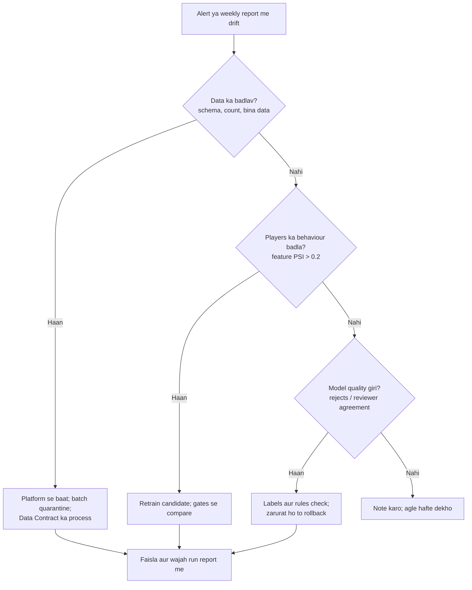

# Monitoring aur Drift Plan
# Fraud Detection Platform

| Item | Detail |
|---|---|
| Document | Monitoring aur Drift Plan |
| Version | 1.0 (review ke liye draft) |
| Date | 10 Oct 2026 |
| Organisation | MiraiGate Technologies |
| Baseline data | 15 Sep se 8 Oct 2026 |
| Related documents | Model Cards; Service Levels aur Timing; Data Quality aur Lineage; Incident Response Playbook |

**Status:** abhi monitoring manual hai: weekly anomaly report aur har retrain ki reports. Is plan ke alerts aur reports automation ke Phase 2 aur 3 me banenge.

---

## 1. Purpose

Players ka behaviour aur platform ka data waqt ke saath badalte hain. Jis model pe nazar nahi rakhi jaati, wo bina bataye kamzor ho jaata hai. Ye plan tay karta hai:
- kya naapa jayega aur kitni baar
- normal kya hai (baseline)
- alert kab jayega aur kaun jawab dega
- drift dikhe to kya karna hai

---

## 2. Kya Naapa Jayega

| Layer | Kya | Kyun |
|---|---|---|
| 1. System health | Runs, panel, ingest feed | Kuch band to nahi |
| 2. Data | Freshness, volume, completeness, schema | Kharab data chupchaap score badalta hai |
| 3. Features | Main features ka distribution | Players ya platform badle |
| 4. Scores | Score aur bands ka distribution, queue size | Model ka bartaav badla |
| 5. Model quality | Agent rejects aur reviewer decisions se milan | Model sahi pakad raha hai ya nahi |
| 6. Review operations | Backlog, response time, reviewers ka takraav | Labels time pe aur ek jaise ban rahe hain |

---

## 3. Baseline (Hafte ke hisaab se)

| Hafta | Requests | 20%+ | 60%+ | 90%+ | Queue players (60%+) | Agent reject | Bina data |
|---|---|---|---|---|---|---|---|
| 15–20 Sep | 11,743 | 10.4% | 0.84% | 0.09% | 77 | 0.47% | 6.6% |
| 21–27 Sep | 13,795 | 11.3% | 1.77% | 0.47% | 169 | 0.52% | 0.4% |
| 28 Sep – 4 Oct | 21,752 | 9.7% | 1.06% | 0.25% | 156 | 0.47% | 0.5% |
| 5–8 Oct (adhoora) | 8,124 | 11.2% | 1.46% | 0.43% | 89 | 0.59% | 0.4% |

Baaki baseline:

| Measure | Value |
|---|---|
| Roz ke requests | Average 2,351, median 2,107, max 4,803 |
| Genuine requests 90%+ pe | 0.03% |
| Fraud examples model akele 60%+ pe | 42 / 62 (68%) |
| Layer 2 galat alarm (97+) | 3.3% |
| Layer 3 galat alarm | 0.80% |
| Rejects jo Normal band (0–19) me the | 125 / 277 (45%) |

Pehle hafte me "bina data" zyada tha, kyunki data feed shuru ho raha tha. Baseline har mahine pichhle 4 hafton se dobara banega.

---

## 4. Metrics, Limits aur Alerts

### 4.1 System Health
| Metric | Kitni baar | Warning | Critical | Kaun |
|---|---|---|---|---|
| Run ka status | Har run | – | Koi stage fail | MiraiGate on-call |
| Run ka time | Har run | Usual ka 1.5 guna | Usual ka 2 guna | MiraiGate on-call |
| Panel check (sign-in page + data) | Har 5 minute | 1 fail | 2 fail lagataar | MiraiGate on-call |
| Ingest feed: aakhri record kab aaya | Har 15 minute | 30 minute se koi record nahi (din me) | 2 ghante se koi record nahi | Platform IT + MiraiGate |

### 4.2 Data
| Metric | Kitni baar | Warning | Critical | Kaun |
|---|---|---|---|---|
| Panel me sabse naye request ki umar | Har ghante | 6 ghante (08:00–23:00 IST) | 26 ghante | MiraiGate data team |
| Roz ka count, 7 din ke average se | Roz | ±30% | ±50% | MiraiGate data team |
| Bina data wale requests | Roz | 2% | 5% (batch quarantine) | MiraiGate data team |
| Schema fail records | Roz | 0.1% | 1% | MiraiGate + Platform IT |
| Naye enum values | Roz | Koi bhi | – | MiraiGate data team |

### 4.3 Feature Drift
**Tareeka:** Population Stability Index (PSI), pichhle 4 hafton ke saamne. 10 hisse, genuine requests pe.

**Features:**
- `casino_share`
- `pl_to_dep`
- `casino_net_to_dep`
- `account_age_days`
- `dep_sum`
- `bonus_sum`
- `n_bets`
- `n_sel_both_sides`
- `multi_runner_back`
- `pct_odds_changed`
- `total_game_pl`

| PSI | Matlab | Action |
|---|---|---|
| 0.1 se kam | Stable | Kuch nahi |
| 0.1 se 0.2 | Thoda badla | Weekly report me |
| 0.2 se zyada | Bada badlav | Alert; Section 5 ka process |

Kitni baar: har hafte, aur har release se pehle (quality gate ka hissa).

### 4.4 Score Drift
| Metric | Kitni baar | Warning | Critical |
|---|---|---|---|
| Fraud % ka PSI (4 hafton ke saamne) | Har hafte | 0.1 | 0.2 |
| 60%+ ka hissa | Har hafte | 0.6% se kam ya 2.5% se zyada | 0.4% se kam ya 3.5% se zyada |
| 90%+ ka hissa | Har hafte | 0.6% se zyada | 1% se zyada |
| Queue me naye players (hafte me) | Har hafte | 250 se zyada | 400 se zyada |
| Release ke baad 20+ points badle scores | Har release | 10% requests | 20% requests |

### 4.5 Model Quality
| Metric | Kitni baar | Warning | Critical |
|---|---|---|---|
| Agent rejects ka band ke hisaab se hissa (90%+ me reject rate) | Har hafte | 25% se kam | 15% se kam |
| Data wale rejects jo Normal band me | Har hafte | 50% se zyada | 60% se zyada |
| Genuine requests 90%+ pe | Har release | 0.08% | 0.1% (gate) |
| Fraud examples model akele 60%+ pe | Har release | 60% se kam | 50% se kam |
| Reviewer agreement: Fraud vs Not fraud decisions ki ranking (AUC) | Har hafte | 0.85 se kam | 0.80 se kam |
| Queue precision: review hue 60%+ players me Fraud ka hissa | Har hafte | Report | 4 hafte lagataar girta trend |
| Spot check (60% se neeche random) me Fraud mile | Har hafte | 1 bhi mile to review | 3 ya zyada |

### 4.6 Anomaly Model
| Metric | Kitni baar | Limit |
|---|---|---|
| Layer 2 galat alarm (genuine 97+) | Har hafte | 3.5% |
| Layer 3 galat alarm | Har hafte | 0.6% |
| Pattern chhupa ke test | Har hafte | Pichhle version se kam nahi |
| Roz ka "naya ho sakta hai" bojh | Har hafte | ±30% |

### 4.7 Review Operations
| Metric | Kitni baar | Warning | Critical |
|---|---|---|---|
| Queue me sabse purana waiting player | Roz | 24 ghante | 48 ghante |
| Very high (90%+) player bina review | Roz | 4 ghante | 12 ghante |
| Waiting players | Roz | 100 | 200 |
| Reviewers ke beech ulte faisle (7 din me) | Har hafte | 3 | 10 |
| Bina saaf wajah ke agent rejects | Har hafte | 35% | 50% |

---

## 5. Drift Dikhe To Kya Karein

| Situation | Action | Kaun | Kab tak |
|---|---|---|---|
| Data ka badlav | Batch quarantine; platform ko khabar | MiraiGate data team | 1 business day |
| Feature drift, quality theek | Agle weekly retrain me naya data; report me note | MiraiGate data team | Agla retrain |
| Feature drift aur quality giri | Early retrain; gates pass na hon to rules aur labels review | MiraiGate data lead | 3 business days |
| Naya release ke baad quality giri | Rollback; incident (Sev 2) | MiraiGate data lead | 5 minute rollback, report 1 din |
| Queue bahut badh gayi | Score Policy ke owner se baat; limit ya rule review | Client risk lead + MiraiGate | 2 business days |
| Spot check me fraud mile | Naya pattern ya label review; Taxonomy update | MiraiGate + client risk lead | Agla monthly review |

Har drift ka faisla aur wajah run report ya incident log me likha jayega.

---

## 6. Reports

| Report | Kab | Kisko | Kya hai |
|---|---|---|---|
| Daily health | Roz 09:00 IST | MiraiGate team | Run status, data ki umar, counts, alerts |
| Weekly summary | Monday, retrain ke baad | MiraiGate + client risk lead | Requests, decisions, labels, release outcome, metrics vs pichhla hafta, drift, queue me bade badlav |
| Monthly model review | Mahine ka pehla hafta | MiraiGate + client risk lead | Section 4 ke saare trends, labeling niyamon ka milan, Taxonomy ke numbers, open decisions |

---

## 7. Kahan Dikhega

| Jagah | Kya | Status |
|---|---|---|
| Panel sidebar | "Model updated" aur "Data up to" ki date | Bana hua |
| Run reports | Har run ke metrics aur gates | Bana hua (manual runs) |
| Anomaly weekly report | Layer 2/3 ke numbers | Bana hua |
| Panel admin view | Run history, alerts, trends, rollback | Planned (Phase 3) |
| Alerts | Email operations group ko (chat Open) | Planned (Phase 2) |

---

## 8. Ownership

| Kaam | Owner |
|---|---|
| Alerts ka jawab (system aur data) | MiraiGate on-call |
| Drift aur model quality ke faisle | MiraiGate data lead |
| Score limits aur queue | Client risk lead |
| Review backlog | Client lead reviewer |
| Is plan ka review | Har 3 mahine, MiraiGate data lead + client risk lead |

## Change Log
| Version | Date | Badlav |
|---|---|---|
| 1.0 | 10 Oct 2026 | Pehla draft |
