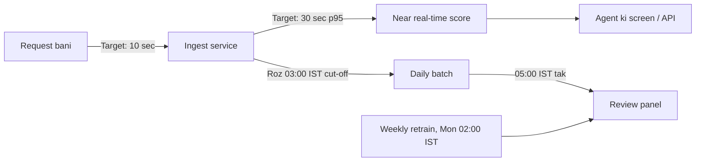

# Service Levels aur Timing
# Fraud Detection Platform

| Item | Detail |
|---|---|
| Document | Service Levels aur Timing |
| Version | 1.0 (review ke liye draft) |
| Date | 10 Oct 2026 |
| Organisation | MiraiGate Technologies |
| Data period | 15 Sep se 8 Oct 2026 (24 din, 56,425 requests) |
| Related documents | System SRS; Platform Data Contract; Continuous Learning aur Retraining Design; Monitoring aur Drift Plan |

**Status ka matlab:**
- **Abhi** = aaj aisa chal raha hai
- **Target** = proposal, client sign-off ke baad lagu
- **Open** = faisla baaki

---

## 1. Purpose

Ye document batata hai ki system ka har hissa kitne time me kaam karega, kab chalega, aur deadline chhoot jaye to kya hoga. Targets platform ke asli data se nikale gaye hain. Card payment wale latency numbers (10 se 20 ms) yahan lagu nahi hote, kyunki yahan faisla agent leta hai aur use minute lagte hain.

---

## 2. Data se Mili Baatein

### 2.1 Volume
| Measure | Value |
|---|---|
| Roz ka average | 2,351 requests |
| Roz ka median | 2,107 requests |
| Sabse bada din | 4,803 requests |
| Ek ghante me average | 30 (raat 3–5 baje) se 151 (raat 10–11 baje) tak |
| Ek ghante me sabse zyada | 1,036 requests |
| Ghante ka 95th percentile | 252 requests |
| Ek minute me sabse zyada | 62 requests |
| Minute ka 99th percentile | 11 requests |

**Ghante ke hisaab se average (IST):**

| Time | Requests/ghanta | Time | Requests/ghanta |
|---|---|---|---|
| 00–01 | 137 | 12–13 | 95 |
| 01–02 | 79 | 13–14 | 112 |
| 02–03 | 41 | 14–15 | 93 |
| 03–04 | 30 | 15–16 | 85 |
| 04–05 | 31 | 16–17 | 98 |
| 05–06 | 44 | 17–18 | 108 |
| 06–07 | 73 | 18–19 | 139 |
| 07–08 | 91 | 19–20 | 127 |
| 08–09 | 114 | 20–21 | 125 |
| 09–10 | 117 | 21–22 | 140 |
| 10–11 | 97 | 22–23 | 151 |
| 11–12 | 97 | 23–24 | 124 |

Sabse kam traffic **raat 2 se 6 baje** ke beech hai. Batch run aur maintenance isi time me rakhe gaye hain.

### 2.2 Agent ke Faisle ka Time
Ye request bante hi (`createdAt`) se agent ke faisle (`action_time`) tak ka time hai.

| Percentile | Sab requests | Approved | Rejected |
|---|---|---|---|
| 10% | 0.7 min | 0.7 min | 1.4 min |
| 25% | 1.3 min | 1.3 min | 2.8 min |
| 50% (median) | 2.7 min | 2.7 min | 6.2 min |
| 75% | 6.2 min | 6.2 min | 11.5 min |
| 90% | 11.8 min | 11.8 min | 25.2 min |
| 95% | 17.1 min | 17.0 min | 27.5 min |
| 99% | 39.5 min | 39.4 min | 80.3 min |

**Matlab:** agent ki madad tabhi hogi jab score **42 second ke andar** aa jaye, kyunki 10% faisle isse pehle ho jaate hain.

### 2.3 Data Kab Aata Hai
| Measure | Median | 99th percentile |
|---|---|---|
| Agent ke faisle se ingest service tak | 1.8 second | 10.7 second |
| Request bante hi se ingest service tak | 2.8 minute | 39.6 minute |

**Sabse ahem baat:** platform har request ko **agent ka faisla hone ke baad** bhejta hai. Isliye aaj score agent ke faisle me madad nahi kar sakta; wo sirf baad me review aur seekhne ke kaam aata hai. Near real-time path (Section 3.1) ke liye platform ko request **bante hi** bhejni hogi (Platform Data Contract, gap G-01).

---

## 3. Service Paths

### 3.1 Near Real-time Scoring (Planned)
| Item | Target |
|---|---|
| Platform se request ka aana | Request bante hi, 10 second ke andar |
| Request aane se score milne tak | p95 30 second, p99 60 second |
| Throughput | 120 requests/minute (dekhe gaye peak 62/minute ka 2 guna) |
| Roz ki capacity | 5,000 requests bina hardware badle |
| Availability | 99.5% mahine me |
| Output | Fraud %, band, top 3 reasons, known pattern |

**Fail-open:** score 60 second me na aaye to withdrawal process nahi rukta. Agent apna kaam karta hai, request "Score late" mark hoti hai, aur agle batch me score ho jaati hai.

### 3.2 Daily Batch Refresh (Planned)
| Step | Time (IST) |
|---|---|
| Data cut-off aur run shuru | 03:00 |
| Ingest service se naye records ka pull | 03:00–03:15 |
| Validation aur features | 03:15–03:40 |
| Current model se scoring | 03:40–04:00 |
| Panel data ka release (release agent har 10 minute dekhta hai) | 04:00–04:30 |
| **Panel me naya data dikh jana chahiye** | **05:00 tak** |

**Abhi:** data ki JSON exports haath se aati hain, 1 se 4 din ke gap pe (24 Sep, 26, 28, 29, 1 Oct, 5, 7, 8). Panel ka data utna hi purana hota hai.

### 3.3 Weekly Retrain (Planned)
| Item | Target |
|---|---|
| Schedule | Har Monday 02:00 IST |
| Early trigger | Pichhli release ke baad 25 naye reviewer decisions (din me max ek extra run) |
| Feedback cut-off | Panel ka export 23:30 IST (pichhli raat) |
| Run ka time | 1 ghante ke andar |
| Release | Quality gates pass hon to 05:00 IST tak panel me |
| Report | 09:00 IST tak team ko |

**Abhi:** retrain haath se chalta hai. Ek run me lagbhag 20 minute machine time aur kai ghante analyst ka kaam lagta hai.

### 3.4 Review Panel
| Item | Target |
|---|---|
| Availability | 99% har mahine; maintenance window ke bahar |
| Pehla load (dashboard data, ~8 MB gzip) | 5 second se kam |
| Statements/bets ka ek page (100 rows) | 1 second se kam |
| Decision submit | 1 second se kam |
| Service band ho jaye | systemd 3 second me dobara chalu kare |
| Maintenance window | Raat 02:00–05:00 IST, 24 ghante pehle notice |

### 3.5 Reviewer Response (Proposal, Open)
| Band | Player queue me aane ke baad review |
|---|---|
| Very high (90–99) | 4 ghante ke andar |
| High (60–89) | 24 ghante ke andar |
| Spot check (random, 60 se neeche) | 7 din ke andar |

Reviewers ke kaam ke ghante client batayega. Ye targets unhi ghanton me gine jayenge.

---

## 4. Data Freshness

| Measure | Abhi | Target (batch) | Target (real-time) |
|---|---|---|---|
| Request bani se panel me score dikhne tak | 1 se 4 din | 26 ghante max (03:00 cut-off ke turant baad aayi request agle din 05:00 tak) | 1 minute |
| Reviewer decision se training tak | Manual, tay nahi | Agli weekly ya early run (max 7 din) | Same |
| Statements ka window | Request se pehle ke 20 din | Same | Same |

**Alert:** panel me sabse naye request ki umar din ke time (08:00–23:00 IST) 6 ghante se zyada ho jaye, ya batch 06:00 tak na aaye.

---

## 5. Deadline Chhoot Jaye To

| Kya hua | System kya karega | Kaun jawab dega | Kitni der me |
|---|---|---|---|
| Real-time score 60 second me nahi aaya | Withdrawal chalta rahega (fail-open); request batch me score hogi | Automatic | – |
| Daily pull fail hua (network) | 1, 5 aur 15 minute ke gap pe 3 retry | Automatic, phir on-call | Alert 15 minute me |
| Data validation fail (batch quarantine) | Panel pichhla data dikhata rahega; sidebar me "Data up to" purani date dikhegi | MiraiGate data team | 1 business day me fix |
| Daily batch 05:00 IST tak release nahi hua | Alert; panel pichhla data dikhata rahega | MiraiGate on-call | Response 2 ghante |
| Retrain ka quality gate fail | Current model chalta rahega; naya data current model se score hoga | MiraiGate data team | Report usi din |
| Panel down | systemd restart; na chale to on-call | MiraiGate on-call | Response 30 minute, fix 4 ghante |
| Platform data bhejna band (koi naya record nahi) | Alert; panel pichhla data dikhata rahega | Platform IT + MiraiGate | Response 2 ghante |

---

## 6. Incident Severity

| Severity | Udaharan | Response | Fix ya workaround |
|---|---|---|---|
| Sev 1 | Panel band; real-time scoring band; data leak ka shak | 30 minute | 4 ghante |
| Sev 2 | Daily batch fail; data 24 ghante se purana; galat model release | 2 ghante | 1 business day |
| Sev 3 | Ek page ya filter galat; reason ka text galat | 1 business day | Agli release |

Har Sev 1 aur Sev 2 ke baad 3 business days me incident review likha jayega.

---

## 7. Backup aur Recovery

| Item | Target |
|---|---|
| Review aur accounts database ka backup | Roz, S3 me |
| Recovery Point Objective (RPO) | 24 ghante |
| Recovery Time Objective (RTO) | 4 ghante |
| Server disk snapshot | Har hafte |
| Restore test | Har mahine |
| Model aur panel releases | Har version rakha jayega; rollback 5 minute me |

---

## 8. Measurement aur Reporting

**Kaise naapa jayega:**

| Time ka hissa | Kahan se |
|---|---|
| Request bani | `createdAt` |
| Agent ka faisla | `action_time` |
| Ingest me aaya | `ingested_at` |
| Score bana | `scored_at` (naya field, banana hai) |
| Panel me aaya | Release manifest ka time |
| Reviewer ka faisla | Decision ka `at` |

**Report:**
- **Har hafte:** batch ka time, data ki umar, failures, queue me sabse purana request.
- **Har mahine:** SLA report: har target ke saamne asli number, aur incidents ki list.

---

## 9. Open Decisions

| # | Sawaal | Proposal |
|---|---|---|
| 1 | Near real-time path kab banega? | Data Contract ka gap G-01 band hone ke baad |
| 2 | Reviewers ke kaam ke ghante | Client batayega |
| 3 | Reviewer response ke targets (Section 3.5) | Upar wale proposal |
| 4 | Maintenance window | Raat 02:00–05:00 IST |
| 5 | Alerts kahan jayein: email ya chat | Email |
