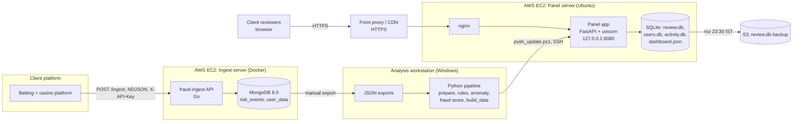
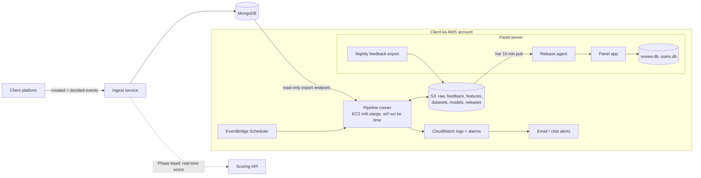

# System Architecture Document
# Fraud Detection Platform

| Item | Detail |
|---|---|
| Document | System Architecture Document |
| Version | 1.0 (review ke liye draft) |
| Date | 10 Oct 2026 |
| Organisation | MiraiGate Technologies |
| Audience | Engineers, client IT team |
| Related documents | System SRS; Continuous Learning aur Retraining Design; Deployment, Backup aur DR Runbook; Access Control aur Security Design |

Is document me server ke IP addresses, keys ya passwords nahi likhe gaye. Wo sirf admin ke paas rehte hain.

---

## 1. Purpose

Engineers aur client ki IT team ko ek hi jagah dikhna chahiye:
- kaun se components hain
- wo kaise jude hain
- data kahan rakha jaata hai
- aaj kya chal raha hai, aur target me kya banega

---

## 2. Abhi ka Architecture

### 2.1 Components
| Component | Kya karta hai | Technology | Kahan |
|---|---|---|---|
| Client platform | Withdrawal requests flag karta hai aur bhejta hai | Client ka | Client |
| Ingest service | Risk events stream me leta hai, MongoDB me rakhta hai | Go; MongoDB 8.0; Docker Compose | AWS EC2 (ingest server) |
| Analysis workstation | Dataset, features, labels, training, scoring, panel data build | Python 3.12: pandas, numpy, scikit-learn, scipy, ijson, joblib | MiraiGate ka Windows machine |
| Review panel | Reviewers ke liye web app; sign-in, queue, request page, decisions | Python: FastAPI + uvicorn; frontend: vanilla JavaScript (ES modules), HTML, CSS | AWS EC2 t3.medium, Ubuntu, 40 GB gp3 |
| nginx | Reverse proxy, sign-in rate limit, security headers, gzip | nginx | Panel server |
| Front proxy / CDN | Domain ke liye HTTPS | Client/MiraiGate ka proxy | Panel server ke aage |
| Backup storage | `review.db` ki roz copy | AWS S3 | AWS |

### 2.2 Data Stores
| Store | Kya hai | Size (8 Oct) | Kaun likhta hai | Backup |
|---|---|---|---|---|
| MongoDB `risk_events` | Har risk event, verbatim, bundle ke saath | Bada (exports 0.7–4 GB) | Ingest service | mongodump (setup confirm karna hai) |
| MongoDB `user_data` | Har user ka merged bets aur statements | – | Ingest service | Upar jaisa |
| JSON exports | MongoDB se nikale gaye risk events | 0.7–4 GB per file | Manual | Workstation pe |
| `dataset.csv` | Har request ke features + label | 36 MB | `prepare.py` | Workstation |
| Model files | `rules.json`, `score_model.joblib`, `layer2/3.joblib`, `fraud_pct.joblib` | Chhote | Training scripts | Anomaly ke versions folder me |
| `dashboard.json` | Panel ki request tables, bands, groups, model figures | ~8 MB (gzip pe) | `build_data.py` | Har build me naya |
| `activity.db` | Har user ke statements aur bets, aur har request ka window | Bada | `build_data.py` | Har build me naya |
| `review.db` | Decisions, decision history, pattern answers, notes | Chhota | Panel | Roz S3 (23:30 IST) |
| `users.db` | Reviewer accounts, sessions, sign-in log | Chhota | Panel, `fraud-panel-users` | **Abhi backup nahi** (runbook dekhein) |

### 2.3 Data Flow (Abhi)
1. Platform har request agent ke faisle ke baad `POST /ingest` pe bhejta hai. Ingest service 500 records ya 2 second ke batch me MongoDB me upsert karti hai.
2. MiraiGate MongoDB se JSON export nikaal ke workstation pe laata hai (1 se 4 din me ek baar).
3. Workstation pe pipeline chalti hai:
   - `prepare.py`
   - rules → pattern score → pattern test
   - anomaly weekly update
   - Fraud % train → scoring
   - `build_data.py`
4. `push_update.ps1` SSH se code aur data panel server pe bhejta hai; `fraud-panel-install-update` files lagata hai aur service restart karta hai.
5. Reviewers HTTPS se panel kholte hain. Decisions `review.db` me jaate hain.
6. Decisions abhi training me apne aap nahi jaate.

### 2.4 Network
| Server | Bahar khule ports | Andar |
|---|---|---|
| Panel server | 443 aur 80 (80 sirf HTTPS redirect / proxy), 22 sirf admin ke IP se | Panel `127.0.0.1:8080`; 8080 bahar band |
| Ingest server | API port (compose me 80 → 8090); security group se client ka IP | MongoDB 27017 publish nahi hota, sirf Docker ke internal network pe |

**Gap:** compose config ke hisaab se ingest API **HTTP** pe hai, aur API key header me jaati hai. Production me HTTPS (proxy ya load balancer) confirm karna hai. Access Control aur Security Design me S-01.

---

## 3. Target Architecture

| Badlav | Kyun |
|---|---|
| Object storage (S3) me raw data, feedback, features, datasets, models, releases | Ek jagah, versioned, encrypted; workstation pe nirbharta khatam |
| Pipeline runner alag instance pe, sirf run ke time | Kharcha kam; panel server pe bojh nahi |
| Release agent pull karta hai, push nahi | Pipeline ke paas panel server ki keys nahi; ek baar me swap aur rollback |
| Feedback export har raat | Reviewer decisions training me |
| Scheduler + alarms | Bina insaan ke runs; failures 15 minute me pata |
| Real-time scoring API (baad ka phase) | Platform Data Contract ka G-01 band hone ke baad |

Detail: Continuous Learning aur Retraining Design.

---

## 4. Design ke Faisle

| # | Faisla | Wajah |
|---|---|---|
| D-01 | Kafka ya Flink jaise streaming tools nahi | Volume roz ~2,000–5,000 requests aur peak ~62/minute hai. Ek scheduled batch aur ek chhota API kaafi hai |
| D-02 | Panel me SQLite | Kuch reviewers, chhota write load. Backup aasaan (ek file). Zarurat pe PostgreSQL pe ja sakte hain |
| D-03 | Panel data `dashboard.json` + `activity.db` me, pehle se bana hua | Panel tez khule; server pe heavy compute nahi |
| D-04 | Panel ka apna sign-in (browser popup nahi) | Ek account ek browser, sign-out, lockout, audit |
| D-05 | Score sirf salah; fail-open | Scoring band ho to withdrawals na rukein |
| D-06 | Features sirf request ke time tak ke data se | Live me baad ka data nahi milega; leakage se bachav |
| D-07 | Models chhote aur samjhne layak (rules, Isolation Forest, signed logistic) | 62 fraud examples; har score ki wajah dikhani hai |
| D-08 | Pull-based release | Security aur atomic switch |
| D-09 | Panel ka text sirf English | Client-facing |

---

## 5. Non-Functional Pehlu

| Pehlu | Kaise |
|---|---|
| Scale | Roz 5,000 requests tak bina hardware badle; panel 6 reviewers (User1–User6) |
| Availability | systemd restart (3 sec); ingest me Docker `restart: unless-stopped`; fail-open |
| Performance | Gzip; versioned static files; statements/bets page-wise (100 rows) |
| Security | Access Control aur Security Design |
| Backup / DR | Deployment, Backup aur DR Runbook |
| Observability | Monitoring aur Drift Plan |

---

## 6. Environments

| Environment | Kahan | Kaam |
|---|---|---|
| Development | Workstation (`python server.py`, `127.0.0.1:8080`) | Code aur data ka test |
| Production panel | Panel server (`review-panel.api.savage1.one`) | Client reviewers |
| Production ingest | Ingest server | Platform ka feed |
| Training (target) | Alag EC2, schedule pe | Retrain aur scoring |

Staging environment abhi nahi hai. Proposal: panel ka ek staging copy same server pe alag port aur alag data folder ke saath.

---

## 7. Code Repositories aur Folders

| Folder | Kya hai |
|---|---|
| `fraud_ingest/` | Ingest service (Go), Docker Compose, deploy notes |
| `pattern_detection/` | Data preparation, pattern rules, pattern score, pattern test |
| `new_pattern_detection/` | Features, anomaly model (Layer 2/3), weekly update, naye pattern ki khoj |
| `fraud_score/` | Fraud % train, scoring, panel artifact |
| `dashboard_github/fraud_detection/panel/` | Review panel: `server.py`, `accounts.py`, `web/`, `deploy/`, `build_data.py` |
| `Documets/` | Ye aur baaki documents |

Client data (`data/` folders) kabhi repository me commit nahi hota.

## Change Log
| Version | Date | Badlav |
|---|---|---|
| 1.0 | 10 Oct 2026 | Pehla draft |
